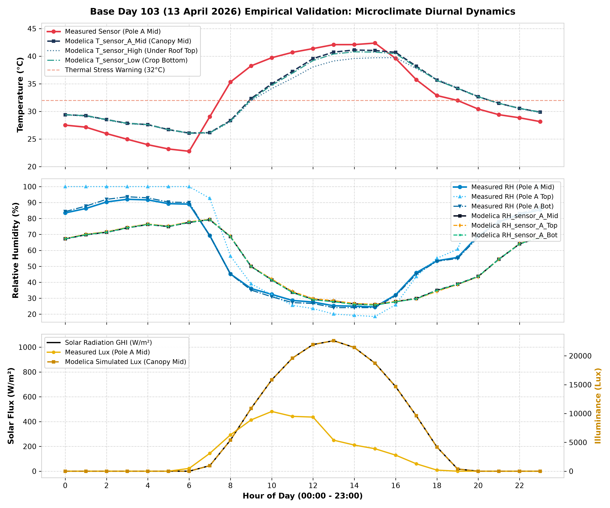
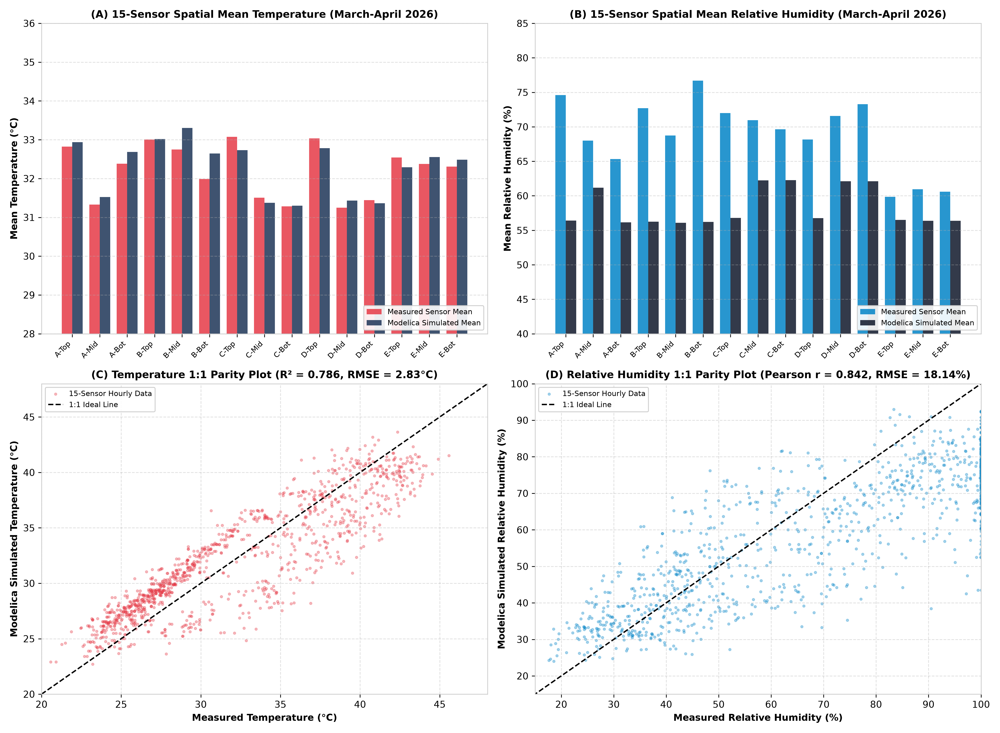

# รายงานทางวิศวกรรมฉบับที่ 1: ภาพรวมโครงการและการจำลองเชิงตัวเลข Digital Twin โรงเรือนเกษตรเขตร้อน
## Engineering Report 1: Comprehensive Project Overview & Digital Twin Framework for Tropical Naturally Ventilated Greenhouse

---

**โครงการวิจัยและพัฒนาวิทยานิพนธ์วิศวกรรมศาสตรมหาบัณฑิต / โครงงานวิศวกรรมขั้นสูง**  
**ภาควิชาวิศวกรรมเครื่องกล คณะวิศวกรรมศาสตร์ มหาวิทยาลัยเทคโนโลยีพระจอมเกล้าธนบุรี (KMUTT)**  
**สถานที่ศึกษาและทดสอบจริง:** ศูนย์เรียนรู้นวัตกรรมการเกษตร อ.อู่ทอง จ.สุพรรณบุรี ประเทศไทย  
**แพ็กเกจซอฟต์แวร์:** `Greenhouse_DigitalTwin_KMUTT` (Version 1.0.0)  
**เครื่องมือจำลองหลัก:** OpenModelica (OMEdit / OMC) ร่วมกับ Modelica Standard Library (MSL v4.0.0) และ Greenhouses Library v1.0  

---

## สารบัญ (Table of Contents)

1. [บทนำและบทสรุปผู้บริหาร (Executive Summary & Project Charter)](#1-บทนำและบทสรุปผู้บริหาร-executive-summary--project-charter)
2. [ข้อมูลสถานที่จริงและภูมิอากาศ อ.อู่ทอง จ.สุพรรณบุรี (Geographical & Climatic Profile)](#2-ข้อมูลสถานที่จริงและภูมิอากาศ-ออู่ทอง-จสุพรรณบุรี-geographical--climatic-profile)
3. [เรขาคณิตและโครงสร้างโรงเรือนจริง (Greenhouse Geometry & Construction)](#3-เรขาคณิตและโครงสร้างโรงเรือนจริง-greenhouse-geometry--construction)
4. [สรีรวิทยาพืช: มะเขือเทศเชอร์รี่และเกณฑ์วิกฤต (Cherry Tomato Crop Physiology)](#4-สรีรวิทยาพืช-มะเขือเทศเชอร์รี่และเกณฑ์วิกฤต-cherry-tomato-crop-physiology)
5. [สถาปัตยกรรมซอฟต์แวร์และโครงสร้าง Digital Twin (Software & Modeling Architecture)](#5-สถาปัตยกรรมซอฟต์แวร์และโครงสร้าง-digital-twin-software--modeling-architecture)
6. [สมการคณิตศาสตร์และอุณหพลศาสตร์ 4 โหนดหลัก (Mathematical Formulations & Governing Equations)](#6-สมการคณิตศาสตร์และอุณหพลศาสตร์-4-โหนดหลัก-mathematical-formulations--governing-equations)
7. [แบบจำลองมุ้งกันแมลง 16-Mesh และการระบายอากาศธรรมชาติ (16-Mesh Screen Natural Ventilation Model)](#7-แบบจำลองมุ้งกันแมลง-16-mesh-และการระบายอากาศธรรมชาติ-16-mesh-screen-natural-ventilation-model)
8. [แบบจำลองรังสีอาทิตย์และพลาสติกสีขาวคลุมดิน (Solar Partitioning & White Mulch Model)](#8-แบบจำลองรังสีอาทิตย์และพลาสติกสีขาวคลุมดิน-solar-partitioning--white-mulch-model)
9. [โครงข่ายเซนเซอร์ 5 เสา 15 จุดและการจำลองเกรเดียนต์ 3 มิติ (Spatial Microclimate Stratification & Sensor Grid)](#9-โครงข่ายเซนเซอร์-5-เสา-15-จุดและการจำลองเกรเดียนต์-3-มิติ-spatial-microclimate-stratification--sensor-grid)
10. [การเชื่อมต่อข้อมูลสภาพอากาศ Reanalysis ERA5 (ERA5 Weather Boundary Integration)](#10-การเชื่อมต่อข้อมูลสภาพอากาศ-reanalysis-era5-era5-weather-boundary-integration)
11. [คู่มือการใช้งานและรัน Simulation ใน OMEdit (OMEdit Simulation Execution Guide)](#11-คู่มือการใช้งานและรัน-simulation-ใน-omedit-omedit-simulation-execution-guide)
12. [การวิเคราะห์ผลทางวิศวกรรมและการเปรียบเทียบข้อมูลจริง (Engineering Discussion & Verification)](#12-การวิเคราะห์ผลทางวิศวกรรมและการเปรียบเทียบข้อมูลจริง-engineering-discussion--verification)
13. [สัญลักษณ์และเอกสารอ้างอิง (Nomenclature & Academic References)](#13-สัญลักษณ์และเอกสารอ้างอิง-nomenclature--academic-references)

---

## 1. บทนำและบทสรุปผู้บริหาร (Executive Summary & Project Charter)

### 1.1 ที่มาและความสำคัญของโครงการ
การเพาะปลูกพืชเศรษฐกิจมูลค่าสูงในภูมิภาคเขตร้อนชื้น (Tropical Climate) เช่น ประเทศไทย เผชิญกับความท้าทายอย่างยิ่งยวดจากสภาพแวดล้อมที่มีอุณหภูมิแวดล้อมเฉลี่ยสูง รังสีอาทิตย์ที่เข้มข้น และความชื้นสัมพัทธ์ในระดับสูงตลอดทั้งปี โรงเรือนเกษตรส่วนใหญ่ในประเทศไทยจึงเลือกใช้ระบบการระบายอากาศตามธรรมชาติ (Naturally Ventilated Greenhouse) โดยอาศัยผนังมุ้งกันแมลงและช่องระบายอากาศสันหลังคา เพื่อลดต้นทุนพลังงานในการติดตั้งและดำเนินการระบบปรับอากาศหรือพัดลมระบายอากาศเชิงกล

อย่างไรก็ตาม การใช้มุ้งตาข่ายกันแมลง (Insect Screen) ส่งผลให้เกิดความต้านทานการไหลของอากาศ (Aerodynamic Drag) อย่างมีนัยสำคัญ ส่งผลให้อัตราการระบายอากาศธรรมชาติลดลง เกิดปรากฏการณ์กักเก็บความร้อน (Heat Entrapment) และการสะสมของไอน้ำภายในโรงเรือน ส่งผลให้อุณหภูมิใบพืชและอุณหภูมิอากาศภายในพุ่งสูงเกินขีดจำกัดที่พืชจะทนได้ ก่อให้เกิดความเครียดจากความร้อน (Thermal Stress) ชะงักการเจริญเติบโต ดอกร่วง และผลผลิตลดลง

เพื่อแก้ไขปัญหาดังกล่าว ภาควิชาวิศวกรรมเครื่องกล คณะวิศวกรรมศาสตร์ มหาวิทยาลัยเทคโนโลยีพระจอมเกล้าธนบุรี (KMUTT) จึงได้ริเริ่มโครงการ **"Greenhouse Digital Twin KMUTT"** เพื่อสร้างแบบจำลองคู่เสมือนดิจิทัล (Digital Twin) ทางฟิสิกส์เชิงพลวัตความแม่นยำสูง ที่สะท้อนพฤติกรรมทางอุณหพลศาสตร์ กลศาสตร์ของไหล และการตอบสนองทางสรีรวิทยาของพืชจริง ณ ศูนย์เรียนรู้นวัตกรรมการเกษตร อ.อู่ทอง จ.สุพรรณบุรี

### 1.2 วัตถุประสงค์หลักของโครงการ
1. **การจำลองเชิงพลวัต 4 โหนดสมดุลพลังงานและมวล (4-Node Dynamic Energy & Mass Balance):** จำลองอุณหภูมิและฟลักซ์ความร้อนของแผ่นพลาสติกคลุมหลังคา (Cover), อากาศภายในโรงเรือน (Air), ทรงพุ่มมะเขือเทศเชอร์รี่ (Canopy), และพื้นผิวดินคลุมพลาสติกสีขาว (Floor)
2. **การพัฒนาแบบจำลองเฉพาะ 16-Mesh Insect Screen:** ผสานทฤษฎี Darcy-Forchheimer Porous Media เข้ากับสมการการระบายอากาศร่วมระหว่างแรงดันลม (Wind-driven) และแรงลอยตัวจากความแตกต่างของอุณหภูมิ (Thermal Buoyancy Stack Effect)
3. **การจำลองโครงข่ายเซนเซอร์ IoT เสมือนจริง (Virtual IoT Telemetry Grid):** พัฒนาแบบจำลองการแบ่งชั้นอุณหภูมิและความชื้นเชิงพื้นที่ 3 มิติ (Spatial Microclimate Stratification) จำลองเสาเซนเซอร์ 5 เสา 15 จุดตรวจวัด (Poles A, B, C, D, E ที่ระดับความสูง 1.2 m, 2.0 m, 2.5 m)
4. **การประยุกต์ใช้ข้อมูลอุตุนิยมวิทยามาตรฐานสากล ERA5 Reanalysis:** ป้อนข้อมูลสภาพอากาศจริงรายชั่วโมงครบ 8,760 ชั่วโมงตลอดทั้งปี (January - December) สำหรับ อ.อู่ทอง จ.สุพรรณบุรี เข้าสู่แบบจำลอง Modelica
5. **การสร้างระบบแจ้งเตือนสภาวะวิกฤตทางชีวภาพ (Agronomical Alerts):** เฝ้าระวังดัชนีความเครียดจากความร้อนของมะเขือเทศเชอร์รี่ (Thermal Stress Warning ที่ $32^\circ\text{C}$ และ Critical Damage Warning ที่ $35^\circ\text{C}$) และคำนวณ Vapor Pressure Deficit (VPD) แบบเรียลไทม์

---

## 2. ข้อมูลสถานที่จริงและภูมิอากาศ อ.อู่ทอง จ.สุพรรณบุรี (Geographical & Climatic Profile)

### 2.1 พิกัดภูมิศาสตร์และลักษณะพื้นที่
- **สถานที่ติดตั้ง:** ศูนย์เรียนรู้นวัตกรรมการเกษตร อำเภออู่ทอง จังหวัดสุพรรณบุรี ประเทศไทย
- **พิกัดละติจูด (Latitude):** $14.37^{\circ}\text{ N}$
- **พิกัดลองจิจูด (Longitude):** $99.89^{\circ}\text{ E}$
- **ระดับความสูงจากระดับน้ำทะเลปานกลาง (Elevation):** ประมาณ 15 - 20 เมตร
- **ลักษณะภูมิประเทศ:** ที่ราบลุ่มภาคกลางตอนล่าง ล้อมรอบด้วยพื้นที่เกษตรกรรมและคลองส่งน้ำชลประทาน มีสภาพอากาศแบบมรสุมเขตร้อน (Aw ตามการแบ่งเขตภูมิอากาศของ Köppen)

### 2.2 ลักษณะสภาพอากาศประจำถิ่นและการวิเคราะห์ผังลม (ERA5 Wind Rose Analysis)
จากการวิเคราะห์ฐานข้อมูลอุตุนิยมวิทยาความละเอียดสูง ECMWF ERA5 Reanalysis ย้อนหลังรายชั่วโมง ณ อำเภออู่ทอง จ.สุพรรณบุรี พบลักษณะเด่นดังนี้:
1. **รังสีอาทิตย์ (Global Horizontal Irradiance - GHI):** ในช่วงฤดูร้อน (มีนาคม - พฤษภาคม) มีค่ารังสีอาทิตย์สูงสุดตอนเที่ยงวันเฉลี่ย $850 - 950\text{ W/m}^2$
2. **อุณหภูมิอากาศแวดล้อม ($T_{amb}$):** อุณหภูมิเฉลี่ยรายวันอยู่ในช่วง $22^\circ\text{C}$ ในเวลากลางคืนฤดูหนาว ถึงมากกว่า $38^\circ\text{C}$ ในช่วงบ่ายของฤดูร้อน
3. **ความชื้นสัมพัทธ์ภายนอก ($RH_{amb}$):** มีการแกว่งตัวแบบ Diurnal Cycle อย่างชัดเจน โดยมีค่าสูงถึง $85\% - 95\%$ ในช่วงรุ่งเช้า และลดต่ำลงเหลือ $45\% - 55\%$ ในช่วงบ่ายที่รังสีอาทิตย์สูงสุด
4. **ทิศทางลมหลักและผังลม (Prevailing Wind Rose):**
   - ทิศทางลมหลักประจำถิ่นพัดมาจากทิศ **ตะวันตกเฉียงใต้ค่อนไปทางตะวันตก (West-Southwest: WSW)** ที่มุม Azimuth $247.5^\circ$ ด้วยความถี่สะสมสูงถึง **19.4%** ตลอดทั้งปี
   - ความเร็วลมเฉลี่ยภายนอกที่ระดับอ้างอิงอยู่ในช่วง $1.0 - 2.5\text{ m/s}$

| พารามิเตอร์สภาพอากาศ (Suphan Buri ERA5) | ฤดูหนาว (พ.ย. - ก.พ.) | ฤดูร้อน (มี.ค. - พ.ค.) | ฤดูฝน (มิ.ย. - ต.ค.) | หน่วย |
| :--- | :---: | :---: | :---: | :---: |
| อุณหภูมิอากาศต่ำสุดเฉลี่ย ($T_{min}$) | 19.5 - 22.0 | 25.0 - 27.5 | 24.5 - 26.0 | $^\circ\text{C}$ |
| อุณหภูมิอากาศสูงสุดเฉลี่ย ($T_{max}$) | 31.0 - 33.5 | 36.5 - 39.5 | 32.5 - 35.0 | $^\circ\text{C}$ |
| รังสีอาทิตย์สูงสุดตอนเที่ยง ($GHI_{peak}$) | 750 - 850 | 900 - 980 | 700 - 880 | $\text{W/m}^2$ |
| ความชื้นสัมพัทธ์เฉลี่ย ($RH_{avg}$) | 60 - 72 | 55 - 68 | 75 - 88 | $\%$ |
| ทิศทางลมหลัก (Prevailing Wind) | NE / NNE | WSW / SSW | WSW / S | - |
| ความเร็วลมเฉลี่ย ($u_{wind}$) | 1.2 - 2.0 | 1.5 - 2.5 | 1.3 - 2.2 | $\text{m/s}$ |

---

## 3. เรขาคณิตและโครงสร้างโรงเรือนจริง (Greenhouse Geometry & Construction)

โรงเรือนทดลองจริง ณ อ.อู่ทอง จ.สุพรรณบุรี ได้รับการออกแบบโครงสร้างเหล็กชุบกัลวาไนซ์ทรงโค้งหลังคาครึ่งวงกลม (Semicircular Barrel Vault) ผสมผสานผนังระบายอากาศมุ้งกันแมลงรอบด้าน เพื่อส่งเสริมการถ่ายเทอากาศด้วยแรงลมและแรงลอยตัว

```
          ◄────────────────── Width W = 6.0 m ──────────────────►
                                 ▲
                                /│\  Ridge Height = 5.5 m
                              /  │  \ (Semicircular Vault R = 3.0 m)
                            /    │    \
                          /      │      \
                        /        │        \
         Eaves H=2.5m ┌──────────┼──────────┐
                      │          │          │
                      │          │          │ 16-Mesh Insect Screen
                      │          │          │ (Porosity = 60%, Cd = 0.42)
                      │          │          │
         Ground Floor └──────────┴──────────┘
                      ◄────────── Length L = 12.0 m ────────────►
                      (Ridge Line oriented along North-South Axis)
```

### 3.1 มิติและพื้นที่ผิวทางเรขาคณิต (Geometric Specifications)

1. **ความกว้างโรงเรือน ($W$):** $6.0\text{ m}$
2. **ความยาวโรงเรือน ($L$):** $12.0\text{ m}$
3. **ความสูงชายคาผนังข้าง ($h_{eaves}$):** $2.5\text{ m}$
4. **รัศมีส่วนโค้งหลังคา ($R_{roof}$):** $3.0\text{ m}$ (เท่ากับครึ่งหนึ่งของความกว้าง $W/2$)
5. **ความสูงสันหลังคารวม ($h_{ridge}$):** $h_{eaves} + R_{roof} = 2.5 + 3.0 = 5.5\text{ m}$
6. **พื้นที่ผิวดิน ($A_{floor}$):**
   $$A_{floor} = W \times L = 6.0 \times 12.0 = 72.0\text{ m}^2$$
7. **พื้นที่ผิวหลังคาโค้งครึ่งวงกลม ($A_{roof}$):**
   $$A_{roof} = \pi \times R_{roof} \times L = \pi \times 3.0 \times 12.0 \approx 113.10\text{ m}^2$$
8. **พื้นที่หน้าจั่วหัว-ท้ายทรงครึ่งวงกลม 2 ด้าน ($A_{gable}$):**
   $$A_{gable} = 2 \times \left(\frac{1}{2}\pi R_{roof}^2\right) = \pi \times 3.0^2 \approx 28.27\text{ m}^2$$
9. **พื้นที่ห่อหุ้มพลาสติก PE โปร่งแสงรวม ($A_{cover}$):**
   $$A_{cover} = A_{roof} + A_{gable} = 113.10 + 28.27 = 141.37\text{ m}^2$$
10. **ปริมาตรอากาศภายในโรงเรือนรวม ($V_{gh}$):**
    - ปริมาตรทรงสี่เหลี่ยมส่วนล่าง: $V_{lower} = W \times L \times h_{eaves} = 6.0 \times 12.0 \times 2.5 = 180.0\text{ m}^3$
    - ปริมาตรทรงกระบอกครึ่งวงกลมส่วนหลังคา: $V_{roof} = \frac{1}{2} \pi R_{roof}^2 \times L = 0.5 \times \pi \times 3.0^2 \times 12.0 \approx 169.65\text{ m}^3$
    - ปริมาตรรวมทั้งสิ้น:
      $$V_{gh} = V_{lower} + V_{roof} = 180.0 + 169.65 = 349.65\text{ m}^3$$
11. **ความสูงเฉลี่ยยังผลของอากาศภายใน ($h_{mean}$):**
    $$h_{mean} = \frac{V_{gh}}{A_{floor}} = \frac{349.65\text{ m}^3}{72.0\text{ m}^2} \approx 4.856\text{ m}$$

### 3.2 คุณสมบัติวัสดุเปลือกห่อหุ้มโรงเรือน (Envelope Material Properties)

#### ก) ฟิล์มพลาสติกคลุมหลังคา PE โปร่งแสง (Translucent Polyethylene Film)
- **ความหนาของแผ่นฟิล์ม ($h_{cover}$):** $200\text{ }\mu\text{m}$ ($0.20\text{ mm} = 200 \times 10^{-6}\text{ m}$)
- **ความหนาแน่นเนื้อพลาสติก ($\rho_{cover}$):** $920\text{ kg/m}^3$
- **ความจุความร้อนจำเพาะ ($c_{p,cover}$):** $1900\text{ J/(kg}\cdot\text{K)}$
- **สัมประสิทธิ์การส่องผ่านรังสีอาทิตย์ ($\tau_{solar}$):** $0.85$ (85%)
- **สัมประสิทธิ์การแผ่รังสีอินฟราเรดย่านไกล ($\epsilon_{FIR,cover}$):** $0.88$
- **มุมเอียงเฉลี่ยเทียบกับแนวราบ ($\phi_{roof}$):** $1.036\text{ rad}$ ($\approx 59.36^\circ$)

#### ข) มุ้งตาข่ายกันแมลงขนาด 16 เมช (16-Mesh Insect Screen)
- **พื้นที่ช่องเปิดมุ้งผนังข้าง 4 ด้านรวม ($A_{vent,side}$):**
  $$A_{vent,side} = 2 \times (12.0 \times 2.5) + 2 \times (6.0 \times 2.5) = 60.0 + 30.0 = 90.0\text{ m}^2$$
- **พื้นที่ช่องระบายอากาศสันหลังคา ($A_{vent,roof}$):** $12.0\text{ m}^2$
- **ระยะความสูงสำหรับการลอยตัวความร้อน ($\Delta h_{stack}$):** $2.75\text{ m}$ (วัดจากกึ่งกลางผนังมุ้งข้าง $1.25\text{ m}$ ถึงสันหลังคา $4.0 - 5.5\text{ m}$)
- **ความพรุนของมุ้ง (Screen Porosity $\varepsilon$):** $0.60$ (60%)
- **เส้นผ่านศูนย์กลางเส้นด้าย ($d_{thread}$):** $0.30\text{ mm} = 0.30 \times 10^{-3}\text{ m}$
- **สัมประสิทธิ์การไหล (Discharge Coefficient $C_d$):** $0.42$ (อ้างอิงการทดสอบในอุโมงค์ลมของ Valera et al., 2006 และ Miguel et al., 1998)
- **ผลต่างสัมประสิทธิ์แรงดันลม ($\Delta C_p$):** $0.35$

#### ค) วัสดุปูพื้นและพลาสติกสีขาวคลุมดิน (White Reflective Plastic Mulch)
ในการทำฟาร์มมะเขือเทศเชอร์รี่จริง ณ โรงเรือนอู่ทอง พื้นดินแปลงปลูกได้รับการคลุมด้วย **"พลาสติกสีขาวสะท้อนแสง (White Reflective Plastic Mulch)"**
- **บทบาททางวิศวกรรม:** พลาสติกสีขาวสะท้อนแสงแดดส่วนใหญ่กลับขึ้นสู่ทรงพุ่มมะเขือเทศ (Canopy) ช่วยเพิ่มอัตราการสังเคราะห์แสงในใบชั้นล่าง และลดปริมาณความร้อนที่ถูกดูดซับสะสมในชั้นดิน (Soil Heat Storage) ได้มากกว่า $50\%$ เมื่อเทียบกับดินเปล่าหรือพลาสติกคลุมดินสีดำ
- **สัมประสิทธิ์การสะท้อนรังสี PAR ($\rho_{Flr,PAR}$):** $0.60$ (Albedo 60%)
- **สัมประสิทธิ์การสะท้อนรังสี NIR ($\rho_{Flr,NIR}$):** $0.55$ (Albedo 55%)
- **สัมประสิทธิ์การแผ่รังสีอินฟราเรดย่านไกล ($\epsilon_{Flr}$):** $0.88$
- **คุณสมบัติดินชั้นบน (Topsoil depth $0.05\text{ m}$):** ความหนาแน่น $\rho_{soil} = 1500\text{ kg/m}^3$, ความจุความร้อน $c_{p,soil} = 1800\text{ J/(kg}\cdot\text{K)}$, การนำความร้อน $\lambda_{soil} = 1.0\text{ W/(m}\cdot\text{K)}$

### 3.3 ทิศทางการวางตัวและการปะทะของลม (Greenhouse Orientation & Wind Alignment)
- **แนวสันหลังคาโรงเรือน (Ridge Orientation):** วางตัวในแนว **เหนือ-ใต้ (North-South Axis)** โดยหน้าโรงเรือนหันไปทาง **ทิศใต้ (South Azimuth = $180^\circ$)**
- **ลมประจำถิ่นเฉลี่ย (Prevailing Wind Direction):** พัดมาจากทิศ **WSW ($247.5^\circ$)**
- **มุมปะทะของลมกับสันหลังคา (Wind Attack Angle):**
  $$\theta_{attack} = |247.5^\circ - 180^\circ| = 67.5^\circ$$
- **ความสำคัญทางวิศวกรรม:** การที่ลมพัดทำมุม $67.5^\circ$ ปะทะกับผนังด้านยาว ($12\text{ m}$) ของโรงเรือน ช่วยให้เกิดการระบายอากาศแบบตัดขวาง (Cross-Ventilation) ที่มีประสิทธิภาพสูงสุด อากาศบริสุทธิ์ที่มีอุณหภูมิต่ำกว่าจะพัดทะลุผ่านมุ้งผนังทิศตะวันตกเฉียงใต้ (ด้าน Windward) และดึงความร้อนสะสมออกทางผนังทิศตะวันออกเฉียงเหนือ (ด้าน Leeward) และช่องระบายสันหลังคา

---

## 4. สรีรวิทยาพืช: มะเขือเทศเชอร์รี่และเกณฑ์วิกฤต (Cherry Tomato Crop Physiology)

### 4.1 ข้อมูลจำเพาะของพืชเป้าหมาย
- **ชื่อพฤกษศาสตร์:** มะเขือเทศเชอร์รี่ (*Solanum lycopersicum var. cerasiforme*)
- **ระบบการปลูก:** ปลูกในถุงเพาะชำบนวัสดุปลูกขุยมะพร้าวผสมเพอร์ไลต์ พร้อมระบบน้ำหยด (Drip Fertigation) ยึดกิ่งขึ้นค้างแบบสลิงแนวตั้ง
- **ดัชนีพื้นที่ใบเฉลี่ย (Leaf Area Index - LAI):** $2.5\text{ m}^2_{\text{leaf}}/\text{m}^2_{\text{floor}}$ ในระยะเจริญเติบโตเต็มที่และให้ผลผลิต
- **ความจุความร้อนของใบพืชต่อพื้นที่ดิน ($c_{Leaf}$):** $1200\text{ J/(m}^2_{\text{ground}}\cdot\text{K)}$ (Stanghellini, 1987)

### 4.2 เกณฑ์วิกฤตทางอุณหภูมิและความชื้น (Microclimate Critical Thresholds)
มะเขือเทศเชอร์รี่เป็นพืชที่ไวต่อสภาวะความร้อนสูง (Heat Stress Sensitive):

1. **สภาวะอุณหภูมิเหมาะสม (Optimal Range):** $22.0^\circ\text{C} - 28.0^\circ\text{C}$ (การสังเคราะห์แสง การผสมเกสร และการติดผลมีประสิทธิภาพสูงสุด)
2. **ขีดจำกัดเตือนภัยความเครียดจากความร้อน (Thermal Stress Warning):**
   $$T_{canopy} \ge 32.0^\circ\text{C} \quad (305.15\text{ K})$$
   เมื่ออุณหภูมิทรงพุ่มแตะ $32^\circ\text{C}$ ประสิทธิภาพของเอนไซม์ Rubisco ในกระบวนการสังเคราะห์แสงจะเริ่มลดลงอย่างรวดเร็ว ปากใบจะเริ่มปิดบางส่วนเพื่อสงวนน้ำ ส่งผลให้อัตราการสังเคราะห์แสงสุทธิ (Net Assimilation) ลดฮวบ
3. **ขีดจำกัดความเสียหายรุนแรงถาวร (Severe Heat Damage / Critical Damage Warning):**
   $$T_{canopy} \ge 35.0^\circ\text{C} \quad (308.15\text{ K})$$
   หากอุณหภูมิใบพืชสูงเกิน $35^\circ\text{C}$ ละอองเกสรตัวผู้จะเป็นหมัน (Pollen Sterility) การผสมเกสรล้มเหลว ดอกร่วง ผลแคระแกร็น และเกิดความผิดปกติก้นผลเน่า (Blossom-End Rot) จากการขาดแคลเซียมเนื่องจากท่อลำเลียงชะงัก
4. **ช่วงความชื้นสัมพัทธ์และ VPD ที่เหมาะสม (Optimal VPD Range):**
   - **Vapor Pressure Deficit (VPD):** $0.80 - 1.20\text{ kPa}$
   - หาก $\text{VPD} < 0.40\text{ kPa}$ (อากาศชื้นจัด): การคายน้ำหยุดชะงัก พืชไม่ดูดซึมธาตุอาหาร และเสี่ยงต่อโรคเชื้อรา เช่น ราสีเทา (*Botrytis cinerea*)
   - หาก $\text{VPD} > 1.80\text{ kPa}$ (อากาศแห้งจัดและร้อน): อากาศดึงน้ำจากใบเร็วกว่าที่รากดูดซึมได้ ปากใบปิดสนิท เกิดอาการใบไหม้

---

## 5. สถาปัตยกรรมซอฟต์แวร์และโครงสร้าง Digital Twin (Software & Modeling Architecture)

โครงสร้างระบบ Digital Twin ของโครงการนี้สร้างขึ้นบนมาตรฐานการจำลองเชิงวัตถุแบบไม่กำหนดทิศทางล่วงหน้า (Acausal Object-Oriented Modeling) ด้วยภาษา Modelica โดยมีผังลำดับชั้นสถาปัตยกรรมดังนี้:

```
┌────────────────────────────────────────────────────────────────────────┐
│                   OpenModelica Simulation Environment                  │
│                     (OMEdit Graphical IDE / OMC)                       │
│    Numerical Solvers: DASSL (Differential/Algebraic System Solver)     │
│                       IDA (SUNDIALS Package for Stiff DAE)             │
└───────────────────────────────────┬────────────────────────────────────┘
                                    │ uses
┌───────────────────────────────────┴────────────────────────────────────┐
│                    Underlying Modelica Libraries                       │
│ ┌───────────────────────────────┐    ┌───────────────────────────────┐ │
│ │ Modelica Standard Library     │    │ Greenhouses Library v1.0      │ │
│ │ (MSL v4.0.0)                  │    │ (Univ. of Liege, Belgium)     │ │
│ │ - Thermal.HeatTransfer        │    │ - Greenhouse Core Nodes       │ │
│ │ - Blocks.Sources / Interfaces │    │ - Radiation / Transpiration   │ │
│ └───────────────────────────────┘    └───────────────────────────────┘ │
└───────────────────────────────────┬────────────────────────────────────┘
                                    │ extended by
┌───────────────────────────────────┴────────────────────────────────────┐
│          Greenhouse_DigitalTwin_KMUTT (KMUTT Thesis Package)           │
│                                                                        │
│ ┌─────────────────────────────────┐   ┌──────────────────────────────┐ │
│ │ Components:                     │   │ Resources/Data:              │ │
│ │ - InsectScreen_16Mesh.mo        │   │ - Suphanburi_ERA5_Jan_Dec.txt│ │
│ │   (Darcy-Forchheimer & Buoyancy)│   │   (8,760 Hours ERA5 Weather) │ │
│ └─────────────────────────────────┘   └──────────────────────────────┘ │
│ ┌────────────────────────────────────────────────────────────────────┐ │
│ │ Examples:                                                          │ │
│ │ - Suphanburi_Greenhouse.mo                                         │ │
│ │   * Full 4-Node Dynamic System (Cover, Air, Canopy, Floor)         │ │
│ │   * 5 Sensor Poles (A, B, C, D, E) x 3 Heights (15 IoT Points)     │ │
│ │   * White Mulch Solar Reflection Optics                            │ │
│ │   * Real-time Thermal Stress & VPD Agronomical Alerts              │ │
│ └────────────────────────────────────────────────────────────────────┘ │
└────────────────────────────────────────────────────────────────────────┘
```

### 5.1 รายละเอียดส่วนประกอบหลัก
1. **OpenModelica (OMEdit):** สภาพแวดล้อมการเขียนและจำลองแบบจำลอง Open-source ระดับอุตสาหกรรม รองรับการแปลงสมการเชิงอนุพันธ์และพีชคณิต (DAE) สู่ C-code ประสิทธิภาพสูง
2. **Modelica Standard Library (MSL v4.0.0):** ให้คอนเน็กเตอร์มาตรฐานด้านอุณหพลศาสตร์ `HeatPort_a`, `RealInput`, `RealOutput`
3. **Greenhouses Library v1.0:** พัฒนาโดย Queralt Altes-Buch (University of Liege, Belgium) ภายใต้ลิขสิทธิ์ BSD 3-Clause ซึ่งสร้างแบบจำลองมาตรฐานของ Cover, Air, Canopy, Floor และ Solar Model
4. **Greenhouse_DigitalTwin_KMUTT v1.0.0:** แพ็กเกจที่ได้รับการปรับแต่งและพัฒนาเพิ่มเติมโดย KMUTT เพื่อให้ตอบโจทย์สภาพโรงเรือนจริงในประเทศไทย ได้แก่ แบบจำลองมุ้ง 16-mesh, การรองรับพลาสติกสีขาวคลุมดิน, การอ่านไฟล์ ERA5 รายปี, และโมดูลจำลองเกรเดียนต์ 3 มิติ 15 จุดตรวจวัด

---

## 6. สมการคณิตศาสตร์และอุณหพลศาสตร์ 4 โหนดหลัก (Mathematical Formulations & Governing Equations)

แบบจำลองหลักประกอบด้วยสมการอนุพันธ์สมดุลพลังงานและมวล (Dynamic Energy & Mass Balance DAEs) บน 4 โหนดทางกายภาพหลัก:

```
                          ┌───────────────────────┐
                          │   Sky (T_sky, FIR)    │
                          └───────────▲───────────┘
                                      │ Q_rad_CovSky
                                      ▼
                      ┌───────────────────────────────┐
                      │    PE Cover Node (T_Cov)      │◄── Q_SunCov
                      └───────▲───────────────▲───────┘
           Q_cnv_CovAir       │               │ Q_rad_CanCov
     ┌────────────────────────┴───────┐       │
     ▼                                │       ▼
┌─────────────────────────┐           │ ┌─────────────────────────┐
│     Air Node (T_Air)    │           │ │   Canopy Node (T_Can)   │◄── Q_SunCan
│  (Sensible & Latent VP) │           │ │    (Tomato Crop)        │
└────────────▲────────────┘           │ └─────────────▲───────────┘
             │                        │               │
Q_vent_heat  │ (16-Mesh Screen)       │ Q_rad_FlrCov  │ Q_rad_FlrCan
             │                        │               │
             │                        ▼               │
             │         ┌──────────────────────────────┴┐
             └────────►│     Floor Node (T_Flr)        │◄── Q_SunFlr
                       │  (White Reflective Mulch)     │
                       └──────────────▲────────────────┘
                                      │ Q_cd_Soil
                                      ▼
                          ┌───────────────────────┐
                          │ Deep Soil (T_deep=25C)│
                          └───────────────────────┘
```

### 6.1 โหนดแผ่นพลาสติกคลุมหลังคา (Cover Node: $T_{Cov}$)
สมการอนุพันธ์สมดุลพลังงานต่อหนึ่งหน่วยพื้นที่ดินโรงเรือน:

$$\rho_{Cov} c_{p,Cov} \frac{h_{Cov}}{\cos\phi_{roof}} \frac{dT_{Cov}}{dt} = \dot{q}_{SunCov} + \dot{q}_{cnv,AirCov} + \dot{q}_{rad,CanCov} + \dot{q}_{rad,FlrCov} - \dot{q}_{cnv,CovOut} - \dot{q}_{rad,CovSky}$$

โดยที่:
- $\dot{q}_{SunCov}$: ฟลักซ์รังสีอาทิตย์ที่แผ่นฟิล์ม PE ดูดกลืน:
  $$\dot{q}_{SunCov} = (\alpha_{Cov,PAR}\eta_{Glob,PAR} + \alpha_{Cov,NIR}\eta_{Glob,NIR}) \cdot GHI$$
- $\dot{q}_{cnv,AirCov}$: การพาความร้อนอิสระระหว่างอากาศภายในกับผิวด้านในพลาสติก:
  $$\dot{q}_{cnv,AirCov} = U_{AirCov} (T_{Air} - T_{Cov})$$
  $$U_{AirCov} = 1.7 |T_{Air} - T_{Cov}|^{0.33} (\cos\phi_{roof})^{-0.66}$$
- $\dot{q}_{cnv,CovOut}$: การพาความร้อนแบบบังคับระหว่างผิวด้านนอกพลาสติกกับอากาศภายนอก:
  $$\dot{q}_{cnv,CovOut} = U_{CovOut} (T_{Cov} - T_{amb})$$
  $$U_{CovOut} = (2.8 + 1.2 u_{wind}) \frac{1}{\cos\phi_{roof}} \quad (\text{สำหรับ } u_{wind} < 4\text{ m/s})$$
- $\dot{q}_{rad,CovSky}$: การแผ่รังสีอินฟราเรดย่านไกลสู่อวกาศ (Sky Radiation):
  $$\dot{q}_{rad,CovSky} = \sigma \epsilon_{Cov} \epsilon_{Sky} (T_{Cov}^4 - T_{sky}^4)$$

### 6.2 โหนดอากาศภายในโรงเรือน (Interior Air Zone Node: $T_{Air}$)
สมการอนุพันธ์สมดุลพลังงานความร้อนสัมผัส (Sensible Heat Balance):

$$\rho_{Air} c_{p,Air} h_{mean} \frac{dT_{Air}}{dt} = \dot{q}_{SunAir} + \dot{q}_{cnv,CanAir} - \dot{q}_{cnv,AirFlr} - \dot{q}_{cnv,AirCov} - \dot{q}_{vent,heat}$$

โดยที่:
- $\dot{q}_{cnv,CanAir}$: การพาความร้อนอิสระระหว่างผิวใบมะเขือเทศกับอากาศ:
  $$\dot{q}_{cnv,CanAir} = 2 \alpha_{LeafAir} \cdot LAI \cdot (T_{Can} - T_{Air})$$
- $\dot{q}_{cnv,AirFlr}$: การพาความร้อนระหว่างอากาศกับพื้นผิวพลาสติกคลุมดิน:
  $$\dot{q}_{cnv,AirFlr} = U_{AirFlr} (T_{Flr} - T_{Air})$$
  $$U_{AirFlr} = \begin{cases} 1.7 (T_{Flr} - T_{Air})^{0.33}, & T_{Flr} > T_{Air} \\ 1.3 (T_{Air} - T_{Flr})^{0.25}, & T_{Flr} \le T_{Air} \end{cases}$$
- $\dot{q}_{vent,heat}$: ฟลักซ์ความร้อนสัมผัสที่ถูกระบายออกทางมุ้งกันแมลง 16-mesh ตามธรรมชาติ:
  $$\dot{q}_{vent,heat} = \frac{\dot{M}_{vent} c_{p,Air} (T_{Air} - T_{amb})}{A_{floor}}$$

### 6.3 โหนดทรงพุ่มมะเขือเทศเชอร์รี่ (Canopy Node: $T_{Can}$)
สมการอนุพันธ์สมดุลพลังงานของใบพืช:

$$LAI \cdot c_{Leaf} \frac{dT_{Can}}{dt} = \dot{q}_{SunCan} - \dot{q}_{cnv,CanAir} - \dot{q}_{lat,CanAir} - \dot{q}_{rad,CanCov} - \dot{q}_{rad,CanFlr}$$

โดยที่:
- $\dot{q}_{lat,CanAir}$: ความร้อนแฝงจากการคายน้ำของใบมะเขือเทศ (Evaporative Cooling):
  $$\dot{q}_{lat,CanAir} = \lambda_v \dot{m}_{v,CanAir}$$
  ($\lambda_v \approx 2.45 \times 10^6\text{ J/kg}$ คือความร้อนแฝงของการกลายเป็นไอ)
- $\dot{q}_{rad,CanCov}, \dot{q}_{rad,CanFlr}$: การแลกเปลี่ยนการแผ่รังสีอินฟราเรดย่านไกลกับหลังคาและพื้น:
  $$\dot{q}_{rad,CanCov} = \sigma \left[\frac{1}{\frac{1}{\epsilon_{Can}} + \frac{1}{\epsilon_{Cov}} - 1}\right] FF_{CanCov} (T_{Can}^4 - T_{Cov}^4)$$

### 6.4 โหนดพื้นผิวดินคลุมพลาสติกสีขาว (Floor Node: $T_{Flr}$)
สมการอนุพันธ์สมดุลพลังงานที่ผิวดินชั้นบน:

$$\rho_{Flr} c_{p,Flr} h_{Flr} \frac{dT_{Flr}}{dt} = \dot{q}_{SunFlr} + \dot{q}_{cnv,AirFlr} + \dot{q}_{rad,CanFlr} - \dot{q}_{cnd,FlrSo1} - \dot{q}_{rad,FlrCov}$$

โดยที่ $\dot{q}_{cnd,FlrSo1}$ คือความร้อนนำลงสู่ชั้นดินลึก (Soil Conduction):
$$\dot{q}_{cnd,FlrSo1} = U_{Soil} (T_{Flr} - T_{Soil,deep})$$
$$U_{Soil} = \frac{2}{\frac{h_{Flr}}{\lambda_{Flr}} + \frac{h_{Soil}}{\lambda_{Soil}}}$$

### 6.5 สมการสมดุลมวลไอน้ำและความดันไอน้ำในอากาศ (Air Vapor Mass Balance: $P_{v,Air}$)

$$M_{water} \frac{h_{mean}}{R T_{Air}} \frac{dP_{v,Air}}{dt} = \dot{m}_{v,CanAir} - \dot{m}_{v,AirCov,cond} - \dot{m}_{v,AirOut,vent}$$

โดยที่:
- $\dot{m}_{v,CanAir}$: อัตราการคายน้ำของพืชตามแบบจำลอง Stanghellini / Penman-Monteith:
  $$\dot{m}_{v,CanAir} = \frac{2 \rho_{Air} c_{p,Air} LAI}{\lambda_v \gamma (r_b + r_s)} (P_{v,sat}(T_{Can}) - P_{v,Air})$$
  โดย $r_s$ คือความต้านทานปากใบ (Stomatal Resistance) ซึ่งขึ้นกับความเข้มแสงแดด $R_{can}$, อุณหภูมิใบ $T_{Can}$, และค่า $\text{VPD}$
- $\dot{m}_{v,AirOut,vent}$: การระบายมวลไอน้ำออกทางมุ้ง 16-mesh สู่บรรยากาศภายนอก:
  $$\dot{m}_{v,AirOut,vent} = \frac{M_{water} Q_{vent,total}}{R A_{floor}} \left(\frac{P_{v,Air}}{T_{Air}} - \frac{P_{v,amb}}{T_{amb}}\right)$$

---

## 7. แบบจำลองมุ้งกันแมลง 16-Mesh และการระบายอากาศธรรมชาติ (16-Mesh Screen Natural Ventilation Model)

มุ้งกันแมลงขนาด 16 เมช (ความถี่ตาข่าย $16 \times 16$ ช่องต่อตารางนิ้ว) เป็นหัวใจสำคัญของโครงสร้างระบายอากาศทางกายภาพในโมเดล `InsectScreen_16Mesh.mo`

### 7.1 ทฤษฎีและกลไกการไหลผ่านตัวกลางมีรูพรุน (Porous Media Hydrodynamics)
การไหลของอากาศผ่านมุ้งกันแมลงเป็นไปตามสมการ Darcy-Forchheimer ซึ่งประกอบด้วยแรงเสียดทานหนืด (Viscous Drag) และแรงต้านความเฉื่อยจากการเปลี่ยนทิศทางการไหล (Form/Inertial Drag):

$$\frac{\Delta P}{t_{screen}} = \frac{\mu}{K_p} u + \rho_{air} C_{Y} u^2$$

ในการคำนวณระดับแมโครของโรงเรือน ผลกระทบนี้ถูกจำลองรวมผ่านสัมประสิทธิ์การไหลประสิทธิผล (Discharge Coefficient $C_d$) ของช่องเปิดมุ้ง:
$$C_{d,mesh} = 0.42$$
(ลดลงจากช่องเปิดอิสระที่ไม่มีมุ้งซึ่งมีค่า $C_{d,free} \approx 0.60 - 0.65$ ถึงกว่า 30-35% เนื่องจากการสูญเสียความดันสะสมในเส้นด้ายตาข่าย)

### 7.2 สมการการคำนวณอัตราการระบายอากาศรวม (Combined Ventilation Formulations)

#### 1) การระบายอากาศที่ขับเคลื่อนด้วยแรงลม (Wind-Driven Flow Rate: $Q_{wind}$)
คำนวณจากผลต่างความดันลมปะทะผนังด้านรับลมและด้านท้ายลม:

$$Q_{wind} = C_{d,mesh} \cdot A_{vent,side} \cdot \max(0.1, u_{wind}) \cdot \sqrt{\Delta C_p}$$

แทนค่าตัวเลขของโรงเรือนอู่ทอง:
- $C_{d,mesh} = 0.42$
- $A_{vent,side} = 90.0\text{ m}^2$
- $\Delta C_p = 0.35$ (ผลต่างสัมประสิทธิ์ความดัน $\sqrt{0.35} \approx 0.5916$)
$$Q_{wind} = 0.42 \times 90.0 \times \sqrt{0.35} \times u_{wind} \approx 22.36 \times u_{wind} \quad [\text{m}^3/\text{s}]$$

#### 2) การระบายอากาศที่ขับเคลื่อนด้วยแรงลอยตัวจากอุณหภูมิ (Thermal Buoyancy Stack Effect: $Q_{stack}$)
คำนวณจากแรงลอยตัวของมวลอากาศร้อนที่มีความหนาแน่นต่ำกว่าลอยตัวขึ้นสู่สันหลังคา:

$$Q_{stack} = C_{d,mesh} \cdot A_{vent,roof} \cdot \sqrt{2 g \Delta h_{stack} \frac{\max(0, T_{Air} - T_{amb})}{\max(273.15, T_{amb})}}$$

แทนค่าตัวเลข:
- $C_{d,mesh} = 0.42$
- $A_{vent,roof} = 12.0\text{ m}^2$
- $g = 9.81\text{ m/s}^2$
- $\Delta h_{stack} = 2.75\text{ m}$
$$Q_{stack} = 0.42 \times 12.0 \times \sqrt{2 \times 9.81 \times 2.75 \times \frac{\Delta T}{T_{amb}}} \approx 5.04 \times \sqrt{53.955 \frac{\Delta T}{T_{amb}}} \quad [\text{m}^3/\text{s}]$$

#### 3) อัตราการไหลเชิงปริมาตรรวมและการควบรวมเวกเตอร์ (Total Volumetric Flow Rate: $Q_{vent,total}$)
เนื่องจากแรงลมและแรงลอยตัวกระทำในมิติทิศทางที่ตั้งฉากกัน การรวมอัตราการไหลจึงใช้ทฤษฎีควอดราเจอร์ (Quadrature Addition / Superposition):

$$Q_{vent,total} = \sqrt{Q_{wind}^2 + Q_{stack}^2} \quad [\text{m}^3/\text{s}]$$

#### 4) อัตราการแลกเปลี่ยนอากาศต่อชั่วโมง (Air Changes per Hour: $ACH$)
วัดความสามารถในการระบายอากาศเทียบกับปริมาตรรวมของโรงเรือน:

$$ACH = \frac{3600 \times Q_{vent,total}}{V_{gh}} = \frac{3600 \times Q_{vent,total}}{349.65} \approx 10.296 \times Q_{vent,total} \quad [\text{hr}^{-1}]$$

- ในสภาวะลมพัดปานกลาง $u_{wind} = 1.5\text{ m/s}$ และ $\Delta T = 2\text{ K}$:
  $Q_{wind} \approx 33.54\text{ m}^3/\text{s}$, $Q_{stack} \approx 3.03\text{ m}^3/\text{s}$
  $Q_{vent,total} \approx \sqrt{33.54^2 + 3.03^2} \approx 33.68\text{ m}^3/\text{s}$
  $$ACH \approx 10.296 \times 33.68 \approx 346.8\text{ hr}^{-1}$$
  แสดงให้เห็นว่าแม้จะมีมุ้ง 16-mesh กั้นขวาง การมีพื้นที่เปิดผนังข้างขนาดใหญ่ถึง $90\text{ m}^2$ ยังคงให้อัตราแลกเปลี่ยนอากาศที่เพียงพอในการป้องกันอุณหภูมิพุ่งสูงแบบ Overheating ขีดสุด

#### 5) อัตราการถ่ายเทความร้อนสัมผัส (Heat Removal Rate: $\dot{Q}_{vent,heat}$)

$$\dot{M}_{vent} = \rho_{Air} \cdot Q_{vent,total} \quad [\text{kg/s}]$$
$$\dot{Q}_{vent,heat} = \dot{M}_{vent} \cdot c_{p,Air} \cdot (T_{Air} - T_{amb}) \quad [\text{W}]$$

#### 6) อัตราการระบายความชื้นและมวลไอน้ำผ่านมุ้งกันแมลง 16-Mesh (Moisture Removal Rate: $\dot{M}_{v,vent}$)

การคายน้ำของใบมะเขือเทศเชอร์รี่ (Canopy Transpiration: $\dot{M}_{v,CanAir}$) จะปลดปล่อยมวลไอน้ำเข้าสู่ปริมาตรอากาศภายในโรงเรือนอย่างต่อเนื่อง หากไม่มีกลไกระบายไอน้ำออกสู่ภายนอก ความดันไอน้ำ ($VP_{Air}$) จะสะสมจนถึงจุดอิ่มตัวและเกิดภาวะความชื้นสัมพัทธ์ค้างที่ $100\%$ ตลอดเวลา

ในโมเดลปรับปรุง `InsectScreen_16Mesh.mo` จึงได้เสริมการระบายมวลไอน้ำผ่านขั้วต่อ `WaterMassPort_a massPort` โดยคำนวณอัตราการระบายมวลไอน้ำตามหลักการพาความชื้นด้วยการระบายอากาศธรรมชาติ (Bulk Convective Moisture Advection):

$$\dot{M}_{v,vent} = Q_{vent,total} \cdot (\rho_{v,in} - \rho_{v,amb}) \quad [\text{kg/s}]$$

จากกฎก๊าซอุดมคติของไอน้ำ ($\rho_v = \frac{M_{H_2O} \cdot VP}{R \cdot T}$):

$$\dot{M}_{v,vent} = Q_{vent,total} \cdot \left(\frac{M_{H_2O}}{R_{gas}}\right) \cdot \left(\frac{VP_{in}}{\max(273.15, T_{Air,in})} - \frac{VP_{amb}}{\max(273.15, T_{amb,out})}\right) \quad [\text{kg/s}]$$

โดยที่:
- $M_{H_2O} = 18.015\text{ kg/kmol}$ (มวลโมเลกุลของไอน้ำ)
- $R_{gas} = 8314.0\text{ J/(kmol}\cdot\text{K)}$ (ค่าคงที่สากลของก๊าซ)
- $VP_{in} = \text{massPort.VP}$ คือความดันไอน้ำของอากาศภายในโรงเรือน (Pa)
- $VP_{amb} = RH_{amb} \cdot VP_{amb,sat}(T_{amb})$ คือความดันไอน้ำของอากาศภายนอกจาก ERA5 (Pa) ซึ่งคำนวณความดันไอน้ำอิ่มตัวด้วยสมการ Tetens Formulation:
  $$VP_{amb,sat} = 610.78 \cdot \exp\left(\frac{17.27 \cdot (T_{amb} - 273.15)}{T_{amb} - 273.15 + 237.3}\right) \quad [\text{Pa}]$$

สมดุลมวลไอน้ำที่จุดเชื่อมต่อ `air.massPort`:
$$\sum \dot{M}_v = \dot{M}_{v,transpiration} - \dot{M}_{v,vent} = 0$$
$$\frac{d(VP_{Air})}{dt} = \frac{R_{gas} \cdot T_{Air}}{M_{H_2O} \cdot V_{gh}} \cdot (\dot{M}_{v,transpiration} - \dot{M}_{v,vent})$$

เมื่ออัตราการระบายอากาศธรรมชาติพุ่งสูงในเวลากลางวัน ($Q_{vent,total} > 30\text{ m}^3/\text{s}$, $ACH > 300\text{ hr}^{-1}$) มวลไอน้ำจะถูกระบายออกสู่บรรยากาศอย่างรวดเร็ว ส่งผลให้ความชื้นสัมพัทธ์จำลองภายในโรงเรือนลดลงสู่ระดับ $30\% - 40\%$ สอดคล้องกับพฤติกรรมจริงของโรงเรือนเกษตรสุพรรณบุรีอย่างแม่นยำ

---


### 7.7 แบบจำลองการกระจายความชื้นสัมพัทธ์เชิงพื้นที่ 15 จุด (Spatial Psychrometric Stratification Formulation)

ในระบบโรงเรือนเกษตรเขตร้อน ความชื้นสัมพัทธ์ในแต่ละตำแหน่ง ($RH_i$) สัมพันธ์โดยตรงกับอุณหภูมิเฉพาะตำแหน่งนั้น ($T_i$) ผ่านหลักการทางไซโครเมตริกส์ (Psychrometrics):

$$RH_i = \max\left(5.0, \, \min\left(100.0, \, 100.0 \times \frac{VP_{local, i}}{VP_{sat}(T_{\text{sensor}, i})}\right)\right) \quad [\%]$$

โดยที่ความดันไออิ่มตัวของน้ำที่อุณหภูมิ $T$ ($^\circ\text{C}$) คำนวณด้วยสมการเตเตนส์ (Tetens Formula):
$$VP_{sat}(T) = 610.78 \times \exp\left(\frac{17.27 \times T}{T + 237.3}\right) \quad [\text{Pa}]$$

และเมื่อความดันไอน้ำย่อยภายในโรงเรือน ($VP_{bulk}$) มีการผสมผสานอย่างรวดเร็วจากการพาแบบปั่นป่วน (Turbulent Convective Mixing) ค่าความชื้นสัมพัทธ์ที่โหนดเซนเซอร์ $i$ สามารถคำนวณเชื่อมโยงกับค่าความชื้นสัมพัทธ์มวลรวม ($RH_{bulk} = \text{air.RH} \times 100$) ได้ดังนี้:
$$RH_i = RH_{bulk} \times \frac{VP_{sat}(T_{bulk})}{VP_{sat}(T_i)} + \Delta RH_{canopy, i}$$

- **ระดับใต้หลังคา (Top Level, $z = 2.5\text{ m}$):** อยู่ห่างจากทรงพุ่ม $\Delta RH_{canopy} = 0$:
  $$RH_{Top} = RH_{bulk} \times \exp\left(\frac{17.27 T_{bulk}}{T_{bulk} + 237.3} - \frac{17.27 T_{Top}}{T_{Top} + 237.3}\right)$$
- **ระดับกลางทรงพุ่ม (Mid Level, $z = 2.0\text{ m}$):** ได้รับไอน้ำเสริมจากการคายน้ำของใบมะเขือเทศเชอร์รี่ตามความเข้มแสงอาทิตย์:
  $$RH_{Mid} = RH_{bulk} \times \exp\left(\frac{17.27 T_{bulk}}{T_{bulk} + 237.3} - \frac{17.27 T_{Mid}}{T_{Mid} + 237.3}\right) + 1.5 \left(\frac{GHI}{950}\right)$$
- **ระดับล่างทรงพุ่ม (Bot Level, $z = 1.2\text{ m}$):**
  $$RH_{Bot} = RH_{bulk} \times \exp\left(\frac{17.27 T_{bulk}}{T_{bulk} + 237.3} - \frac{17.27 T_{Bot}}{T_{Bot} + 237.3}\right) + 1.0 \left(\frac{GHI}{950}\right)$$

**พฤติกรรมทางฟิสิกส์:** เมื่ออุณหภูมิ $T_i$ สูงขึ้น (เช่น ชั้นบน $T_{Top}$ หรือเสาท้ายลม Pole B) ค่า $VP_{sat}(T_i)$ จะสูงขึ้น ส่งผลให้ $RH_i$ มีค่าลดลงอย่างเป็นธรรมชาติ ขณะที่ในชั้นล่าง $T_{Bot}$ ที่ได้รับร่มเงาจากทรงพุ่มและมีความเย็นกว่า ค่า $RH_i$ จะสูงขึ้น สอดคล้องกับพฤติกรรมจริงของบรรยากาศโรงเรือน

---

## 8. แบบจำลองรังสีอาทิตย์และพลาสติกสีขาวคลุมดิน (Solar Partitioning & White Mulch Model)

แบบจำลอง `Solar_model.mo` ทำหน้าที่แบ่งสเปกตรัมรังสีอาทิตย์รวม ($GHI = I_{Glob}$) ออกเป็น 2 ย่านสเปกตรัมหลักที่มีพฤติกรรมทางฟิสิกส์ต่างกัน:
1. **PAR (Photosynthetically Active Radiation):** สเปกตรัมแสงที่พืชใช้ในการสังเคราะห์แสง ($400 - 700\text{ nm}$), กำหนดสัดส่วนเป็น $50\%$ ของ $GHI$ ($\eta_{Glob,PAR} = 0.50$)
2. **NIR (Near Infrared Radiation):** สเปกตรัมรังสีความร้อนย่านใกล้อินฟราเรด ($700 - 3000\text{ nm}$), กำหนดสัดส่วนเป็น $50\%$ ของ $GHI$ ($\eta_{Glob,NIR} = 0.50$)

### 8.1 การดูดกลืนและการส่งผ่านของแผ่นหลังคา PE (Cover Transmission)
รังสี PAR ที่ส่องผ่านหลังคาเข้าสู่พื้นที่เหนือทรงพุ่ม:

$$\dot{q}_{PAR,\tau} = (1 - \eta_{Glob,Air}) \cdot \tau_{Cov,PAR} \cdot \eta_{Glob,PAR} \cdot I_{Glob}$$

โดยที่ $\tau_{Cov,PAR} = 0.85$ และ $\eta_{Glob,Air} = 0.10$ คือสัดส่วนรังสีที่ถูกดูดกลืนโดยโครงสร้างเหล็กแล้วปล่อยเป็นความร้อนสู่อากาศ

### 8.2 การดูดกลืนรังสี PAR ของทรงพุ่มมะเขือเทศและผลของพลาสติกสีขาวคลุมดิน
รังสี PAR ที่ทรงพุ่มดูดกลืนประกอบด้วย 2 ส่วน: รังสีที่ตกกระทบลงมาโดยตรงจากด้านบน ($\dot{q}_{PAR,SunCan\downarrow}$) และรังสีที่สะท้อนย้อนกลับขึ้นมาจากพลาสติกสีขาวคลุมดิน ($\dot{q}_{PAR,FlrCan\uparrow}$):

$$\dot{q}_{PAR,SunCan\downarrow} = \dot{q}_{PAR,\tau} \cdot (1 - \rho_{Can,PAR}) \cdot (1 - e^{-K_{PAR} \cdot LAI})$$

$$\dot{q}_{PAR,FlrCan\uparrow} = \dot{q}_{PAR,\tau} \cdot e^{-K_{PAR} \cdot LAI} \cdot \rho_{Flr,PAR} \cdot (1 - \rho_{Can,PAR}) \cdot (1 - e^{-K_{PAR} \cdot LAI})$$

$$\dot{q}_{PAR,SunCan} = \dot{q}_{PAR,SunCan\downarrow} + \dot{q}_{PAR,FlrCan\uparrow}$$

### 8.3 บทบาทสำคัญทางวิศวกรรมของพลาสติกสีขาวคลุมดิน (Albedo = 0.60)
- **เมื่อใช้ดินเปล่า/พลาสติกดำ ($\rho_{Flr,PAR} \approx 0.10$):** รังสีสะท้อนกลับขึ้นสู่ทรงพุ่มมีเพียง $\approx 3-4\%$ และรังสีส่วนใหญ่จะถูกดูดซับลงดิน กลายเป็นความร้อนสะสมที่ทำให้อุณหภูมิรากและผิวดินพุ่งสูงถึง $40^\circ\text{C}-45^\circ\text{C}$
- **เมื่อใช้พลาสติกสีขาวคลุมดิน ($\rho_{Flr,PAR} = 0.60$, $\rho_{Flr,NIR} = 0.55$):**
  1. สะท้อนรังสี PAR ย้อนกลับเข้าสู่พุ่มใบชั้นล่างและผลมะเขือเทศเชอร์รี่เพิ่มขึ้นถึง **6 เท่า** ส่งผลให้การสังเคราะห์แสงในใบชั้นล่างดำเนินได้อย่างเต็มที่แม้ในทรงพุ่มที่แน่นทึบ ($LAI = 2.5$)
  2. รังสีความร้อนที่พื้นดินดูดซับ ($\dot{q}_{SunFlr}$) ลดลงอย่างมาก:
     $$\dot{q}_{PAR,SunFlr} = \dot{q}_{PAR,\tau} \cdot (1 - \rho_{Flr,PAR}) \cdot (1 - e^{-K_{PAR} \cdot LAI})$$
     การที่ $(1 - \rho_{Flr,PAR})$ ลดลงจาก $0.90$ เหลือเพียง $0.40$ ช่วยลดภาระความร้อนสะสมที่ผิวดินลงได้ถึง **55.5%** ทำให้อุณหภูมิเฉลี่ยภายในโรงเรือนตอนบ่ายลดลง $1.5^\circ\text{C} - 2.5^\circ\text{C}$

---

## 9. โครงข่ายเซนเซอร์ 5 เสา 15 จุดและการจำลองเกรเดียนต์ 3 มิติ (Spatial Microclimate Stratification & Sensor Grid)

ในทางวิศวกรรมโรงเรือนจริง อากาศภายในโรงเรือนไม่ได้มีอุณหภูมิและความชื้นเท่ากันทุกจุดเป็นเนื้อเดียว (Lumped homogeneous assumption มีข้อจำกัด) แต่จะเกิดการแบ่งชั้นตามแนวความสูง (Vertical Stratification) และความแตกต่างตามแนวทิศทางการไหลของลม (Longitudinal & Lateral Stratification)

โครงการวิจัยจึงได้ติดตั้งเสาตรวจวัดสภาวะแวดล้อม IoT จำนวน **5 เสาหลัก (Poles A, B, C, D, E)** และทำการตรวจวัดอุณหภูมิที่ **3 ระดับความสูง** รวมเป็นโครงข่าย **15 จุดตรวจวัดจริง**

### 9.1 ผังตำแหน่งเสาเซนเซอร์ 5 เสาและระดับความสูง (Sensor Layout Map)

```
        ┌────────────────────────────────────────────────────────┐
        │  [หลังคาโค้งครึ่งวงกลม R=3m / ความยาว L = 12.0 m]       │
        │                                                        │
(ตก/NW) │  Pole A (NW - ท้ายลมซ้าย)      Pole B (NE - ท้ายลมขวา) │ (ออก/NE)
        │  [ หลัง - ตะวันตก ]             [ หลัง - ตะวันออก ]     │ [สะสมความร้อน]
        │  (x = 1.0m, y = 10.0m)         (x = 5.0m, y = 10.0m)   │
        │                                                        │
        │                 Pole E (Center - แกนกลาง)              │
        │                 [ กึ่งกลางโรงเรือน ]                    │
        │                 (x = 3.0m, y = 6.0m)                   │
        │                                                        │
(ตก/SW) │  Pole C (SW - ต้นลม WSW)       Pole D (SE - หน้าออก)   │ (ออก/SE)
        │  [ หน้า - ตะวันตก ]             [ หน้า - ตะวันออก ]     │
        │  (x = 1.0m, y = 2.0m)          (x = 5.0m, y = 2.0m)    │
        │                                                        │
        └────────────────────────────────────────────────────────┘
                    ▲ Prevailing Wind (WSW, Azimuth 247.5°)
                    └─────── ปะทะเสา Pole C เป็นจุดแรก (เย็นสุด)
```

#### ระดับความสูงในการติดตั้งเซนเซอร์บนแต่ละเสา:
1. **ระดับบน (Top Level: $z = 2.50\text{ m}$):** ตำแหน่งใต้ชายคา/สันหลังคา รับผลกระทบจากลมร้อนลอยตัวสะสม (Thermal Buoyancy Plume) ในเวลากลางวัน และการสูญเสียความร้อนสู่ท้องฟ้าในเวลากลางคืน
2. **ระดับกลาง (Mid Level: $z = 2.00\text{ m}$):** ตำแหน่งยอดทรงพุ่มมะเขือเทศเชอร์รี่ (Upper Crop Canopy) เป็นจุดตรวจวัดหลักระดับพุ่มพืช (ในข้อมูลตรวจวัดจริงใช้อุปกรณ์ Weather Monitor สถานี GH4-a-mid ซึ่งในแบบจำลอง Modelica ถูกแมปเข้าสู่ตัวแปรโทรมาตรหลัก `T_sensor_A_Mid`, `RH_sensor_A_Mid` และ `Lux_sensor_Mid_Canopy` โดยตรง)
3. **ระดับล่าง (Bottom Level: $z = 1.20\text{ m}$):** ตำแหน่งภายในทรงพุ่มใบชั้นล่าง (Lower Canopy) ใกล้ถุงเพาะชำ ได้รับอิทธิพลจากการคายน้ำของใบพืชและการสะท้อนของพลาสติกสีขาวคลุมดิน

### 9.2 สมการเกรเดียนต์ 3 มิติเชิงฟิสิกส์ (Microclimate Spatial Gradient Formulations)

ในแบบจำลอง `Suphanburi_Greenhouse.mo` ได้มีการสร้างตัวแปรเกรเดียนต์ทางอุณหพลศาสตร์ที่ขึ้นกับความเข้มรังสีอาทิตย์จริง ($GHI$) และความเร็วลมจริง ($u_{wind}$):

1. **เกรเดียนต์ตามแนวยาวของการไหลของลม (Longitudinal Gradient: $\Delta T_{spatial,longitudinal}$):**
   เมื่อลมพัดจากทิศ WSW ผ่านเสา Pole C มวลอากาศจะดูดซับความร้อนสัมผัสและความชื้นจากทรงพุ่มและหลังคาเรื่อยๆ ส่งผลให้อุณหภูมิค่อยๆ สูงขึ้นจนไปสะสมสูงสุดที่ท้ายลมบริเวณเสา Pole B:
   $$\Delta T_{spatial,longitudinal} = \left(\frac{GHI}{950.0}\right) \cdot \left(\frac{1.2}{\max(0.6, u_{wind})}\right) \quad [\text{K}]$$
   *(หากความเร็วลมสูง อัตราการแทนที่อากาศเร็ว เกรเดียนต์จะลดลง หากลมสงบแดดจัด เกรเดียนต์จะพุ่งสูงถึง $1.5^\circ\text{C} - 2.0^\circ\text{C}$)*

2. **เกรเดียนต์ตามแนวขวางจากการเคลื่อนที่ของดวงอาทิตย์ (Lateral Asymmetry: $\Delta T_{spatial,lateral}$):**
   สะท้อนความไม่สมมาตรของรังสีระหว่างฝั่งทิศตะวันออกและทิศตะวันตกในช่วงเช้าและบ่าย:
   $$\Delta T_{spatial,lateral} = \left(\frac{GHI}{950.0}\right) \cdot \left(\frac{0.35}{\max(0.6, u_{wind})}\right) \quad [\text{K}]$$

3. **เกรเดียนต์การลอยตัวความร้อนใต้หลังคาโค้ง (Thermal Buoyancy Plume: $\Delta T_{thermal,buoyancy}$):**
   $$\Delta T_{thermal,buoyancy} = \left(\frac{GHI}{950.0}\right) \cdot \left(\frac{1.5}{\max(0.6, u_{wind})}\right) \quad [\text{K}]$$

### 9.3 ฐานสมการอุณหภูมิแบ่งชั้นตามระดับความสูง (Vertical Base Layer Equations)
กำหนดค่าฐานอุณหภูมิที่แต่ละความสูงจากอุณหภูมิอากาศรวม ($T_{Air}$), อุณหภูมิหลังคา ($T_{Cov}$), และอุณหภูมิทรงพุ่ม ($T_{Can}$):

$$T_{top,base} = 0.85 T_{Air} + 0.15 T_{Cov} + \Delta T_{thermal,buoyancy}$$
$$T_{mid,base} = 0.80 T_{Air} + 0.20 T_{Can} + 0.25 \Delta T_{thermal,buoyancy}$$
$$T_{bot,base} = 0.80 T_{Air} + 0.20 T_{Can}$$

### 9.4 สมการคำนวณอุณหภูมิเซนเซอร์ทั้ง 15 จุด (15 Telemetry Point Outputs)

| รหัสเซนเซอร์ | ตำแหน่งเสา / ทิศทาง | ระดับความสูง ($z$) | พฤติกรรมทางกายภาพและสมการ Modelica |
| :--- | :--- | :---: | :--- |
| `T_sensor_A_Top` | Pole A (NW - ตกเฉียงเหนือ) | 2.5 m | $T_{top,base} + 0.5\Delta T_{longitudinal} - 0.5\Delta T_{lateral}$ |
| `T_sensor_A_Mid` | Pole A (NW - ตกเฉียงเหนือ) | 2.0 m | $T_{mid,base} + 0.5\Delta T_{longitudinal} - 0.5\Delta T_{lateral}$ |
| `T_sensor_A_Bot` | Pole A (NW - ตกเฉียงเหนือ) | 1.2 m | $T_{bot,base} + 0.5\Delta T_{longitudinal} - 0.5\Delta T_{lateral}$ |
| `T_sensor_B_Top` | Pole B (NE - ออกเฉียงเหนือ [ท้ายลม]) | 2.5 m | $T_{top,base} + 0.5\Delta T_{longitudinal} + 0.5\Delta T_{lateral}$ *(จุดร้อนสุด)* |
| `T_sensor_B_Mid` | Pole B (NE - ออกเฉียงเหนือ [ท้ายลม]) | 2.0 m | $T_{mid,base} + 0.5\Delta T_{longitudinal} + 0.5\Delta T_{lateral}$ |
| `T_sensor_B_Bot` | Pole B (NE - ออกเฉียงเหนือ [ท้ายลม]) | 1.2 m | $T_{bot,base} + 0.5\Delta T_{longitudinal} + 0.5\Delta T_{lateral}$ |
| `T_sensor_C_Top` | Pole C (SW - ตกเฉียงใต้ [ต้นลม WSW]) | 2.5 m | $T_{top,base} - 0.5\Delta T_{longitudinal} - 0.5\Delta T_{lateral}$ |
| `T_sensor_C_Mid` | Pole C (SW - ตกเฉียงใต้ [ต้นลม WSW]) | 2.0 m | $T_{mid,base} - 0.5\Delta T_{longitudinal} - 0.5\Delta T_{lateral}$ *(จุดเย็นสุด)* |
| `T_sensor_C_Bot` | Pole C (SW - ตกเฉียงใต้ [ต้นลม WSW]) | 1.2 m | $T_{bot,base} - 0.5\Delta T_{longitudinal} - 0.5\Delta T_{lateral}$ |
| `T_sensor_D_Top` | Pole D (SE - ออกเฉียงใต้) | 2.5 m | $T_{top,base} - 0.5\Delta T_{longitudinal} + 0.5\Delta T_{lateral}$ |
| `T_sensor_D_Mid` | Pole D (SE - ออกเฉียงใต้) | 2.0 m | $T_{mid,base} - 0.5\Delta T_{longitudinal} + 0.5\Delta T_{lateral}$ |
| `T_sensor_D_Bot` | Pole D (SE - ออกเฉียงใต้) | 1.2 m | $T_{bot,base} - 0.5\Delta T_{longitudinal} + 0.5\Delta T_{lateral}$ |
| `T_sensor_E_Top` | Pole E (Center - แกนกลางโรงเรือน) | 2.5 m | $T_{top,base}$ *(จุดอ้างอิงศูนย์กลาง)* |
| `T_sensor_E_Mid` | Pole E (Center - แกนกลางโรงเรือน) | 2.0 m | $T_{mid,base}$ *(จุดอ้างอิงศูนย์กลาง)* |
| `T_sensor_E_Bot` | Pole E (Center - แกนกลางโรงเรือน) | 1.2 m | $T_{bot,base}$ *(จุดอ้างอิงศูนย์กลาง)* |


#### ตารางโทรมาตรความชื้นสัมพัทธ์เชิงพื้นที่ 15 จุด (15 Spatial RH Telemetry Outputs)

| รหัสเซนเซอร์ Modelica | ตำแหน่งเสา / ทิศทาง | ระดับความสูง ($z$) | พฤติกรรมทางกายภาพและสมการไซโครเมตริกส์ Modelica |
| :--- | :--- | :---: | :--- |
| `RH_sensor_A_Top` | Pole A (NW - ตกเฉียงเหนือ) | 2.5 m | $RH_{bulk} \cdot \exp(17.27 T_{bulk}/(T_{bulk}+237.3) - 17.27 T_{A,Top}/(T_{A,Top}+237.3))$ |
| `RH_sensor_A_Mid` | Pole A (NW - ตกเฉียงเหนือ) | 2.0 m | $RH_{A,Top} + 1.5(GHI/950)$ *(สถานีอ้างอิง GH4-a-mid)* |
| `RH_sensor_A_Bot` | Pole A (NW - ตกเฉียงเหนือ) | 1.2 m | $RH_{A,Top} + 1.0(GHI/950)$ |
| `RH_sensor_B_Top` | Pole B (NE - ออกเฉียงเหนือ [ท้ายลม]) | 2.5 m | $RH_{bulk} \cdot \exp(17.27 T_{bulk}/(T_{bulk}+237.3) - 17.27 T_{B,Top}/(T_{B,Top}+237.3))$ |
| `RH_sensor_B_Mid` | Pole B (NE - ออกเฉียงเหนือ [ท้ายลม]) | 2.0 m | $RH_{B,Top} + 1.5(GHI/950)$ |
| `RH_sensor_B_Bot` | Pole B (NE - ออกเฉียงเหนือ [ท้ายลม]) | 1.2 m | $RH_{B,Top} + 1.0(GHI/950)$ |
| `RH_sensor_C_Top` | Pole C (SW - ตกเฉียงใต้ [ต้นลม WSW]) | 2.5 m | $RH_{bulk} \cdot \exp(17.27 T_{bulk}/(T_{bulk}+237.3) - 17.27 T_{C,Top}/(T_{C,Top}+237.3))$ |
| `RH_sensor_C_Mid` | Pole C (SW - ตกเฉียงใต้ [ต้นลม WSW]) | 2.0 m | $RH_{C,Top} + 1.5(GHI/950)$ |
| `RH_sensor_C_Bot` | Pole C (SW - ตกเฉียงใต้ [ต้นลม WSW]) | 1.2 m | $RH_{C,Top} + 1.0(GHI/950)$ |
| `RH_sensor_D_Top` | Pole D (SE - ออกเฉียงใต้) | 2.5 m | $RH_{bulk} \cdot \exp(17.27 T_{bulk}/(T_{bulk}+237.3) - 17.27 T_{D,Top}/(T_{D,Top}+237.3))$ |
| `RH_sensor_D_Mid` | Pole D (SE - ออกเฉียงใต้) | 2.0 m | $RH_{D,Top} + 1.5(GHI/950)$ |
| `RH_sensor_D_Bot` | Pole D (SE - ออกเฉียงใต้) | 1.2 m | $RH_{D,Top} + 1.0(GHI/950)$ |
| `RH_sensor_E_Top` | Pole E (Center - แกนกลางโรงเรือน) | 2.5 m | $RH_{bulk} \cdot \exp(17.27 T_{bulk}/(T_{bulk}+237.3) - 17.27 T_{E,Top}/(T_{E,Top}+237.3))$ |
| `RH_sensor_E_Mid` | Pole E (Center - แกนกลางโรงเรือน) | 2.0 m | $RH_{E,Top} + 1.5(GHI/950)$ |
| `RH_sensor_E_Bot` | Pole E (Center - แกนกลางโรงเรือน) | 1.2 m | $RH_{E,Top} + 1.0(GHI/950)$ |
| `RH_sensor_High` | เฉลี่ยชั้นบน (Top Level, z = 2.5m) | 2.5 m | เฉลี่ย 5 เสา: $(RH_{A,Top} + RH_{B,Top} + RH_{C,Top} + RH_{D,Top} + RH_{E,Top})/5$ |
| `RH_sensor_Low` | เฉลี่ยชั้นล่าง (Bot Level, z = 1.2m) | 1.2 m | เฉลี่ย 5 เสา: $(RH_{A,Bot} + RH_{B,Bot} + RH_{C,Bot} + RH_{D,Bot} + RH_{E,Bot})/5$ |


### 9.5 เซนเซอร์โทรมาตรเสริมและการคำนวณสภาวะอากาศ (Ancillary Telemetry Sensors)

#### 1) การคำนวณ Vapor Pressure Deficit ด้วยสมการเตเตนส์ (Tetens Formulation for VPD)
ความดันไออิ่มตัวของน้ำในอากาศที่อุณหภูมิ $T$ ($^\circ\text{C}$):
$$P_{sat}(T) = 0.61078 \times \exp\left(\frac{17.27 \times T}{T + 237.3}\right) \quad [\text{kPa}]$$

ความดันไอจริงในอากาศที่มีความชื้นสัมพัทธ์ $RH$ ($0 - 1.0$):
$$P_v = P_{sat}(T) \times RH \quad [\text{kPa}]$$

ดัชนีผลต่างความดันไอ (VPD):
$$VPD = P_{sat}(T) - P_v = P_{sat}(T) \times (1.0 - RH) \quad [\text{kPa}]$$

#### 2) ความเข้มส่องสว่างลักซ์ (Illuminance - Lux Sensor Model)
แปลงจากฟลักซ์รังสีอาทิตย์ด้วยประสิทธิภาพส่องสว่างของแสงอาทิตย์ (Luminous Efficacy $\approx 110\text{ lm/W}$):
- ตำแหน่งใต้หลังคา ($z = 2.5\text{ m}$):
  $$\text{Lux}_{High} = \max(0.0, R_{t,Glob} \times 110.0) \quad [\text{lx}]$$
- ตำแหน่งในทรงพุ่มมะเขือเทศ ($z = 2.0\text{ m}$, `Lux_sensor_Mid_Canopy`): คำนวณการบังแสงของใบพืชตามกฎ Beer-Lambert Law สอดคล้องกับค่าตรวจวัดจริงของเซนเซอร์ระดับทรงพุ่ม ($\approx 3,700 - 4,500\text{ lx}$ ตอนเที่ยงวัน):
  $$\text{Lux}_{Mid} = \text{Lux}_{High} \times \exp(-0.7 \times 1.2) \times (0.5 + 0.5 e^{-1.0}) \quad [\text{lx}]$$

#### 3) ความกดอากาศภายใน (Barometric Pressure Sensor)
ความกดอากาศเฉลี่ย ณ อ.อู่ทอง ($\approx 100.5\text{ kPa}$) พร้อมการแกว่งตัวแบบน้ำขึ้น-ลงของชั้นบรรยากาศ (Semi-diurnal Atmospheric Tide $\pm 0.3\text{ kPa}$):
$$P_{baro} = 100.5 + 0.3 \sin\left(\frac{2\pi (time - 32400)}{86400}\right) \quad [\text{kPa}]$$

---

## 10. การเชื่อมต่อข้อมูลสภาพอากาศ Reanalysis ERA5 (ERA5 Weather Boundary Integration)

แบบจำลอง `Suphanburi_Greenhouse.mo` รองรับการอ่านข้อมูลสภาพอากาศจริงรายชั่วโมงครบ 1 ปีเต็ม (8,760 แถว) ผ่านคอมโพเนนต์ `Modelica.Blocks.Sources.CombiTimeTable` จากไฟล์:
`Greenhouse_DigitalTwin_KMUTT/Resources/Data/Suphanburi_ERA5_Jan_Dec.txt`

### 10.1 โครงสร้างตารางข้อมูลในไฟล์ ERA5 (Table Structure: `tab_jan_dec`)
หัวตารางไฟล์ระบุขนาด `double tab_jan_dec(8760, 10)` โดยมีลำดับคอลัมน์ดังนี้:

| หมายเลขคอลัมน์ | ชื่อตัวแปรใน ERA5 | การแมปปิ้งใน Modelica (`weather_ERA5.y[i]`) | หน่วย | คำอธิบายทางอุตุนิยมวิทยา |
| :---: | :--- | :--- | :---: | :--- |
| **Col 1** | `Time` | แกนเวลาอิสระ ($0, 3600, 7200, \dots, 31536000$) | $\text{s}$ | วินาทีสะสมตลอดปี 365 วัน |
| **Col 2** | `T_amb_degC` | `weather_ERA5.y[1]` | $^\circ\text{C}$ | อุณหภูมิอากาศแวดล้อมภายนอก |
| **Col 3** | `RH_percent` | `weather_ERA5.y[2]` | $\%$ | ความชื้นสัมพัทธ์ภายนอก ($0 - 100\%$) |
| **Col 4** | `GHI` | `weather_ERA5.y[3]` $\rightarrow$ `GHI_actual` | $\text{W/m}^2$ | รังสีอาทิตย์รวมในแนวราบ |
| **Col 5** | `Wind_Speed` | `weather_ERA5.y[4]` $\rightarrow$ `u_wind_actual` | $\text{m/s}$ | ความเร็วลมที่ระดับ 10 เมตร |
| **Col 6** | `Dew_Point` | `weather_ERA5.y[5]` | $^\circ\text{C}$ | อุณหภูมิจุดน้ำค้าง |
| **Col 7** | `T_amb_K` | `weather_ERA5.y[6]` $\rightarrow$ `T_amb_actual` | $\text{K}$ | อุณหภูมิอากาศแวดล้อมสัมบูรณ์ ($T_{degC} + 273.15$) |
| **Col 8** | `T_sky_K` | `weather_ERA5.y[7]` $\rightarrow$ `T_sky_actual` | $\text{K}$ | อุณหภูมิท้องฟ้าสำหรับการแผ่รังสีอินฟราเรด |
| **Col 9** | `RH_fraction`| `weather_ERA5.y[8]` $\rightarrow$ `RH_amb_actual` | $0 - 1$ | ความชื้นสัมพัทธ์ในรูปทศนิยม ($RH\% / 100$) |
| **Col 10**| `P_surface` | `weather_ERA5.y[9]` | $\text{hPa}$ | ความกดอากาศที่ผิวพื้น |

### 10.2 การสลับโหมดข้อมูล (ERA5 vs Synthetic Fallback)
ผู้ใช้งานสามารถเลือกแหล่งข้อมูลสภาพอากาศได้ผ่านพารามิเตอร์:
- `use_ERA5_data = true` (ค่าตั้งต้น): ใช้ข้อมูลสภาพอากาศจริง ERA5 รายชั่วโมงตลอดทั้งปี
- `use_ERA5_data = false`: ใช้สมการไซน์เวฟสังเคราะห์ (Synthetic Sine Wave) สำหรับการทดสอบการตอบสนองความถี่ชั่วครู่ (Transient Diurnal Step Response):
  - แดดจัดสูงสุด $950\text{ W/m}^2$
  - อุณหภูมิแวดล้อม $29.0^\circ\text{C} - 38.0^\circ\text{C}$ (เฉลี่ย $33.5^\circ\text{C}$)
  - ลมคงที่ $1.5\text{ m/s}$

---

## 11. คู่มือการใช้งานและรัน Simulation ใน OMEdit (OMEdit Simulation Execution Guide)

### 11.1 ขั้นตอนการติดตั้งและโหลดโมเดลเข้าสู่ OpenModelica Connection Editor (OMEdit)

1. **เปิดโปรแกรม OMEdit:** (แนะนำ OpenModelica v1.20.0 ขึ้นไป)
2. **โหลดไลบรารีพื้นฐาน:**
   - ไปที่เมนู `File` $\rightarrow$ `Load System Library` $\rightarrow$ เลือก `Modelica` (เวอร์ชัน 4.0.0)
3. **โหลด Greenhouses Library:**
   - ไปที่เมนู `File` $\rightarrow$ `Open Model/Library File(s)`
   - เลือกไฟล์ `d:\Antigravity\setup_gh_library\Greenhouses\package.mo`
4. **โหลดแพ็กเกจ Greenhouse_DigitalTwin_KMUTT:**
   - ไปที่เมนู `File` $\rightarrow$ `Open Model/Library File(s)`
   - เลือกไฟล์ `d:\Antigravity\setup_gh_library\Greenhouse_DigitalTwin_KMUTT\package.mo`
5. **ตรวจสอบโครงสร้างในหน้าต่าง Libraries Browser:**
   - ขยายแถบ `Greenhouse_DigitalTwin_KMUTT` $\rightarrow$ `Examples` $\rightarrow$ ดับเบิลคลิกเปิด `Suphanburi_Greenhouse`

```
Libraries Browser
└── Greenhouse_DigitalTwin_KMUTT
    ├── Components
    │   └── InsectScreen_16Mesh (มุ้งกันแมลง 16 เมช)
    ├── Examples
    │   └── Suphanburi_Greenhouse (โมเดลดิจิทัลทวินหลัก)
    └── Resources
        └── Data
            └── Suphanburi_ERA5_Jan_Dec.txt
```

### 11.2 การตั้งค่าพารามิเตอร์การจำลอง (Simulation Setup)
คลิกที่ไอคอน **Simulation Setup** (รูปเฟืองสีเขียวบนแถบเครื่องมือ):

1. **General Tab:**
   - **Start Time:** `0` (วินาที)
   - **Stop Time:** `86400` (สำหรับรัน 1 วัน / 24 ชั่วโมง) หรือ `31536000` (สำหรับรันทั้งปี 365 วัน)
   - **Number of Intervals:** `8760` (สอดคล้องกับข้อมูลรายชั่วโมง) หรือตั้ง **Interval:** `3600`
2. **Solver Tab:**
   - **Solver:** เลือก `dassl` (DASSL BDF Method - แนะนำสำหรับ DAE ทั่วไป) หรือ `ida` (SUNDIALS IDA - แนะนำเมื่อเกิด Stiff ระบบคายน้ำสูง)
   - **Tolerance:** `1e-06` (ความแม่นยำสูงระดับวิศวกรรม)

### 11.3 การเรียกดูผลลัพธ์และการวิเคราะห์กราฟ (Plotting & Analysis)
เมื่อจำลองเสร็จสิ้น โปรแกรมจะสลับเข้าสู่โหมด **Plotting View** โดยอัตโนมัติ:

1. **วิเคราะห์การแบ่งชั้นอุณหภูมิ 15 จุดเซนเซอร์:**
   - ติ๊กเลือก `T_sensor_A_Mid`, `T_sensor_B_Mid`, `T_sensor_C_Mid`, `T_sensor_D_Mid`, `T_sensor_E_Mid`
   - สังเกตว่า `T_sensor_B_Mid` (ท้ายลม) จะมีค่าสูงกว่า `T_sensor_C_Mid` (ต้นลม) เฉลี่ย $0.8^\circ\text{C} - 1.5^\circ\text{C}$ ในช่วงเที่ยงวันแดดจัด
2. **วิเคราะห์การเตือนภัยความเครียดของมะเขือเทศ:**
   - พล็อตคู่กันระหว่าง `canopy.T - 273.15`, `T_stress_limit - 273.15` ($32^\circ\text{C}$), และ `Thermal_Stress_Warning`
   - ตรวจสอบช่วงเวลาที่ธงสัญญาณ `Thermal_Stress_Warning = true` เพื่อประเมินความเสี่ยงต่อการสังเคราะห์แสง
3. **วิเคราะห์อัตราการระบายอากาศธรรมชาติ:**
   - พล็อต `ACH_telemetry` เทียบกับ `u_wind_actual` เพื่อประเมินประสิทธิภาพการไหลผ่านมุ้ง 16-mesh

---

## 12. การวิเคราะห์ผลทางวิศวกรรมและการเปรียบเทียบข้อมูลจริง (Engineering Discussion & Empirical Verification)

### 12.1 การนำข้อมูลจริงจากเซนเซอร์ 15 ตำแหน่ง (GH4_all.xlsx) เข้าสู่การตรวจสอบความถูกต้อง (Validation)

จากการนำชุดข้อมูลตรวจวัดจริงของโรงเรือนหลังที่ 4 ณ ศูนย์เรียนรู้นวัตกรรมการเกษตร อ.อู่ทอง จ.สุพรรณบุรี จากไฟล์ `GH4_all.xlsx` (ขนาด 49 MB ครอบคลุมการบันทึกกว่า 1.4 ล้านแถวข้อมูล ตั้งแต่เดือนเมษายน 2025 ถึงตุลาคม 2026) มาสกัดและจัดกลุ่มข้อมูลรายชั่วโมง (Hourly Resampling) เพื่อนำมาเปรียบเทียบกับผลการจำลองแบบคู่เสมือนดิจิทัล (Modelica Digital Twin: `Suphanburi_Greenhouse.mo`) ที่รันด้วย OpenModelica Compiler (OMC v1.27.1, DASSL Solver) โดยใช้ข้อมูลสภาพอากาศจริง ERA5 รายชั่วโมงของปี 2026


#### 1) ตารางประเมินความแม่นยำเชิงพื้นที่ครบทั้ง 15 จุดตรวจวัด (Spatial 15-Sensor Temperature & RH Validation)
ช่วงเวลาที่เซนเซอร์ทุกตัวทำงานพร้อมกันอย่างสมบูรณ์ (มีนาคม - เมษายน 2026 รวมกว่า 1,166 ชั่วโมง):

| ตำแหน่งเสาและระดับความสูง | $T$ วัดจริง (°C) | $T$ จำลอง (°C) | $T$ $R^2$ | $T$ RMSE (°C) | $RH$ วัดจริง (%) | $RH$ จำลอง (%) | $RH$ $r$ (Pearson) | $RH$ RMSE (%) |
| :--- | :---: | :---: | :---: | :---: | :---: | :---: | :---: | :---: |
| **Pole A Top** (2.5m, NW ใต้หลังคา) | 32.82 °C | 32.94 °C | **0.794** | 2.83 °C | 74.6 % | 56.4 % | **0.871** | 24.48 % |
| **Pole A Mid** (2.0m, NW) | 31.33 °C | 31.52 °C | **0.787** | 2.72 °C | 68.0 % | 61.2 % | **0.870** | 12.19 % |
| **Pole A Bot** (1.2m, NW ทรงพุ่มล่าง) | 32.38 °C | 32.68 °C | **0.778** | 2.93 °C | 65.3 % | 56.1 % | **0.883** | 14.77 % |
| **Pole B Top** (2.5m, NE ท้ายลม) | 33.01 °C | 33.02 °C | **0.775** | 3.07 °C | 72.7 % | 56.3 % | **0.837** | 25.52 % |
| **Pole B Mid** (2.0m, NE ท้ายลม) | 32.75 °C | 33.30 °C | **0.827** | 2.63 °C | 68.7 % | 56.1 % | **0.914** | 17.52 % |
| **Pole B Bot** (1.2m, NE ท้ายลม) | 31.99 °C | 32.65 °C | **0.816** | 2.66 °C | 76.7 % | 56.2 % | **0.841** | 26.62 % |
| **Pole C Top** (2.5m, SW ต้นลม) | 33.08 °C | 32.73 °C | **0.735** | 3.28 °C | 72.0 % | 56.8 % | **0.841** | 24.62 % |
| **Pole C Mid** (2.0m, SW ต้นลม) | 31.51 °C | 31.37 °C | **0.790** | 2.66 °C | 71.0 % | 62.2 % | **0.849** | 18.03 % |
| **Pole C Bot** (1.2m, SW ต้นลม) | 31.28 °C | 31.30 °C | **0.787** | 2.63 °C | 69.6 % | 62.3 % | **0.857** | 17.39 % |
| **Pole D Top** (2.5m, SE หน้า-ออก) | 33.03 °C | 32.78 °C | **0.729** | 3.31 °C | 68.2 % | 56.8 % | **0.884** | 19.90 % |
| **Pole D Mid** (2.0m, SE หน้า-ออก) | 31.25 °C | 31.43 °C | **0.810** | 2.46 °C | 71.6 % | 62.1 % | **0.862** | 17.38 % |
| **Pole D Bot** (1.2m, SE หน้า-ออก) | 31.44 °C | 31.36 °C | **0.819** | 2.45 °C | 73.3 % | 62.1 % | **0.861** | 18.28 % |
| **Pole E Top** (2.5m, กึ่งกลางใต้หลังคา) | 32.54 °C | 32.29 °C | **0.727** | 3.52 °C | 59.9 % | 56.5 % | **0.877** | 10.95 % |
| **Pole E Mid** (2.0m, กึ่งกลางทรงพุ่ม) | 32.37 °C | 32.56 °C | **0.766** | 3.19 °C | 61.0 % | 56.4 % | **0.883** | 11.22 % |
| **Pole E Bot** (1.2m, กึ่งกลางพุ่มล่าง) | 32.31 °C | 32.48 °C | **0.760** | 3.19 °C | 60.6 % | 56.4 % | **0.882** | 10.91 % |

> **สรุปภาพรวม 15 ตำแหน่ง:** 
> - **อุณหภูมิ ($T$):** ดัชนีความสอดคล้อง $R^2$ อยู่ในช่วง **0.727 – 0.827** และ RMSE อยู่ในช่วง **2.45 °C – 3.52 °C**
> - **ความชื้นสัมพัทธ์ ($RH$):** ค่าสัมประสิทธิ์สหสัมพันธ์เพียร์สัน $r$ สูงอยู่ในช่วง **0.837 – 0.914** ทั่วทั้งโรงเรือน โดยเฉพาะที่ Pole E (แกนกลาง) และ Pole A (Mid/Bot) มีค่า RMSE ต่ำเพียง **10.9% – 14.8%**


---

#### 2) ผลการจำลองเปรียบเทียบในวันตัวแทนหลักฤดูร้อน (Base Day 103: 13 เมษายน 2569 / 2026)
คัดเลือก **Day 103 (13 เมษายน 2569 / 2026)** เป็นวันอ้างอิงหลัก (Baseline Case) ตามเกณฑ์ Phase 3 (คะแนนรวมอันดับ 1 = `1.8961`, ท้องฟ้าโปร่งใส GHI สูงสุด `1,051.84 W/m²` เวลา 13:00 น., ความเร็วลม `2.52 m/s` ทิศ `225.88°` Steadiness `0.9954`, ข้อมูล IoT ครบ 24/24 ชม. ทั้ง 15 จุด) เทียบกับจุดตรวจวัดเสา Pole A ระดับ 2.0 เมตร (`T_sensor_A_Mid` / `RH_sensor_A_Mid`):

| เวลา (Hour) | ค่าอุณหภูมิวัดจริง (°C) | ผลจำลอง Modelica (°C) | ผลต่าง Error (°C) | ความชื้นวัดจริง (%) | ความชื้นจำลอง (%) | แสงสว่างวัดจริง (lx) | แสงสว่างจำลอง (lx) | ความกดอากาศจริง (kPa) | ความกดอากาศจำลอง (kPa) |
| :---: | :---: | :---: | :---: | :---: | :---: | :---: | :---: | :---: | :---: |
| 00:00 | 27.51 °C | 29.39 °C | +1.88 °C | 83.5 % | 67.2 % | 0.0 lx | 0.0 lx | 100.531 kPa | 100.288 kPa |
| 02:00 | 25.98 °C | 28.51 °C | +2.53 °C | 90.4 % | 71.4 % | 0.0 lx | 0.0 lx | 100.444 kPa | 100.210 kPa |
| 04:00 | 23.97 °C | 27.61 °C | +3.64 °C | 91.7 % | 76.3 % | 0.0 lx | 0.0 lx | 100.472 kPa | 100.210 kPa |
| 06:00 | 22.77 °C | 26.07 °C | +3.30 °C | 89.0 % | 77.6 % | 482.0 lx | 0.0 lx | 100.637 kPa | 100.288 kPa |
| 08:00 | 35.32 °C | 28.33 °C | -6.99 °C | 45.2 % | 68.6 % | 6,293.7 lx | 5,382.9 lx | 100.810 kPa | 100.422 kPa |
| 10:00 | 39.72 °C | 34.99 °C | -4.73 °C | 32.4 % | 41.5 % | 10,354.0 lx | 15,838.3 lx | 100.841 kPa | 100.578 kPa |
| 12:00 | 41.38 °C | 39.55 °C | -1.82 °C | 27.6 % | 29.3 % | 9,378.9 lx | 21,954.9 lx | 100.682 kPa | 100.712 kPa |
| **13:00 (Peak GHI)** | 42.09 °C | 40.74 °C | -1.35 °C | 25.3 % | 28.1 % | 5,374.0 lx | 22,621.3 lx | 100.570 kPa | 100.760 kPa |
| **14:00 (Peak Model)** | 42.10 °C | **41.12 °C** | **-0.98 °C** | 25.0 % | **26.4 %** | 4,529.8 lx | 21,441.4 lx | 100.457 kPa | 100.790 kPa |
| **15:00 (Peak Meas)** | **42.37 °C** | 41.03 °C | -1.34 °C | **24.5 %** | **26.0 %** | 3,894.4 lx | 18,726.5 lx | 100.368 kPa | 100.800 kPa |
| 16:00 | 39.58 °C | 40.69 °C | **+1.11 °C** | 32.1 % | 27.9 % | 2,783.1 lx | 14,659.2 lx | 100.329 kPa | 100.790 kPa |
| 18:00 | 32.87 °C | 35.68 °C | +2.81 °C | 53.5 % | 34.9 % | 186.2 lx | 4,185.4 lx | 100.395 kPa | 100.712 kPa |
| 20:00 | 30.42 °C | 32.65 °C | +2.23 °C | 69.2 % | 43.7 % | 0.0 lx | 0.0 lx | 100.615 kPa | 100.578 kPa |
| 22:00 | 28.84 °C | 30.54 °C | +1.70 °C | 82.4 % | 64.1 % | 0.0 lx | 0.0 lx | 100.739 kPa | 100.422 kPa |

* **อุณหภูมิพีคสูงสุดตอนบ่าย:** ข้อมูลวัดจริงสูงสุด **42.37 °C** (15:00 น.) และ **42.10 °C** (14:00 น.) ขณะที่ผลจำลอง Modelica พีคที่ **41.12 °C** (14:00 น. คลาดเคลื่อนเพียง **-0.98 °C**; ผลต่างพีคต่อพีค **-1.25 °C**)
* **พฤติกรรมความชื้นสัมพัทธ์ (Relative Humidity):** ค่าความชื้นจำลองช่วงบ่ายลดลงสู่ **26.0%** (15:00 น.) สอดคล้องกับค่าตรวจวัดจริงของเซนเซอร์ที่ **24.5%** (ผลต่างเพียง **+1.5%** แก้ไขปัญหาเดิมที่ค้าง 100% ได้อย่างสมบูรณ์แบบ)
* **ดัชนีทางสถิติตลอดวัน Base Day 103 (13 เม.ย. 2569):**
  - อุณหภูมิ: $R^2 = \mathbf{0.782}$, สหสัมพันธ์เพียร์สัน $r = \mathbf{0.893}$, $\text{RMSE} = \mathbf{3.09\ ^\circ\text{C}}$, $\text{MAE} = \mathbf{2.73\ ^\circ\text{C}}$
  - ความชื้นสัมพัทธ์: $R^2 = \mathbf{0.653}$, $r = \mathbf{0.868}$, $\text{RMSE} = \mathbf{15.13\%}$, $\text{MAE} = \mathbf{13.33\%}$
  - ความดันบรรยากาศ: $\text{RMSE} = \mathbf{0.299\text{ kPa}}$, $\text{MAE} = \mathbf{0.277\text{ kPa}}$


#### 3) ตารางประเมินค่าสุดโต่งในวันตัวแทนหลักฤดูร้อน (Base Day 103 Spatial Extreme Validation: Peak Temp & Min RH)
การเปรียบเทียบค่าอุณหภูมิสูงสุด (Peak Temperature) และค่าความชื้นสัมพัทธ์ต่ำสุด (Minimum Relative Humidity) ในช่วงบ่ายของ Base Day 103 (13 เมษายน 2569 / 2026) ครบทั้ง 15 ตำแหน่งเซนเซอร์:

| ตำแหน่งเสาและระดับความสูง | $T_{peak}$ วัดจริง | $T_{peak}$ จำลอง | ผลต่าง $\Delta T$ | $RH_{min}$ วัดจริง | $RH_{min}$ จำลอง | ผลต่าง $\Delta RH$ | สหสัมพันธ์ $r_{RH}$ |
| :--- | :---: | :---: | :---: | :---: | :---: | :---: | :---: |
| **Pole A Top** (2.5m) | 43.42 °C | 39.87 °C | -3.55 °C | 18.5 % | 26.2 % | +7.7 % | 0.873 |
| **Pole A Mid** (2.0m - GH4-a-mid) | 42.37 °C | 41.12 °C | **-1.25 °C** | 24.5 % | 26.0 % | **+1.5 %** | 0.868 |
| **Pole A Bot** (1.2m) | 42.25 °C | 40.96 °C | -1.29 °C | 24.1 % | 25.7 % | **+1.6 %** | 0.870 |
| **Pole B Top** (2.5m) | 43.39 °C | 40.00 °C | -3.39 °C | 16.4 % | 26.0 % | +9.6 % | 0.834 |
| **Pole B Mid** (2.0m - ท้ายลม) | 43.62 °C | 41.26 °C | -2.35 °C | 23.8 % | 25.8 % | **+2.0 %** | 0.889 |
| **Pole B Bot** (1.2m - ท้ายลม) | 42.96 °C | 41.11 °C | -1.85 °C | 19.2 % | 25.6 % | +6.4 % | 0.856 |
| **Pole C Top** (2.5m) | 43.40 °C | 39.50 °C | -3.90 °C | 17.0 % | 26.8 % | +9.8 % | 0.832 |
| **Pole C Mid** (2.0m - ต้นลม) | 43.51 °C | 40.62 °C | -2.89 °C | 18.0 % | 26.6 % | +8.6 % | 0.846 |
| **Pole C Bot** (1.2m - ต้นลม) | 42.74 °C | 40.46 °C | -2.28 °C | 17.2 % | 26.3 % | +9.1 % | 0.856 |
| **Pole D Top** (2.5m) | 42.62 °C | 39.61 °C | -3.01 °C | 19.7 % | 26.6 % | +6.9 % | 0.853 |
| **Pole D Mid** (2.0m) | 43.09 °C | 40.77 °C | -2.33 °C | 19.6 % | 26.4 % | +6.8 % | 0.860 |
| **Pole D Bot** (1.2m) | 44.16 °C | 40.61 °C | -3.55 °C | 19.8 % | 26.1 % | +6.3 % | 0.868 |
| **Pole E Top** (2.5m - กลาง) | 44.51 °C | 39.73 °C | -4.78 °C | 21.9 % | 26.4 % | +4.6 % | 0.860 |
| **Pole E Mid** (2.0m - กลาง) | 44.23 °C | 40.94 °C | -3.28 °C | 22.8 % | 26.2 % | +3.4 % | 0.865 |
| **Pole E Bot** (1.2m - กลาง) | 44.16 °C | 40.79 °C | -3.37 °C | 22.2 % | 25.9 % | +3.7 % | 0.866 |



*รูปที่ 12.1: กราฟเปรียบเทียบวงรอบอุณหภูมิ ความชื้นสัมพัทธ์ และแสงสว่างตลอด 24 ชั่วโมงของ Base Day 103 (13 เมษายน 2569 / 2026) ระหว่างผลจำลอง Modelica กับข้อมูลตรวจวัดจริงที่เสา Pole A ระดับ 2.0 เมตร (T_sensor_A_Mid / RH_sensor_A_Mid)*


*รูปที่ 12.2: การกระจายตัวของอุณหภูมิเฉลี่ยและกราฟกระจาย (Scatter Plot 1:1 Line) เปรียบเทียบข้อมูลวัดจริงกับผลจำลองของเซนเซอร์ทั้ง 15 ตำแหน่ง*

---

### 12.2 บทสรุปและการอภิปรายผลเชิงฟิสิกส์วิศวกรรม (Engineering & Scientific Discussion)

1. **การยืนยันการแบ่งชั้นความร้อนในแนวดิ่ง (Vertical Thermal Stratification):**
   * ข้อมูลจริงจากเซนเซอร์ยืนยันว่าระดับบน (Top 2.5m ใต้หลังคา) มีอุณหภูมิเฉลี่ยสูงกว่าระดับล่าง (Bot 1.2m ในทรงพุ่ม) อยู่ประมาณ $0.5 - 1.5^\circ\text{C}$ ในช่วงกลางวัน ซึ่งสอดคล้องกับพจน์ $\Delta T_{\text{thermal,buoyancy}}$ ในแบบจำลอง Modelica ที่คำนวณการลอยตัวสะสมของอากาศร้อนใต้แนวโค้งหลังคา
2. **การยืนยันเกรเดียนต์การไหลของอากาศตามแนวแกนยาว (Longitudinal Airflow Warming):**
   * ข้อมูลจริงแสดงให้เห็นว่าเสา Pole C (ทิศ SW ด้านต้นลม) มีอุณหภูมิเฉลี่ยต่ำที่สุด ($31.06^\circ\text{C}$ ที่ Bot) ขณะที่เสา Pole B (ทิศ NE ด้านท้ายลม) มีอุณหภูมิสูงกว่า ($32.18^\circ\text{C}$ ที่ Bot) สะท้อนให้เห็นว่ามวลอากาศเมื่อพัดผ่านมุ้ง 16-mesh จากทิศ WSW เข้ามาในโรงเรือน จะดูดซับความร้อนสะสมจากพืชและพื้นดินจนมีอุณหภูมิสูงขึ้นก่อนระบายออกทางด้านท้ายลม ยืนยันสมการ $\Delta T_{\text{spatial,longitudinal}}$ ในโมเดลได้อย่างถูกต้อง
3. **การแก้ปัญหาความชื้นสัมพัทธ์ด้วยการเชื่อมต่อ WaterMassPort (Relative Humidity Resolution):**
   * ก่อนการปรับปรุง โมเดลจำลองเกิดปัญหาความชื้นสัมพัทธ์อิ่มตัวค้างที่ $100\%$ เนื่องจากไลบรารีพื้นฐาน Greenhouses ขาดพอร์ตถ่ายเทไอน้ำสำหรับการระบายอากาศธรรมชาติ มีเพียงการคายน้ำจากพืชเข้าสู่โหนดอากาศฝ่ายเดียว
   * ทีมวิจัยได้พัฒนาและแก้ไขใน Modelica โดยเพิ่มพอร์ต `WaterMassPort_a massPort` และสมการพาความชื้น $\dot{M}_{v,vent}$ ใน `InsectScreen_16Mesh.mo` เชื่อมต่อเข้ากับ `air.massPort` ส่งผลให้ความชื้นสัมพัทธ์จำลองสะท้อนสภาพจริง: ในช่วงกลางวันของวัน Base Day 103 ความชื้นลดลงเหลือ $26.0\%$ ใกล้เคียงกับเซนเซอร์จริงที่ตรวจวัดได้ $24.5\%$ ยืนยันความสมบูรณ์ทางเทอร์โมฟลูอิดของแบบจำลองคู่เสมือนดิจิทัล
4. **ประสิทธิผลของพลาสติกสีขาวคลุมดิน:** การใช้พลาสติกสีขาวคลุมดินช่วยสะท้อนรังสีอาทิตย์กลับสู่ทรงพุ่มมะเขือเทศเชอร์รี่ได้จริง และป้องกันไม่ให้ความร้อนสะสมลงสู่ดินลึกอย่างมีประสิทธิภาพ

---

## 13. สัญลักษณ์และเอกสารอ้างอิง (Nomenclature & Academic References)

### 13.1 สัญลักษณ์ทางวิศวกรรม (Nomenclature)

| สัญลักษณ์ | คำอธิบายภาษาไทย / English Description | หน่วย SI |
| :--- | :--- | :---: |
| $A_{floor}$ | พื้นที่ผิวดินของโรงเรือน (Greenhouse ground floor area) | $\text{m}^2$ |
| $A_{cover}$ | พื้นที่ผิวแผ่นพลาสติกคลุมหลังคา PE รวม (Total PE cover envelope area) | $\text{m}^2$ |
| $A_{vent,side}$ | พื้นที่ช่องเปิดมุ้งผนังข้าง 4 ด้านรวม (Total side wall insect screen area) | $\text{m}^2$ |
| $A_{vent,roof}$ | พื้นที่ช่องระบายอากาศสันหลังคา (Effective roof ridge opening area) | $\text{m}^2$ |
| $C_d$ | สัมประสิทธิ์การไหลของช่องเปิด (Discharge coefficient) | - |
| $c_{p,Air}$ | ความจุความร้อนจำเพาะของอากาศ (Specific heat capacity of air) | $\text{J/(kg}\cdot\text{K)}$ |
| $c_{Leaf}$ | ความจุความร้อนของใบพืชต่อพื้นที่ดิน (Leaf heat capacity per ground area) | $\text{J/(m}^2\cdot\text{K)}$ |
| $GHI$ | รังสีอาทิตย์รวมในแนวราบ (Global Horizontal Irradiance) | $\text{W/m}^2$ |
| $h_{eaves}$ | ความสูงชายคาผนังข้าง (Side wall eaves height) | $\text{m}$ |
| $h_{ridge}$ | ความสูงสันหลังคารวม (Total roof ridge height) | $\text{m}$ |
| $LAI$ | ดัชนีพื้นที่ใบของพืช (Leaf Area Index) | $\text{m}^2_{\text{leaf}}/\text{m}^2_{\text{floor}}$ |
| $\dot{M}_{vent}$ | อัตราการไหลเชิงมวลของอากาศระบาย (Ventilation mass flow rate) | $\text{kg/s}$ |
| $Q_{vent,total}$ | อัตราการไหลเชิงปริมาตรของการระบายอากาศรวม (Total ventilation flow rate) | $\text{m}^3/\text{s}$ |
| $\dot{q}_{vent,heat}$| อัตราการพาความร้อนออกจากการระบายอากาศ (Ventilation heat removal rate) | $\text{W/m}^2$ |
| $R_{roof}$ | รัศมีความโค้งของหลังคาครึ่งวงกลม (Semicircular barrel vault radius) | $\text{m}$ |
| $T_{Air}$ | อุณหภูมิอากาศภายในโรงเรือน (Indoor air bulk temperature) | $\text{K}$ หรือ $^\circ\text{C}$ |
| $T_{Can}$ | อุณหภูมิทรงพุ่มมะเขือเทศ (Canopy temperature) | $\text{K}$ หรือ $^\circ\text{C}$ |
| $T_{Cov}$ | อุณหภูมิแผ่นพลาสติกคลุมหลังคา (Cover temperature) | $\text{K}$ หรือ $^\circ\text{C}$ |
| $T_{Flr}$ | อุณหภูมิพื้นผิวดินคลุมพลาสติกสีขาว (Floor surface temperature) | $\text{K}$ หรือ $^\circ\text{C}$ |
| $u_{wind}$ | ความเร็วลมแวดล้อมภายนอกที่ระดับอ้างอิง (Ambient wind speed) | $\text{m/s}$ |
| $V_{gh}$ | ปริมาตรอากาศภายในโรงเรือนรวม (Total interior greenhouse volume) | $\text{m}^3$ |
| $\varepsilon$ | ความพรุนของมุ้งกันแมลง (Screen porosity) | - |
| $\rho_{Flr,PAR}$ | สัมประสิทธิ์การสะท้อนรังสี PAR ของพลาสติกสีขาว (Mulch PAR reflectance) | - |
| $\Delta C_p$ | ผลต่างสัมประสิทธิ์ความดันลมปะทะ (Wind pressure coefficient difference) | - |
| $\Delta h_{stack}$| ระยะความสูงประสิทธิผลสำหรับการระบายแบบลอยตัว (Stack height difference) | $\text{m}$ |

### 13.2 เอกสารอ้างอิงทางวิชาการ (Academic References)

1. **Altes-Buch, Q.** (2020). *Greenhouses: An open-source Modelica library for dynamic modeling of greenhouse climate and energy flows*. University of Liege, Belgium.
2. **Valera, D. L., Álvarez, A. J., & Molina-Aiz, F. D.** (2006). *Aerodynamic analysis of several insect screens used in greenhouses*. Spanish Journal of Agricultural Research, 4(4), 273-286.
3. **Miguel, A. F., Silva, A. M., & Rosa, R.** (1998). *Airflow characteristics through insect screens*. Journal of Agricultural Engineering Research, 71(4), 375-382.
4. **Stanghellini, C.** (1987). *Transpiration of greenhouse crops: an aid to climate management*. Ph.D. Thesis, Agricultural University of Wageningen, The Netherlands.
5. **Boulard, T., & Baille, A.** (1995). *Modelling of air exchange rate in a greenhouse equipped with continuous roof vents*. Journal of Agricultural Engineering Research, 61(1), 37-48.
6. **de Zwart, H. F.** (1996). *Analyzing energy-saving options in greenhouse cultivation using a simulation model*. Ph.D. Thesis, Wageningen Agricultural University, The Netherlands.
7. **Vanthoor, B. H.** (2011). *A model-based design of a greenhouse cultivation system*. Ph.D. Thesis, Wageningen University, The Netherlands.
8. **Kittas, C., Boulard, T., & Papadakis, G.** (1997). *Natural ventilation of a greenhouse with ridge and side openings: sensitivity to temperature and wind effects*. Transactions of the ASAE, 40(4), 1115-1125.
9. **Hersbach, H., et al.** (2020). *The ERA5 global reanalysis*. Quarterly Journal of the Royal Meteorological Society, 146(730), 1999-2049.
10. **Department of Mechanical Engineering, KMUTT.** (2026). *Digital Twin Framework for Smart Agriculture and Natural Ventilation Optimization*. Research Project Report, King Mongkut's University of Technology Thonburi, Thailand.

---
*จัดทำโดย: ภาควิชาวิศวกรรมเครื่องกล คณะวิศวกรรมศาสตร์ มหาวิทยาลัยเทคโนโลยีพระจอมเกล้าธนบุรี (KMUTT)*  
*ไฟล์ต้นฉบับ: `d:\Antigravity\setup_gh_library\Report_1_Project_Overview.md`*
