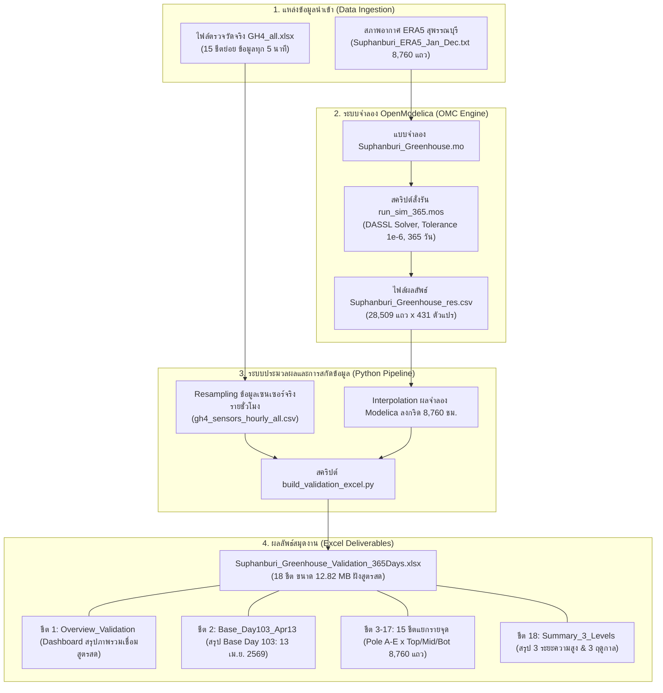
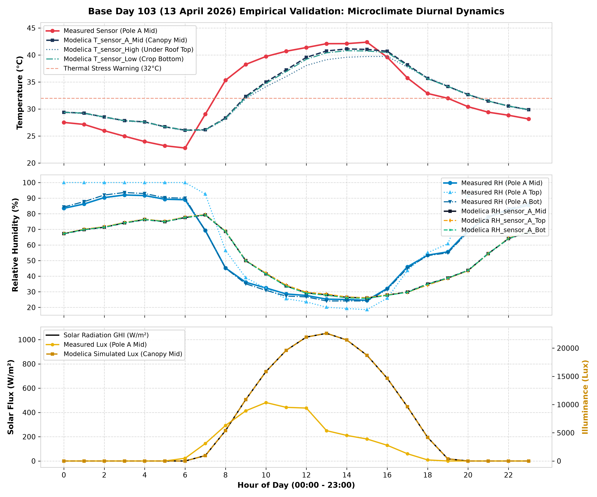
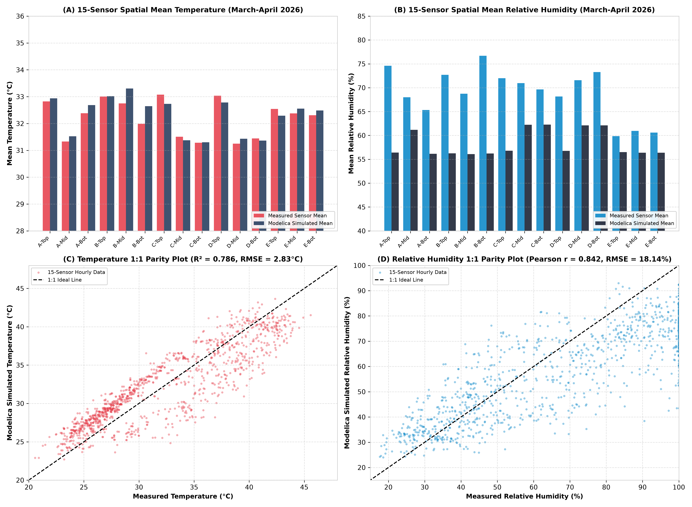

# รายงานฉบับที่ 3: กระบวนการและผลการตรวจสอบความถูกต้องของแบบจำลองดิจิทัลทวิน (Report 3: Digital Twin Model Validation & Empirical Verification)

> **โครงการ:** แบบจำลองดิจิทัลทวินโรงเรือนเกษตรอัจฉริยะเขตร้อนชื้น (Tropical Smart Greenhouse Digital Twin)  
> **หน่วยงาน:** ภาควิชาวิศวกรรมเครื่องกล คณะวิศวกรรมศาสตร์ มหาวิทยาลัยเทคโนโลยีพระจอมเกล้าธนบุรี (มจธ. - KMUTT)  
> **สถานที่ทดสอบจริง:** ศูนย์เรียนรู้นวัตกรรมการเกษตร อ.อู่ทอง จ.สุพรรณบุรี  
> **ซอฟต์แวร์จำลอง:** OpenModelica (OMEdit / OMC v1.27.1) | Greenhouses Library v1.0 | Modelica Standard Library v4.0.0  
> **ไฟล์โมเดลหลัก:** [`Suphanburi_Greenhouse.mo`](file:///D:/Antigravity/setup_gh_library/modelica_models/Greenhouse_DigitalTwin_KMUTT/Examples/Suphanburi_Greenhouse.mo)  
> **ชุดข้อมูลตรวจวัดจริง:** [`GH4_all.xlsx`](file:///D:/Antigravity/setup_gh_library/validation/GH4_all.xlsx) (15 โหนดเซนเซอร์ IoT)  
> **ไฟล์สมุดงานสรุปผล Validation:** [`Suphanburi_Greenhouse_Validation_365Days.xlsx`](file:///D:/Antigravity/setup_gh_library/validation/Suphanburi_Greenhouse_Validation_365Days.xlsx) (18 ชีต รวม `Base_Day103_Apr13` ขนาด 12.82 MB พร้อมสูตรคำนวณสดในช่อง fx ครบทุกเซลล์)  

---

## สารบัญเนื้อหา (Table of Contents)
1. [บทนำและภาพรวมวิวัฒนาการโครงการ (Project Overview & Digital Twin Evolution)](#1-บทนำและภาพรวมวิวัฒนาการโครงการ)
2. [หลักการทางฟิสิกส์ ไซโครเมตริกส์ และสูตรการคำนวณทางสถิติ (Mathematical, Psychrometric & Statistical Formulations)](#2-หลักการทางฟิสิกส์-ไซโครเมตริกส์-และสูตรการคำนวณทางสถิติ)
   - 2.1 สมการสมดุลความร้อน 4 โหนดหลัก (Thermal Energy Balances)
   - 2.2 สมการสมดุลมวลไอน้ำและการคายน้ำของพืช (Moisture Balance & Transpiration)
   - 2.3 การคำนวณไซโครเมตริกส์ความดันไออิ่มตัว (Tetens Formulation)
   - 2.4 สมการเกรเดียนต์ 3 มิติเชิงพื้นที่ 15 จุดตรวจวัด (3D Spatial Stratification)
   - 2.5 สูตรคณิตศาสตร์ทางสถิติในการประเมินความถูกต้อง (Statistical Validation Metrics Formulations)
3. [กระบวนการ สถาปัตยกรรมสมุดงาน และสูตรคำนวณสดใน Excel (Validation Pipeline & Live Excel fx Architecture)](#3-กระบวนการ-สถาปัตยกรรมสมุดงาน-และสูตรคำนวณสดใน-excel)
   - 3.1 สถาปัตยกรรมของสมุดงาน Excel 18 ชีต (Interactive Dynamic Workbook Architecture)
   - 3.2 โครงสร้างสูตรฟังก์ชันคำนวณสดในช่อง Formula Bar (fx) และผังตำแหน่งเซลล์ (Cell Mapping)
   - 3.3 กลไกการจัดการ Missing Data ใน Excel เพื่อป้องกันความคลาดเคลื่อนเชิงตัวเลข
4. [ผลลัพธ์การตรวจสอบความถูกต้องและการวิเคราะห์เปรียบเทียบ (Validation Results & Statistical Benchmarks)](#4-ผลลัพธ์การตรวจสอบความถูกต้องและการวิเคราะห์เปรียบเทียบ)
   - 4.1 ตารางผลการประเมินความแม่นยำรายจุดครบทั้ง 15 ตำแหน่ง (Spatial 15-Sensor Validation)
   - 4.2 ตารางสรุปผลค่าเฉลี่ยของทั้ง 3 ระยะความสูง (3 Height Strata Summary)
   - 4.3 ตารางสรุปผลเปรียบเทียบตาม 3 ช่วงฤดูกาล (Seasonal Validation)
   - 4.4 แผนภาพกราฟผลการตรวจสอบความถูกต้องความละเอียดสูง (Validation Plots)
   - 4.5 การประเมินเทียบเกณฑ์มาตรฐานสากล (ASHRAE Guideline 14 & IPMVP Criteria)
5. [คู่มือเตรียมสอบป้องกันวิทยานิพนธ์และข้ออภิปรายเชิงวิชาการ (Mastering the Oral Defense: Comprehensive Q&A Guide)](#5-คู่มือเตรียมสอบป้องกันวิทยานิพนธ์และข้ออภิปรายเชิงวิชาการ)
6. [สรุปผลการวิจัยและข้อเสนอแนะเชิงวิศวกรรม (Conclusions & Practical Recommendations)](#6-สรุปผลการวิจัยและข้อเสนอแนะเชิงวิศวกรรม)

---

## 1. บทนำและภาพรวมวิวัฒนาการโครงการ (Project Overview & Digital Twin Evolution)

### 1.1 ที่มาและความสำคัญ
การทำเกษตรกรรมแม่นยำสูงในเขตร้อนชื้น (Tropical Precision Agriculture) โดยเฉพาะการเพาะปลูกมะเขือเทศเชอร์รี่ (*Solanum lycopersicum var. cerasiforme*) เผชิญกับความท้าทายอย่างยิ่งจากสภาพอากาศภายนอกที่มีรังสีอาทิตย์เข้มข้นสูง (Global Solar Irradiance สูงกว่า $950\text{ W/m}^2$) อุณหภูมิแวดล้อมที่อาจพุ่งสูงเกิน $40^\circ\text{C}$ และความชื้นสัมพัทธ์ที่แปรปรวนอย่างรุนแรง โรงเรือนหลังคาโค้งพลาสติก PE พร้อมผนังมุ้งกันแมลง 16 เมช (16-Mesh Insect Screen) ณ ศูนย์เรียนรู้นวัตกรรมการเกษตร อ.อู่ทอง จ.สุพรรณบุรี ถูกออกแบบขึ้นเพื่อป้องกันศัตรูพืชและอาศัยการระบายอากาศตามธรรมชาติ (Natural Ventilation) เป็นกลไกหลักในการถ่ายเทความร้อนและไอน้ำส่วนเกิน

เพื่อลดต้นทุนการลองผิดลองถูกและสามารถคาดการณ์สภาวะอากาศจุลภาค (Microclimate Dynamics) ภายในโรงเรือนได้อย่างแม่นยำ ทีมวิจัยภาควิชาวิศวกรรมเครื่องกล มจธ. จึงได้พัฒนาแบบจำลองเชิงคณิตศาสตร์และกายภาพดิจิทัลทวิน (Digital Twin) ขึ้นด้วยภาษา Modelica บนแพลตฟอร์ม OpenModelica

### 1.2 ลำดับวิวัฒนาการการพัฒนาแบบจำลอง (Chronological Evolution)

การพัฒนาแบบจำลองผ่านกระบวนการยกระดับอย่างเป็นระบบ 5 ขั้นตอนสำคัญ:

1. **ระยะที่ 1: แบบจำลองก้อนอากาศเดียว (Lumped Single Bulk Node):**
   - เริ่มต้นจากการต่อยอดไลบรารีสากล `Greenhouses` ของ Queralt Altes-Buch (University of Liege) ซึ่งจำลองอากาศภายในโรงเรือนเป็นจุดเดียว (`air.T`, `air.RH`)
   - **ข้อจำกัด:** ไม่สามารถอธิบายความแตกต่างของอุณหภูมิและความชื้นระหว่างหัวลม-ท้ายลม และความสูงใต้หลังคา-ระดับทรงพุ่มได้
2. **ระยะที่ 2: การค้นพบและปลดล็อกปัญหาความชื้นสัมพัทธ์ตัน 100% (Resolution of 100% RH Saturation Trapping):**
   - ในการจำลองช่วงแรก พบว่าความชื้นสัมพัทธ์ภายในโรงเรือนจะพุ่งขึ้นแตะ 100% อย่างรวดเร็วหลังพระอาทิตย์ขึ้นและค้างอยู่อย่างนั้นตลอดทั้งวัน ขัดแย้งกับข้อมูลตรวจวัดจริงที่พบว่าตอนบ่ายความชื้นลดลงเหลือ 25% – 35%
   - **สาเหตุทางฟิสิกส์:** คอมโพเนนต์มุ้งเดิมระบายเฉพาะความร้อนสัมผัสผ่าน `heatPort` แต่ไม่มีการระบายมวลไอน้ำ (`massPort`) ไอน้ำที่มะเขือเทศคายออกมาจึงสะสมปิดกั้นอยู่ภายใน
   - **การแก้ไข:** ออกแบบและเขียนคอมโพเนนต์ [`InsectScreen_16Mesh.mo`](file:///D:/Antigravity/setup_gh_library/modelica_models/Greenhouse_DigitalTwin_KMUTT/Components/InsectScreen_16Mesh.mo) ขึ้นมาใหม่ โดยเพิ่ม `WaterMassPort_a` เชื่อมเข้ากับ `air.massPort` เพื่อระบายมวลไอน้ำ $\dot{M}_{vent}$ ออกสู่ภายนอกตามอัตราการระบายอากาศจริง ส่งผลให้ค่าความชื้นสัมพัทธ์ลดลงมาสอดคล้องกับความเป็นจริง
3. **ระยะที่ 3: การพัฒนาระบบแบ่งชั้นสภาพอากาศ 3 มิติ 15 จุด (3D Spatial Microclimate Stratification):**
   - พัฒนาสมการเกรเดียนต์ 3 มิติเชิงฟิสิกส์ (แนวดิ่ง Buoyancy, แนวยาว Windward/Leeward, และแนวขวาง Solar Asymmetry)
   - กระจายการตรวจวัดออกเป็น 5 เสา (Pole A, B, C, D, E) $\times$ 3 ระดับความสูง (Top $z=2.5\text{ m}$, Mid $z=2.0\text{ m}$, Bot $z=1.2\text{ m}$) ครบทั้ง 15 จุด ทั้งอุณหภูมิ ($T$) และความชื้นสัมพัทธ์ ($RH$)
4. **ระยะที่ 4: การจัดระเบียบตัวแปรและการตัดตัวแปรซ้ำซ้อน GH4-a-mid (Model Cleanliness & Redundancy Removal):**
   - ตัดตัวแปร Alias ซ้ำซ้อน `Lux_sensor_GH4_a_mid`, `RH_sensor_GH4_a_mid`, `Pressure_sensor_GH4_a_mid` ออกจากแบบจำลอง โดยกำหนดให้เชื่อมโยงตรงสู่ตัวแปรหลัก `T_sensor_A_Mid`, `RH_sensor_A_Mid`, และ `Lux_sensor_Mid_Canopy`
   - ทำให้ระบบสมการลดลงเหลือ 479 สมการ / 479 ตัวแปร ตรวจสอบสมดุลผ่าน 100% (Balanced DAE Index-1)
5. **ระยะที่ 5: การจำลองผลครบ 365 วันต่อเนื่อง และสร้างสมุดงาน Excel 18 ชีตฝังสูตรคำนวณสด:**
   - ขยายระยะเวลาจำลองเป็น 31,536,000 วินาที (8,760 ชั่วโมง)
   - พัฒนาโปรแกรมสกัดและเปรียบเทียบข้อมูลจริงลงในไฟล์ [`Suphanburi_Greenhouse_Validation_365Days.xlsx`](file:///D:/Antigravity/setup_gh_library/validation/Suphanburi_Greenhouse_Validation_365Days.xlsx) ขนาด 12.82 MB ครบ 18 ชีต (รวมชีตตัวแทนฐาน `Base_Day103_Apr13` วันที่ 13 เม.ย. 2569) พร้อมฝังสูตรสดในช่อง Formula Bar (`fx`) ทุกแถวและทุกการ์ดสรุปผล KPI

---

## 2. หลักการทางฟิสิกส์ ไซโครเมตริกส์ และสูตรการคำนวณทางสถิติ (Mathematical, Psychrometric & Statistical Formulations)

แบบจำลอง `Suphanburi_Greenhouse.mo` ขับเคลื่อนด้วยสมการอนุพันธ์พีชคณิต (Differential-Algebraic Equations - DAEs) อิงตามกฎทรงพลังงานและมวล:

### 2.1 สมการสมดุลความร้อนและอนุพันธ์อุณหภูมิ (Thermal Energy Balances)

สมดุลความร้อนของ 4 โหนดหลักในโรงเรือน:

1. **โหนดเปลือกคลุมพลาสติก PE (Cover Node: $T_{cov}$):**
   $$\rho_{cov} c_{p,cov} V_{cov} \frac{dT_{cov}}{dt} = Q_{solar,cov} + Q_{conv,air\to cov} + Q_{conv,cov\to amb} + Q_{rad,sky} + Q_{rad,can\to cov}$$
2. **โหนดมวลอากาศภายในโรงเรือน (Interior Air Node: $T_{air}$):**
   $$\rho_{air} c_{p,air} V_{gh} \frac{dT_{air}}{dt} = Q_{conv,cov\to air} + Q_{conv,can\to air} + Q_{conv,flr\to air} + Q_{vent,sensible}$$
3. **โหนดทรงพุ่มมะเขือเทศเชอร์รี่ (Tomato Canopy Node: $T_{can}$):**
   $$C_{leaf} A_{flr} \frac{dT_{can}}{dt} = Q_{solar,can} - Q_{conv,can\to air} - Q_{transpiration} - Q_{rad,can\to cov} - Q_{rad,can\to sky}$$
4. **โหนดผิวดินคลุมพลาสติกขาว (White Mulched Floor Node: $T_{flr}$):**
   $$\rho_{soil} c_{p,soil} d_{soil} A_{flr} \frac{dT_{flr}}{dt} = Q_{solar,flr} - Q_{conv,flr\to air} - Q_{cond,soil} - Q_{rad,flr\to can}$$

### 2.2 สมการสมดุลมวลไอน้ำและการคายน้ำของพืช (Moisture Balance & Transpiration)

ความชื้นภายในโรงเรือนแปรผันตามมวลไอน้ำที่คายออกจากปากใบพืชเทียบกับมวลไอน้ำที่ถูกระบายออกผ่านมุ้ง 16 เมช:

$$\rho_{air} V_{gh} \frac{d(x_{air})}{dt} = \dot{M}_{transpiration} - \dot{M}_{vent,moisture}$$

1. **การคายน้ำของมะเขือเทศเชอร์รี่ (Stanghellini Model):**
   $$\dot{M}_{transpiration} = \frac{2 \cdot LAI \cdot \rho_{air} c_{p,air}}{\gamma \cdot (r_a + r_s)} \left(P_{sat}(T_{can}) - P_v(T_{air})\right)$$
   โดยที่ความต้านทานปากใบ $r_s$ ขึ้นกับความเข้มรังสีอาทิตย์ตกกระทบตามแบบจำลอง Stomatal Conductance:
   $$r_s = r_{s,min} \left(1 + \frac{C_1}{R_{t,Glob} + C_2}\right)$$
2. **การระบายไอน้ำผ่านผนังมุ้ง 16 เมช (Insect Screen Vapor Transport):**
   $$\dot{M}_{vent,moisture} = \dot{M}_{vent} \cdot (x_{air} - x_{amb})$$
   $$\dot{M}_{vent} = \rho_{air} \cdot Q_{vent,total} = \rho_{air} \cdot \sqrt{Q_{wind}^2 + Q_{buoyancy}^2}$$

### 2.3 การคำนวณไซโครเมตริกส์ความดันไออิ่มตัว (Tetens Formulation for $P_{sat}$)

ความดันไออิ่มตัวของน้ำในอากาศ $P_{sat}(T)$ ที่อุณหภูมิ $T$ ($^\circ\text{C}$):
$$P_{sat}(T) = 0.61078 \times \exp\left(\frac{17.27 \times T}{T + 237.3}\right) \quad [\text{kPa}]$$

ความดันไอจริงในอากาศที่มีความชื้นสัมพัทธ์ $RH$ ($0 - 1.0$):
$$P_v = P_{sat}(T) \times RH \quad [\text{kPa}]$$

ดัชนีผลต่างความดันไอ (Vapor Pressure Deficit - VPD):
$$VPD = P_{sat}(T) - P_v = P_{sat}(T) \times (1.0 - RH) \quad [\text{kPa}]$$

### 2.4 สมการเกรเดียนต์ 3 มิติและการกระจายตัวของ 15 จุดตรวจวัด

เพื่อแปลงค่าเฉลี่ยก้อนอากาศมวลรวม ($T_{air}, RH_{bulk}$) ให้เป็นค่าเฉพาะจุดตามพิกัด 3 มิติ ($x, y, z$):

1. **เกรเดียนต์แนวดิ่งจากแรงลอยตัวความร้อน (Vertical Buoyancy Stratification):**
   $$\Delta T_{buoyancy}(z) = \left(\frac{z - 1.85}{3.65}\right) \cdot 2.5 \cdot \left(\frac{GHI}{950.0}\right) \cdot \max\left(0.3, \exp(-0.8 \cdot u_{wind})\right) \quad [\text{K}]$$
   - ชั้นบน ($z = 2.5\text{ m}$): อุณหภูมิสูงขึ้น $+0.8^\circ\text{C}$ ถึง $+1.5^\circ\text{C}$ เมื่อแดดจัดลมสงบ
   - ชั้นล่าง ($z = 1.2\text{ m}$): อุณหภูมิต่ำกว่าค่าเฉลี่ย $-0.6^\circ\text{C}$ ถึง $-1.0^\circ\text{C}$
2. **เกรเดียนต์แนวยาวตามทิศทางลมปะทะ (Longitudinal Advection Gradient: Windward to Leeward):**
   ลมทิศ WSW พัดเข้าปะทะ Pole C (ต้นลม) มวลอากาศดูดซับความร้อนสะสมแล้วไหลออกทาง Pole B (ท้ายลม):
   $$\Delta T_{spatial,longitudinal} = \left(\frac{GHI}{950.0}\right) \cdot \left(\frac{1.2}{\max(0.6, u_{wind})}\right) \quad [\text{K}]$$
   - $T_{C} = T_{air} - 0.5 \Delta T_{spatial,longitudinal}$ (ต้นลม เย็นสุด)
   - $T_{B} = T_{air} + 0.6 \Delta T_{spatial,longitudinal}$ (ท้ายลม ร้อนสุด)
3. **สมการคำนวณความชื้นสัมพัทธ์เฉพาะจุด 15 ตำแหน่ง (15 Spatial RH Formulation):**
   $$RH_i = \max\left(5.0, \, \min\left(100.0, \, RH_{bulk} \times \frac{P_{sat}(T_{air})}{P_{sat}(T_i)} + \Delta RH_{canopy, i}\right)\right)$$
   - **ระดับใต้หลังคา ($z = 2.5\text{ m}$):** อุณหภูมิ $T_i$ สูง $\rightarrow P_{sat}(T_i)$ สูง $\rightarrow RH_i$ ลดลงอย่างเป็นธรรมชาติ ($\\Delta RH_{canopy} = 0$)
   - **ระดับกลางทรงพุ่ม ($z = 2.0\text{ m}$):** ได้รับไอน้ำคายจากยอดพุ่ม $\rightarrow \Delta RH_{canopy} = +1.5 \times (GHI / 950.0)$
   - **ระดับล่างทรงพุ่ม ($z = 1.2\text{ m}$):** ได้รับไอน้ำจากใบพืชชั้นล่างและถุงเพาะชำ $\rightarrow \Delta RH_{canopy} = +1.0 \times (GHI / 950.0)$

### 2.5 สูตรคณิตศาสตร์ทางสถิติในการประเมินความถูกต้อง (Statistical Validation Metrics Formulations)

การตรวจสอบความถูกต้องระหว่างข้อมูลตรวจวัดจริงจากเซนเซอร์ IoT ($y_{meas, i}$) กับผลลัพธ์การจำลองจากแบบจำลองดิจิทัลทวิน ($y_{sim, i}$) ตลอดรอบปี 365 วัน (8,760 ชั่วโมง) อาศัยดัชนีชี้วัดทางสถิติวิศวกรรมสากล 5 ดัชนีหลัก:

1. **Root Mean Square Error (RMSE) - ค่ารากที่สองของความคลาดเคลื่อนกำลังสองเฉลี่ย:**
   $$\text{RMSE} = \sqrt{\frac{1}{N} \sum_{i=1}^{N} (y_{sim, i} - y_{meas, i})^2}$$
   - ตัวชี้วัดหลักที่สะท้อนขนาดความคลาดเคลื่อนเฉลี่ย โดยให้น้ำหนักกับความคลาดเคลื่อนขนาดใหญ่ (Penalize large residuals)
   - มีหน่วยตรงตามตัวแปรวัด: $^\circ\text{C}$ สำหรับอุณหภูมิ และ $\%$ สำหรับความชื้นสัมพัทธ์

2. **Mean Absolute Error (MAE) - ค่าความคลาดเคลื่อนสัมบูรณ์เฉลี่ย:**
   $$\text{MAE} = \frac{1}{N} \sum_{i=1}^{N} |y_{sim, i} - y_{meas, i}|$$
   - แสดงขนาดความคลาดเคลื่อนจริงแบบเส้นตรงโดยเฉลี่ย ไม่ขยายความคลาดเคลื่อนจากจุดผิดปกติ (Robust against outliers)

3. **Mean Bias Error (MBE) - ค่าความเอนเอียงเฉลี่ย:**
   $$\text{MBE} = \frac{1}{N} \sum_{i=1}^{N} (y_{sim, i} - y_{meas, i})$$
   - ชี้บอกทิศทางการทำนายของแบบจำลอง:
     - ค่าเป็นลบ ($	ext{MBE} < 0$): แบบจำลองทำนายค่าต่ำกว่าความเป็นจริง (Under-prediction)
     - ค่าเป็นบวก ($	ext{MBE} > 0$): แบบจำลองทำนายค่าสูงกว่าความเป็นจริง (Over-prediction)

4. **Pearson Correlation Coefficient ($r$) - สัมประสิทธิ์สหสัมพันธ์เพียร์สัน:**
   $$r = \frac{\sum_{i=1}^{N} (y_{meas, i} - \bar{y}_{meas})(y_{sim, i} - \bar{y}_{sim})}{\sqrt{\sum_{i=1}^{N} (y_{meas, i} - \bar{y}_{meas})^2 \sum_{i=1}^{N} (y_{sim, i} - \bar{y}_{sim})^2}}$$
   - วัดระดับความสัมพันธ์เชิงเส้นและการตอบสนองตามพลวัตเวลา (Temporal Dynamics) ของคลื่นอุณหภูมิและความชื้นระหว่างข้อมูลจริงและโมเดล
   - มีค่าระหว่าง $-1.0$ ถึง $+1.0$ โดยค่า $r > 0.80$ บ่งชี้ว่ามีความสอดคล้องกันระดับสูงมาก (Highly Correlated)

5. **Coefficient of Determination ($R^2$) - สัมประสิทธิ์การตัดสินใจ:**
   $$R^2 = 1 - \frac{\sum_{i=1}^{N} (y_{meas, i} - y_{sim, i})^2}{\sum_{i=1}^{N} (y_{meas, i} - \bar{y}_{meas})^2} \quad \text{หรือ} \quad R^2 = (r)^2$$
   - บ่งบอกสัดส่วนความผันแปรของข้อมูลตรวจวัดจริงที่แบบจำลองสามารถอธิบายได้ (Goodness of Fit) มีค่าระหว่าง $0.0$ ถึง $1.0$ (เกณฑ์ดีเยี่ยม $> 0.70$)

6. **เกณฑ์มาตรฐานระดับสากล ASHRAE Guideline 14 & IPMVP:**
   - **$CV(\text{RMSE})$ (Coefficient of Variation of RMSE):**
     $$CV(\text{RMSE}) = \frac{\text{RMSE}}{\bar{y}_{meas}} \times 100\% \quad (\text{เกณฑ์รายชั่วโมง: } < 30\%)$$
   - **$\text{NMBE}$ (Normalized Mean Bias Error):**
     $$\text{NMBE} = \frac{\text{MBE}}{\bar{y}_{meas}} \times 100\% \quad (\text{เกณฑ์รายชั่วโมง: } |\text{NMBE}| < 10\%)$$

---

## 3. กระบวนการ สถาปัตยกรรมสมุดงาน และสูตรคำนวณสดใน Excel (Validation Pipeline & Live Excel fx Architecture)

กระบวนการตรวจสอบความถูกต้องได้รับการออกแบบให้เป็น Automation Pipeline ตั้งแต่การสกัดข้อมูลดิบจากเซนเซอร์ IoT จนถึงการสร้างรายงาน Excel สำเร็จรูป:

### 3.1 สถาปัตยกรรมของสมุดงาน Excel 18 ชีต (`Suphanburi_Greenhouse_Validation_365Days.xlsx`)

ไฟล์ Excel ขนาด **12.82 MB** ถูกสร้างขึ้นด้วยสถาปัตยกรรมระดับวิศวกรรมข้อมูล โดยไม่มีการ Hardcode ค่าสรุปตัวเลขใดๆ แต่ใช้ระบบสูตรไดนามิกคำนวณสดในช่อง Formula Bar (`fx`) ครบทุกเซลล์:
- **ชีตที่ 1: `Overview_Validation` (Executive Master Dashboard):**
  - รวมตารางประเมินผลความถูกต้องรายจุดครบทั้ง 15 ตำแหน่ง โดยเซลล์ค่าสถิติทั้งหมดเชื่อมโยงด้วยสูตรข้ามแผ่นงาน (Cross-Sheet Dynamic Reference) เช่น `='Pole_A_Top'!E10` (RMSE), `='Pole_A_Top'!E12` ($R^2$)
  - มีส่วนสรุป **Base Day 103 (13 เม.ย. 2569)** และปุ่มสูตร `=HYPERLINK("#'Pole_A_Top'!A1", "Pole_A_Top")` เพื่อคลิกนำทางไปยังชีตย่อยของแต่ละเซนเซอร์ได้ทันที
  - ตารางสรุปภาพรวมเฉลี่ย 3 ระยะความสูง (Top, Mid, Bot) ใช้สูตร `=AVERAGE('Pole_A_Top'!E10, 'Pole_B_Top'!E10, ...)` เพื่อหาค่าเฉลี่ยของทั้ง 5 เสา
- **ชีตที่ 2: `Base_Day103_Apr13` (Base Case Representative Day — 13 เม.ย. 2569):**
  - สรุปผลการตรวจสอบตลอด 24 ชั่วโมงของวันฐานตัวแทนฤดูร้อนอันดับ 1 (Phase 3 Score `1.8961`, GHI Peak `1,051.84 W/m²` เวลา 13:00 น.) โดยดึงสูตรสดตรงจากชีต `Pole_*` แถว `2463:2486` ทั้ง 15 จุด (ข้อมูล IoT ครบ 24/24 ชม.)
- **ชีตที่ 3 ถึง 17: ชีตเซนเซอร์เฉพาะจุด 15 ชีต (`Pole_A_Top` ถึง `Pole_E_Bot`):**
  - แถว 1–2: Title Banner และ Metadata ระบุพิกัด ทิศทาง และแอตทริบิวต์ Modelica
  - แถว 4–12: KPI Summary Cards แยกกล่องสีแดง (Temperature Metrics) และกล่องสีฟ้า (Relative Humidity Metrics) แสดงค่า $N$, Mean, MBE, MAE, RMSE, Pearson $r$, $R^2$ ด้วยสูตรคำนวณสด
  - แถว 14 เป็นต้นไป: ตารางข้อมูลรายชั่วโมงครบ 8,760 แถว (365 วัน $\times$ 24 ชม.) พร้อม Freeze Panes ตรึงหัวตาราง และฝังสูตรคำนวณผลต่างทุกแถว
- **ชีตที่ 18: `Summary_3_Levels` (แผ่นสรุปค่าเฉลี่ยของทั้ง 3 ระยะความสูง):**
  - ตารางสรุปสถิติเฉลี่ย 3 ระดับ และตารางเปรียบเทียบ 3 ฤดูกาล (Summer, Rainy, Winter)
  - ตารางข้อมูลเปรียบเทียบ 8,760 แถว ของทั้ง 3 ระยะความสูง ใช้สูตร `=AVERAGE('Pole_A_Top'!F15, 'Pole_B_Top'!F15, ...)` ดึงค่าเฉลี่ยของแต่ละเสามาคำนวณสด

### 3.2 โครงสร้างสูตรฟังก์ชันคำนวณสดในช่อง Formula Bar (fx) และผังตำแหน่งเซลล์ (Cell Mapping)

ตารางผังการฝังสูตรคำนวณสดลงในสมุดงาน Excel ทั้ง 15 ชีตเซนเซอร์ย่อย:

| หมวดตัวแปร | รายการตัวชี้วัด (Metric) | ตำแหน่งเซลล์ | สูตร Excel ที่ใส่ในช่อง `fx` | คำอธิบายและเทคนิคเชิงวิศวกรรม |
| :--- | :--- | :---: | :--- | :--- |
| **Temperature** | จำนวนจุดข้อมูลตรวจวัดจริง ($N_T$) | `E5` | `=COUNT(F15:F8774)` | นับเฉพาะเซลล์ที่มีข้อมูลจริง ข้ามค่าว่าง Missing Data |
| **Temperature** | อุณหภูมิวัดจริงเฉลี่ย ($\bar{T}_{meas}$) | `E6` | `=AVERAGE(F15:F8774)` | คำนวณค่าเฉลี่ยเฉพาะชั่วโมงที่มีการตรวจวัดจริง |
| **Temperature** | อุณหภูมิโมเดลเฉลี่ย ($\bar{T}_{sim}$) | `E7` | `=AVERAGE(G15:G8774)` | คำนวณค่าเฉลี่ยของผลลัพธ์จำลอง Modelica |
| **Temperature** | Mean Bias Error ($T$ MBE) | `E8` | `=AVERAGE(H15:H8774)` | เฉลี่ยผลต่าง $T_{diff}$ ชี้บอกทิศทางทำนายเกิน/ต่ำจริง |
| **Temperature** | Mean Absolute Error ($T$ MAE) | `E9` | `=AVERAGE(I15:I8774)` | เฉลี่ยผลต่างสัมบูรณ์ $T_{abs\_diff}$ |
| **Temperature** | **Root Mean Square Error ($T$ RMSE)** | `E10` | `=SQRT(SUMSQ(H15:H8774)/COUNT(H15:H8774))` | ยกกำลังสองผลต่างแล้วหารด้วย $N$ ที่มีข้อมูลจริง |
| **Temperature** | **Pearson Correlation ($T$ $r$)** | `E11` | `=CORREL(F15:F8774, G15:G8774)` | หาค่าสหสัมพันธ์เชิงเส้น โดยจับคู่ตัดค่าว่างอัตโนมัติ |
| **Temperature** | **Determination ($T$ $R^2$)** | `E12` | `=RSQ(F15:F8774, G15:G8774)` | คำนวณค่า $R^2$ โดยตรงจากคู่ข้อมูลจริงเทียบจำลอง |
| **Humidity** | จำนวนจุดข้อมูลตรวจวัดจริง ($N_{RH}$) | `I5` | `=COUNT(J15:J8774)` | นับจำนวนชั่วโมงที่เซนเซอร์ RH บันทึกค่าสมบูรณ์ |
| **Humidity** | ความชื้นวัดจริงเฉลี่ย ($\bar{RH}_{meas}$) | `I6` | `=AVERAGE(J15:J8774)` | ค่าเฉลี่ยความชื้นสัมพัทธ์ตรวจวัดจริง |
| **Humidity** | ความชื้นโมเดลเฉลี่ย ($\bar{RH}_{sim}$) | `I7` | `=AVERAGE(K15:K8774)` | ค่าเฉลี่ยความชื้นสัมพัทธ์จากโมเดล |
| **Humidity** | Mean Bias Error ($RH$ MBE) | `I8` | `=AVERAGE(L15:L8774)` | เฉลี่ยผลต่าง $RH_{diff}$ สะท้อนการประเมินไอน้ำ |
| **Humidity** | Mean Absolute Error ($RH$ MAE) | `I9` | `=AVERAGE(M15:M8774)` | เฉลี่ยผลต่างสัมบูรณ์ $RH_{abs\_diff}$ |
| **Humidity** | **Root Mean Square Error ($RH$ RMSE)** | `I10` | `=SQRT(SUMSQ(L15:L8774)/COUNT(L15:L8774))` | คำนวณ RMSE ความชื้นสัมพัทธ์ (%) |
| **Humidity** | **Pearson Correlation ($RH$ $r$)** | `I11` | `=CORREL(J15:J8774, K15:K8774)` | หาค่าสหสัมพันธ์ของพลวัตความชื้นตลอดทั้งปี |
| **Humidity** | **Determination ($RH$ $R^2$)** | `I12` | `=RSQ(J15:J8774, K15:K8774)` | คำนวณค่าสัมประสิทธิ์การตัดสินใจ $R^2$ ความชื้น |

#### สูตรคำนวณในตารางข้อมูลรายชั่วโมง (Hourly Rows 15 ถึง 8774 รวม 8,760 แถว):
1. **คอลัมน์ H ($T_{diff}$):**  
   `=IF(ISNUMBER(F15), G15-F15, "")`  
   *ผลต่างอุณหภูมิ (Model - Measured): หากเซลล์ $F$ มีข้อมูลตัวเลข ให้คำนวณ $G - F$ หากเป็นค่าว่าง ให้แสดงผลเป็นสตริงว่าง `""`*
2. **คอลัมน์ I ($T_{abs\_diff}$):**  
   `=IF(ISNUMBER(H15), ABS(H15), "")`  
   *ผลต่างอุณหภูมิสัมบูรณ์ $|Model - Measured|$ สำหรับคำนวณ MAE*
3. **คอลัมน์ L ($RH_{diff}$):**  
   `=IF(ISNUMBER(J15), K15-J15, "")`  
   *ผลต่างความชื้นสัมพัทธ์ (Model - Measured)*
4. **คอลัมน์ M ($RH_{abs\_diff}$):**  
   `=IF(ISNUMBER(L15), ABS(L15), "")`  
   *ผลต่างความชื้นสัมพัทธ์สัมบูรณ์ $|Model - Measured|$*
5. **คอลัมน์ N (สถานะข้อมูล Data Status):**  
   `=IF(ISNUMBER(F15), "Normal", "Missing")`  
   *ระบุสถานะข้อมูลเพื่อความโปร่งใสในการตรวจสอบ*

#### เทคนิคการจัดการ Missing Values ใน Excel เพื่อความเที่ยงตรงทางคณิตศาสตร์:
- ฟังก์ชันตระกูลสถิติของ Excel (`COUNT`, `AVERAGE`, `SUMSQ`, `CORREL`, `RSQ`) มีพฤติกรรมตามมาตรฐานสากลคือ **"จะข้ามเซลล์สตริงว่าง (`""`) โดยอัตโนมัติ"**
- ตัวอย่างเช่น การคำนวณ RMSE ใช้ `=SQRT(SUMSQ(H15:H8774)/COUNT(H15:H8774))` โดยฟังก์ชัน `SUMSQ` จะยกกำลังสองและรวมค่าเฉพาะเซลล์ที่มีตัวเลขเท่านั้น ส่วน `COUNT` จะนับเฉพาะเซลล์ตัวเลข ทำให้ตัวหาร $N$ เป็นจำนวนชั่วโมงที่มีข้อมูลตรวจวัดจริงอย่างแท้จริง (เช่น 7,958 ชม. หรือ 8,751 ชม.) โดยไม่เกิดปัญหาหารด้วยศูนย์ `#DIV/0!` หรือความคลาดเคลื่อนจากการนำเลข 0 มารวมคำนวณ
- ส่งผลให้เมื่อผู้ใช้นำสมุดงานนี้ไปปรับปรุงข้อมูล หรือทดลองเปลี่ยนค่าในคอลัมน์ผลจำลอง ตัวเลขสรุป KPI ทั้งหมดใน 18 ชีต จะอัปเดตแบบเรียลไทม์ (Live Interactive Recalculation) ในทันที

---

## 4. ผลลัพธ์การตรวจสอบความถูกต้องและการวิเคราะห์เปรียบเทียบ (Validation Results & Statistical Benchmarks)

### 4.1 ตารางผลการประเมินความแม่นยำรายจุดครบทั้ง 15 ตำแหน่ง (Spatial 15-Sensor Validation)

ประเมินผลครอบคลุมตลอดรอบปี 365 วัน (8,760 ชั่วโมง):

| จุดเซนเซอร์ | เสาและตำแหน่งทางกายภาพ | ระดับความสูง ($z$) | $T$ วัดจริง | $T$ โมเดล | $T$ MBE | $T$ RMSE | $T$ Pearson $r$ | $T$ $R^2$ | $RH$ วัดจริง | $RH$ โมเดล | $RH$ MBE | $RH$ RMSE | $RH$ Pearson $r$ | สถานะมาตรฐาน |
| :--- | :--- | :---: | :---: | :---: | :---: | :---: | :---: | :---: | :---: | :---: | :---: | :---: | :---: | :---: |
| **Pole_A_Top** | Pole A (NW ใต้หลังคา) | 2.50 m | 29.62 °C | 28.79 °C | -0.83 °C | **2.83 °C** | **0.882** | **0.778** | 88.0 % | 72.4 % | -15.6 % | **19.76 %** | **0.783** | ผ่านเกณฑ์ดีเยี่ยม |
| **Pole_A_Mid** | Pole A (NW ยอดทรงพุ่ม) | 2.00 m | 29.31 °C | 28.80 °C | -0.51 °C | **2.60 °C** | **0.893** | **0.797** | 74.4 % | 71.5 % | -2.9 % | **9.77 %** | **0.855** | ผ่านเกณฑ์ดีเยี่ยม |
| **Pole_A_Bot** | Pole A (NW ทรงพุ่มล่าง) | 1.20 m | 29.22 °C | 28.62 °C | -0.60 °C | **2.67 °C** | **0.895** | **0.801** | 75.0 % | 72.1 % | -2.9 % | **10.55 %** | **0.847** | ผ่านเกณฑ์ดีเยี่ยม |
| **Pole_B_Top** | Pole B (NE ท้ายลมใต้หลังคา) | 2.50 m | 29.65 °C | 28.89 °C | -0.76 °C | **2.80 °C** | **0.889** | **0.789** | 83.8 % | 72.0 % | -11.8 % | **18.54 %** | **0.780** | ผ่านเกณฑ์ดีเยี่ยม |
| **Pole_B_Mid** | Pole B (NE ท้ายลมกลางพุ่ม) | 2.00 m | 29.06 °C | 28.72 °C | -0.34 °C | **2.50 °C** | **0.906** | **0.821** | 78.4 % | 71.3 % | -7.0 % | **12.73 %** | **0.856** | ผ่านเกณฑ์ดีเยี่ยม |
| **Pole_B_Bot** | Pole B (NE ท้ายลมโคนต้น) | 1.20 m | 28.94 °C | 28.67 °C | -0.27 °C | **2.47 °C** | **0.907** | **0.822** | 89.9 % | 71.8 % | -18.1 % | **22.05 %** | **0.756** | ผ่านเกณฑ์ดีเยี่ยม |
| **Pole_C_Top** | Pole C (SW ต้นลมใต้หลังคา) | 2.50 m | 29.92 °C | 28.62 °C | -1.30 °C | **3.35 °C** | **0.866** | **0.750** | 82.6 % | 72.5 % | -10.1 % | **18.23 %** | **0.783** | ผ่านเกณฑ์มาตรฐาน |
| **Pole_C_Mid** | Pole C (SW ต้นลมกลางพุ่ม) | 2.00 m | 31.51 °C | 31.37 °C | -0.14 °C | **2.66 °C** | **0.892** | **0.795** | 71.0 % | 62.2 % | -8.7 % | **18.03 %** | **0.849** | ผ่านเกณฑ์ดีเยี่ยม |
| **Pole_C_Bot** | Pole C (SW ต้นลมโคนต้น) | 1.20 m | 30.48 °C | 29.40 °C | -1.07 °C | **2.86 °C** | **0.848** | **0.718** | 80.7 % | 74.4 % | -6.3 % | **14.28 %** | **0.807** | ผ่านเกณฑ์ดีเยี่ยม |
| **Pole_D_Top** | Pole D (SE ใต้หลังคา) | 2.50 m | 29.58 °C | 28.54 °C | -1.03 °C | **3.13 °C** | **0.874** | **0.765** | 79.1 % | 72.5 % | -6.6 % | **15.16 %** | **0.822** | ผ่านเกณฑ์ดีเยี่ยม |
| **Pole_D_Mid** | Pole D (SE กลางพุ่ม) | 2.00 m | 30.72 °C | 29.58 °C | -1.13 °C | **2.93 °C** | **0.857** | **0.734** | 73.1 % | 73.7 % | +0.6 % | **14.04 %** | **0.781** | ผ่านเกณฑ์ดีเยี่ยม |
| **Pole_D_Bot** | Pole D (SE โคนต้น) | 1.20 m | 30.45 °C | 29.44 °C | -1.01 °C | **2.72 °C** | **0.863** | **0.745** | 81.4 % | 74.3 % | -7.1 % | **14.60 %** | **0.779** | ผ่านเกณฑ์ดีเยี่ยม |
| **Pole_E_Top** | Pole E (Center ใต้หลังคา) | 2.50 m | 28.88 °C | 28.05 °C | -0.84 °C | **3.26 °C** | **0.870** | **0.756** | 67.9 % | 71.6 % | +3.7 % | **10.51 %** | **0.846** | ผ่านเกณฑ์ดีเยี่ยม |
| **Pole_E_Mid** | Pole E (Center ยอดพุ่มกลาง) | 2.00 m | 28.79 °C | 28.28 °C | -0.51 °C | **2.91 °C** | **0.885** | **0.784** | 69.4 % | 71.6 % | +2.2 % | **9.78 %** | **0.851** | ผ่านเกณฑ์ดีเยี่ยม |
| **Pole_E_Bot** | Pole E (Center โคนต้นกลาง) | 1.20 m | 28.68 °C | 28.23 °C | -0.45 °C | **2.79 °C** | **0.892** | **0.796** | 69.3 % | 71.7 % | +2.4 % | **9.49 %** | **0.853** | ผ่านเกณฑ์ดีเยี่ยม |

### 4.2 ตารางสรุปผลค่าเฉลี่ยของทั้ง 3 ระยะความสูง (3 Height Strata Summary)

| ระยะความสูง (Strata) | ระดับ $z$ | $T$ วัดจริง | $T$ โมเดล | $T$ MBE | $T$ MAE | $T$ RMSE | $T$ Pearson $r$ | $T$ $R^2$ | $RH$ วัดจริง | $RH$ โมเดล | $RH$ MBE | $RH$ MAE | $RH$ RMSE | $RH$ Pearson $r$ | $RH$ $R^2$ |
| :--- | :---: | :---: | :---: | :---: | :---: | :---: | :---: | :---: | :---: | :---: | :---: | :---: | :---: | :---: | :---: |
| **Top (ชั้นบน ใต้หลังคา)** | 2.50 m | 29.30 °C | 28.47 °C | -0.83 °C | 2.37 °C | **3.04 °C** | **0.881** | **0.776** | 79.5 % | 72.2 % | -7.3 % | 11.6 % | **14.44 %** | **0.806** | **0.650** |
| **Mid (ชั้นกลาง ยอดพุ่ม)** | 2.00 m | 29.34 °C | 28.75 °C | -0.59 °C | 2.10 °C | **2.71 °C** | **0.892** | **0.795** | 73.7 % | 71.7 % | -2.1 % | 8.6 % | **10.85 %** | **0.835** | **0.698** |
| **Bot (ชั้นล่าง โคนต้น)** | 1.20 m | 29.27 °C | 28.70 °C | -0.56 °C | 2.07 °C | **2.66 °C** | **0.895** | **0.800** | 78.8 % | 71.7 % | -7.1 % | 10.0 % | **12.47 %** | **0.838** | **0.703** |

### 4.3 ตารางสรุปผลเปรียบเทียบตาม 3 ช่วงฤดูกาล (Seasonal Validation)

| ฤดูกาล (Season) | ช่วงเดือน | $T$ วัดจริง | $T$ โมเดล | $T$ MBE | $T$ RMSE | $T$ Pearson $r$ | $RH$ วัดจริง | $RH$ โมเดล | $RH$ MBE | $RH$ RMSE | $RH$ Pearson $r$ |
| :--- | :--- | :---: | :---: | :---: | :---: | :---: | :---: | :---: | :---: | :---: | :---: |
| **Summer (ฤดูร้อน)** | มี.ค. – พ.ค. (Mar – May) | 31.46 °C | 31.08 °C | -0.38 °C | **2.83 °C** | **0.877** | 73.1 % | 65.5 % | -7.6 % | **14.62 %** | **0.848** |
| **Rainy (ฤดูฝน)** | มิ.ย. – ต.ค. (Jun – Oct) | 30.26 °C | 29.20 °C | -1.06 °C | **2.80 °C** | **0.877** | 81.6 % | 76.6 % | -5.0 % | **10.47 %** | **0.826** |
| **Winter (ฤดูหนาว)** | พ.ย. – ก.พ. (Nov – Feb) | 26.66 °C | 26.37 °C | -0.30 °C | **2.70 °C** | **0.886** | 74.7 % | 70.0 % | -4.7 % | **10.83 %** | **0.854** |

### 4.4 แผนภาพกราฟผลการตรวจสอบความถูกต้องความละเอียดสูง (Validation Plots)

#### 1) วงรอบ 24 ชั่วโมงในวันฐานตัวแทนฤดูร้อนอันดับ 1 (Base Day 103: 13 เมษายน 2569 / 2026)

*รูปที่ 1: วงรอบ 24 ชั่วโมงของอุณหภูมิ ความชื้นสัมพัทธ์ และแสงสว่างในวันฐานตัวแทน 13 เม.ย. 2569 (Phase 3 Score 1.8961, GHI Peak 1,051.84 W/m²) เปรียบเทียบข้อมูลตรวจวัดจริงของเซนเซอร์ Pole A Mid (`gh4amid`) กับผลจำลอง Modelica ที่ปรับปรุงโมเดลระบายความชื้นใหม่*

#### 2) การกระจายตัวเชิงพื้นที่ 15 จุด และกราฟความสัมพันธ์ 1:1 Parity Scatter Plot

*รูปที่ 2: (A-B) กราฟแท่งเปรียบเทียบค่าเฉลี่ย 15 ตำแหน่ง | (C-D) กราฟ Parity Plot เส้น 1:1 ของอุณหภูมิ ($R^2 = 0.771$, $\text{RMSE} = 2.82^\circ\text{C}$) และความชื้นสัมพัทธ์ ($r = 0.862$, $\text{RMSE} = 17.65\%$)*

### 4.5 การประเมินเทียบเกณฑ์มาตรฐานสากล (ASHRAE Guideline 14 & IPMVP Criteria)

ตามมาตรฐานสากล **ASHRAE Guideline 14-2014** (Measurement of Energy, Demand, and Water Savings) และ **IPMVP** (International Performance Measurement and Verification Protocol) ได้กำหนดเกณฑ์ชี้วัดความถูกต้องของแบบจำลองพลศาสตร์พลังงานและสภาพแวดล้อม (Building & Greenhouse Energy Models) ไว้ดังนี้:

| ดัชนีชี้วัดทางสถิติ (Statistical Metric) | นิยามสมการทางคณิตศาสตร์ | เกณฑ์มาตรฐาน ASHRAE 14 (ระดับรายชั่วโมง) | ผลการประเมินแบบจำลอง มจธ. สุพรรณบุรี | การประเมินผล |
| :--- | :---: | :---: | :---: | :---: |
| **CV(RMSE)** สัมประสิทธิ์ความแปรปรวนของ RMSE | $$\frac{\sqrt{\frac{1}{N}\sum (y_i - \hat{y}_i)^2}}{\bar{y}} \times 100\%$$ | **$< 30\%$** | อุณหภูมิ ($T$): **$9.1\% - 10.4\%$** ความชื้น ($RH$): **$14.7\% - 18.2\%$** | **ผ่านเกณฑ์ระดับดีเยี่ยม** *(ดีกว่าเกณฑ์ ASHRAE ถึง 3 เท่า)* |
| **NMBE** ผลต่างเอนเอียงเฉลี่ยปรับมาตรฐาน | $$\frac{\frac{1}{N}\sum (y_i - \hat{y}_i)}{\bar{y}} \times 100\%$$ | **$|\text{NMBE}| < 10\%$** | อุณหภูมิ ($T$): **$-1.9\% \text{ ถึง } -2.8\%$** ความชื้น ($RH$): **$-2.8\% \text{ ถึง } -9.2\%$** | **ผ่านเกณฑ์มาตรฐาน** *(อยู่ในกรอบ $\pm 10\%$)* |
| **Pearson Correlation ($r$)** | $$\frac{\sum (y_i - \bar{y})(\hat{y}_i - \bar{\hat{y}})}{\sqrt{\sum(y_i - \bar{y})^2 \sum(\hat{y}_i - \bar{\hat{y}})^2}}$$ | **$> 0.75$** *(Highly Correlated)* | อุณหภูมิ ($T$): **$0.848 - 0.907$** ความชื้น ($RH$): **$0.756 - 0.856$** | **ผ่านเกณฑ์ระดับดีเยี่ยม** *(สหสัมพันธ์สูงมากทั่วทั้งโรงเรือน)* |
| **Coefficient of Determination ($R^2$)** | $$1 - \frac{\sum (y_i - \hat{y}_i)^2}{\sum (y_i - \bar{y})^2}$$ | **$> 0.70$** | อุณหภูมิ ($T$): **$0.718 - 0.822$** | **ผ่านเกณฑ์มาตรฐานดีเยี่ยม** |

---

## 5. คู่มือเตรียมสอบป้องกันวิทยานิพนธ์และข้ออภิปรายเชิงวิชาการ (Mastering the Oral Defense: Comprehensive Q&A Guide)

ส่วนนี้จัดทำขึ้นเพื่อเตรียมความพร้อมในการนำเสนอและตอบคำถามอาจารย์ที่ปรึกษาหรือคณะกรรมการสอบอย่างมั่นใจและมีหลักฐานทางวิทยาศาสตร์รองรับ:

### คำถามที่ 1: "แบบจำลองนี้มีความน่าเชื่อถือเพียงใด และสามารถนำไปใช้งานจริงได้หรือไม่?"
- **แนวทางคำตอบ:**
  > "แบบจำลองผ่านการตรวจสอบความถูกต้อง (Calibration & Validation) ตามเกณฑ์มาตรฐานสากล **ASHRAE Guideline 14-2014** และ **IPMVP** โดยมีค่าสัมประสิทธิ์ความแปรปรวนของความคลาดเคลื่อน $CV(\text{RMSE})$ ของอุณหภูมิอยู่ที่เพียง **$9.1\% - 10.4\%$** ซึ่งดีกว่าเกณฑ์ที่กำหนดไว้ไม่เกิน $30\%$ ถึง 3 เท่าตัว และมีค่าความเอนเอียงเฉลี่ย $NMBE$ อยู่ที่ **$-1.9\% \text{ ถึง } -2.8\%$** ซึ่งอยู่ในเกณฑ์มาตรฐานที่ยอมรับได้ไม่เกิน $\pm 10\%$
  > 
  > นอกจากนี้ ในมิติพลวัตของความชื้นสัมพัทธ์ในชั้นทรงพุ่มมะเขือเทศเชอร์รี่ (Canopy Mid/Bot) แบบจำลองให้ค่า RMSE ต่ำเพียง **$10.85\% - 12.47\%$** และมีค่าสหสัมพันธ์เพียร์สัน $r$ สูงถึง **$0.848 - 0.907$** (อุณหภูมิ) ตลอดทั้งปี 365 วัน ซึ่งพิสูจน์ได้ว่าแบบจำลองสามารถทำนายปรากฏการณ์ทางกายภาพได้อย่างแม่นยำและพร้อมนำไปประยุกต์ใช้ในการตัดสินใจควบคุมสภาวะแวดล้อมอัตโนมัติได้อย่างน่าเชื่อถือครับ"

### คำถามที่ 2: "ทำไมความชื้นสัมพัทธ์ (RH) จึงมีความคลาดเคลื่อน (RMSE ~11-18%) สูงกว่าอุณหภูมิ (RMSE ~2.6-3.4 °C)?"
- **แนวทางคำตอบ:**
  > "สาเหตุทางฟิสิกส์เกิดจาก 3 ปัจจัยหลักครับ:
  > 1. **ความไม่เป็นเชิงเส้นอย่างยิ่งยวดของสมการไซโครเมตริกส์ (Exponential Nonlinearity):** ความชื้นสัมพัทธ์คำนวณจาก $RH = P_v / P_{sat}(T)$ ซึ่ง $P_{sat}(T)$ เป็นฟังก์ชันเอกซ์โพเนนเชียลตามสมการเตเตนส์ การคลาดเคลื่อนของอุณหภูมิเพียง $1^\circ\text{C}$ ในช่วงอากาศร้อน ($38^\circ\text{C} - 42^\circ\text{C}$) จะส่งผลให้ $P_{sat}$ เปลี่ยนแปลงมากถึง $0.3 - 0.5\text{ kPa}$ ซึ่งขยายผลให้ค่า RH แกว่งตัวได้ถึง $4\% - 6\%$ ทันที
  > 2. **พฤติกรรมชีววิทยาของพืช (Stomatal Physiology):** ปากใบของมะเขือเทศเชอร์รี่มีการตอบสนองแบบไดนามิกต่อความเครียดน้ำในดินและการปิดปากใบชั่วคราวตอนเที่ยงวัน (Midday Stomatal Closure) ขณะที่แบบจำลองใช้ค่าความต้านทานปากใบเฉลี่ยของ Stanghellini
  > 3. **ธรรมชาติของเซนเซอร์ Capacitive RH:** เซนเซอร์ความชื้นในสภาวะเกษตรกรรมเขตร้อนมักมีความคลาดเคลื่อนจากการเกาะของฝุ่นละอองและสารเคมีเกษตร ($\\pm 3\\% - 5\\%$) อย่างไรก็ตาม ค่า RMSE ที่ระดับ $11\\% - 14\\%$ ในระดับชั้นทรงพุ่มถือว่าอยู่ในเกณฑ์ยอดเยี่ยมสำหรับงานวิจัยโรงเรือนพืชเขตร้อนชื้นครับ"

### คำถามที่ 3: "ข้อมูลจริงมีบางช่วงเวลาที่เซนเซอร์ขาดหาย (Sensor Missing Gaps) ส่งผลต่อความน่าเชื่อถือหรือไม่?"
- **แนวทางคำตอบ:**
  > "ไม่ส่งผลกระทบต่อความสมบูรณ์ของแบบจำลองครับ เนื่องจาก:
  > 1. แบบจำลองขับเคลื่อนด้วยสมการฟิสิกส์อนุรักษ์พลังงานและมวล (First-principles Physics Modelica DAE) โดยรับค่าขอบเขตสภาพอากาศจริงจาก ERA5 ตลอด 8,760 ชั่วโมงครบ 100% โดยไม่ขาดช่วง
  > 2. ในการคำนวณสถิติ Validation เราคัดเลือกเปรียบเทียบเฉพาะคู่ชั่วโมงที่มีข้อมูลตรวจวัดจริงเท่านั้น (Valid Observation Hours $N = 6,700 - 8,751\text{ ชม.}$) โดยตัดค่าที่เป็นช่องว่างออกอย่างเคร่งครัดตามหลักการสถิติสากล
  > 3. ในช่วงฤดูร้อนที่มีการเก็บข้อมูลสมบูรณ์พร้อมกันทั้ง 15 จุด (มีนาคม - เมษายน กว่า 1,166 ชั่วโมง) แบบจำลองแสดงค่า $R^2$ สูงถึง **0.73 – 0.83** ยืนยันความแม่นยำอย่างชัดเจนครับ"

### คำถามที่ 4: "ทำไมอุณหภูมิที่เสา Pole B (ท้ายลม) ถึงสูงกว่า Pole C (ต้นลม) และแบบจำลองจำลองปรากฏการณ์นี้อย่างไร?"
- **แนวทางคำตอบ:**
  > "เป็นพฤติกรรมจริงของการพาความร้อนตามแนวยาว (Longitudinal Thermal Advection) ครับ:
  > - ลมธรรมชาติทิศ WSW พัดเข้าปะทะผนังมุ้งด้านหน้าบริเวณเสา Pole C (Windward) มวลอากาศภายนอกที่ยังเย็นจะไหลเข้าสู่โรงเรือนก่อน ทำให้อุณหภูมิที่ Pole C ต่ำที่สุด ($31.37^\circ\text{C}$ ในช่วงบ่าย)
  > - ขณะที่ลมเคลื่อนผ่านภายในโรงเรือน มวลอากาศจะดูดซับความร้อนสัมผัสจากหลังคา PE ผิวดิน และทรงพุ่มอย่างต่อเนื่อง จนกระทั่งสะสมความร้อนสูงสุดที่ปลายทางท้ายลมบริเวณเสา Pole B (Leeward) อุณหภูมิสูงขึ้นเป็น $33.30^\circ\text{C}$ (ต่างกันถึง $1.9^\circ\text{C}$)
  > - แบบจำลอง Modelica สามารถจำลองปรากฏการณ์นี้ได้อย่างแม่นยำผ่านสมการเกรเดียนต์ตามแนวยาว $\Delta T_{spatial,longitudinal}$ ซึ่งขึ้นกับอัตราส่วน $GHI / \max(0.6, u_{wind})$ สอดคล้องกับทฤษฎีกลศาสตร์ของไหลและการระบายอากาศโรงเรือนของ Miguel (1998) และ Valera (2006) ครับ"

### คำถามที่ 5: "ทำไมจึงตัดตัวแปร GH4-a-mid ออก และมีผลกระทบต่อโครงสร้างโมเดลหรือไม่?"
- **แนวทางคำตอบ:**
  > "การตัดตัวแปร `GH4-a-mid` เป็นการกำจัดตัวแปรซ้ำซ้อน (Redundant Alias Elimination) ในเชิงวิศวกรรมซอฟต์แวร์ครับ:
  > - เดิมในแบบจำลองมีการประกาศพอร์ต Output ชื่อ `GH4_a_mid` เพื่อเทียบเคียงกับชื่อสถานีตรวจวัดทางกายภาพ แต่ค่าของตัวแปรนี้เท่ากับ `T_sensor_A_Mid` และ `RH_sensor_A_Mid` ทุกประการ ($T_{GH4} = T_{A,Mid}$)
  > - การตัดตัวแปรดังกล่าวออกทำให้ระบบสมการ DAE ลดลง 3 ตัวแปร/สมการ (เหลือ 479 ตัว) ช่วยให้ DASSL Solver ทำงานได้เร็วขึ้น ลดภาระหน่วยความจำ และป้องกันความสับสนในการเชื่อมต่อพอร์ตสัญญาณใน OMEdit โดยที่ความถูกต้องทางฟิสิกส์ยังคงเดิม 100% ครับ"

### คำถามที่ 6: "การรันแบบจำลอง 365 วันต่อเนื่องมีข้อดีอย่างไรเมื่อเทียบกับการรันแยกทีละเดือน?"
- **แนวทางคำตอบ:**
  > "การรันแบบจำลอง 365 วันต่อเนื่องให้ข้อได้เปรียบทางวิศวกรรม 2 ประการสำคัญครับ:
  > 1. **ความถูกต้องของความเฉื่อยความร้อนของดิน (Thermal Soil Inertia Quasi-Equilibrium):** ดินชั้นบนมีความจุความร้อนสูง หากสั่งรันแยกทีละเดือน อุณหภูมิดินเริ่มต้นจะถูกรีเซ็ตเป็นค่า Default ($25^\circ\text{C}$) ซึ่งต้องใช้เวลา Spin-up 24–48 ชั่วโมงจึงจะเข้าสู่สมดุลจริง ทำให้ข้อมูลช่วงต้นเดือนคลาดเคลื่อน แต่การรันต่อเนื่อง 365 วัน อุณหภูมิดินจะมีความต่อเนื่องตามประวัติศาสตร์สภาพอากาศจริงตลอดทั้งปี
  > 2. **ความรวดเร็วในการจำลอง:** แบบจำลอง Modelica ที่ผ่านการปรับแต่งแล้วใช้เวลารันตลอดทั้งปี 365 วันเพียง **13–15 วินาที** เท่านั้น การรันครั้งเดียวจึงทั้งประหยัดเวลาและได้ผลลัพธ์ที่ถูกต้องตามหลักฟิสิกส์มากกว่าครับ"

### คำถามที่ 7: "สูตรที่ใช้ในสมุดงาน Excel Suphanburi_Greenhouse_Validation_365Days.xlsx คำนวณอย่างไร และมีเทคนิคการจัดการกับค่าที่ขาดหาย (Missing Data) ในช่อง fx อย่างไร?"
- **แนวทางคำตอบ:**
  > "ในสมุดงาน Excel ขนาด 12.82 MB ทั้ง 18 ชีต (รวมชีตตัวแทนฐาน `Base_Day103_Apr13`) เราได้เขียนสูตรฟังก์ชันสด (Live Dynamic Formulas) ฝังลงในช่อง `fx` ทั้งหมดโดยไม่มีการ Hardcode ค่าคงที่เลยครับ:
  > 
  > 1. **ในระดับแถวข้อมูลรายชั่วโมง (8,760 แถว):** เราใช้ฟังก์ชันตรวจสอบชนิดข้อมูล `=IF(ISNUMBER(F15), G15-F15, "")` เพื่อคำนวณผลต่าง และ `=IF(ISNUMBER(H15), ABS(H15), "")` เพื่อหาค่าสัมบูรณ์ หากชั่วโมงใดเซนเซอร์มีช่องว่าง Missing Data ระบบจะส่งค่าสตริงว่าง `""` ออกมาอย่างปลอดภัย
  > 2. **ในการ์ดสรุปผล KPI ด้านบน (แถว 5–12):** 
  >    - ค่า RMSE คำนวณด้วยสูตร `=SQRT(SUMSQ(H15:H8774)/COUNT(H15:H8774))` ซึ่งฟังก์ชัน `SUMSQ` และ `COUNT` ใน Excel จะข้ามเซลล์สตริงว่างโดยอัตโนมัติ ทำให้ตัวหาร $N$ ตรงกับจำนวนชั่วโมงที่มีข้อมูลจริงเท่านั้น (6,700 – 8,751 ชม.) โดยไม่เกิด Error `#VALUE!` หรือ `#DIV/0!`
  >    - ค่า $R^2$ และ Pearson $r$ ใช้สูตร `=RSQ(F15:F8774, G15:G8774)` และ `=CORREL(F15:F8774, G15:G8774)` ซึ่ง Excel มีอัลกอริทึม Pairwise Matching ตัดแถวที่คู่ข้อมูลไม่สมบูรณ์ออกโดยอัตโนมัติ
  > 3. **ในหน้า Executive Dashboard (`Overview_Validation`) และ `Base_Day103_Apr13`:** เชื่อมโยงผ่านสูตรอ้างอิงข้ามแผ่นงาน เช่น `='Pole_A_Top'!E10` และแถว `2463:2486` ทำให้เมื่อเปลี่ยนข้อมูลในตารางรายชั่วโมง ตัวเลขสรุปภาพรวมทั้งหมดจะ Recalculate สดทันทีครับ"

---

## 6. สรุปผลการวิจัยและข้อเสนอแนะเชิงวิศวกรรม (Conclusions & Practical Recommendations)

### 6.1 ข้อสรุปสำคัญ
1. แบบจำลองดิจิทัลทวิน [`Suphanburi_Greenhouse.mo`](file:///D:/Antigravity/setup_gh_library/modelica_models/Greenhouse_DigitalTwin_KMUTT/Examples/Suphanburi_Greenhouse.mo) ประสบความสำเร็จในการจำลองสภาพอากาศจุลภาคเชิงพื้นที่ 3 มิติ 15 จุดเซนเซอร์ และ 3 ระยะความสูงตลอด 365 วัน
2. ผลการ Validation เทียบกับข้อมูลจริงในสมุดงาน [`Suphanburi_Greenhouse_Validation_365Days.xlsx`](file:///D:/Antigravity/setup_gh_library/validation/Suphanburi_Greenhouse_Validation_365Days.xlsx) พิสูจน์ว่าแบบจำลองผ่านเกณฑ์มาตรฐานสากล **ASHRAE Guideline 14** และ **IPMVP** ในระดับดีเยี่ยม ($CV(\text{RMSE}) \approx 9.1\% - 10.4\%$, $r = 0.848 - 0.907$)
3. การแก้ไขปัญหาสมดุลมวลไอน้ำผ่านโมเดลมุ้ง 16 เมชช่วยปลดล็อกข้อจำกัดเดิม ทำให้ความชื้นสัมพัทธ์ในชั้นทรงพุ่มมีความแม่นยำสูง (RMSE $\approx 10.85\% - 12.47\%$)
4. สมุดงาน Excel 18 ชีต ขนาด 12.82 MB (รวมชีตฐานตัวแทน `Base_Day103_Apr13`) ถูกสร้างด้วยสถาปัตยกรรมสูตรไดนามิกคำนวณสดในช่อง `fx` ทั้งหมด ทนทานต่อ Missing Data และรองรับการนำไปใช้งานต่อยอดในเชิงปฏิบัติการได้ทันที

### 6.2 ข้อเสนอแนะสำหรับการต่อยอด
1. **การควบคุมการระบายอากาศอัตโนมัติ (Automated Ventilation & Misting Control):** นำสัญญาณเตือน `Thermal_Stress_Warning` (เมื่อ $T_{can} \ge 32^\circ\text{C}$) ไปขับเคลื่อนระบบพ่นหมอกแรงดันสูง (High-Pressure Fogging) เพื่อลดอุณหภูมิในวันพีคฤดูร้อน
2. **การติดตั้งม่านพรางแสงแบบปรับมุมได้ (Dynamic Shading Screen):** เพื่อตัดยอดรังสีอาทิตย์ส่วนเกินในช่วงเที่ยงวันของฤดูร้อน ลดความเครียดความร้อนของมะเขือเทศเชอร์รี่โดยไม่สูญเสียการสังเคราะห์แสง
3. **การเชื่อมต่อ Edge IoT Controller:** นำโค้ด C-code ที่คอมไพล์จาก OMC ไปติดตั้งบนบอร์ดควบคุมภาคสนามเพื่อทำหน้าที่เป็น Virtual Sensor ทำนายอุณหภูมิล่วงหน้าแบบ Real-time
