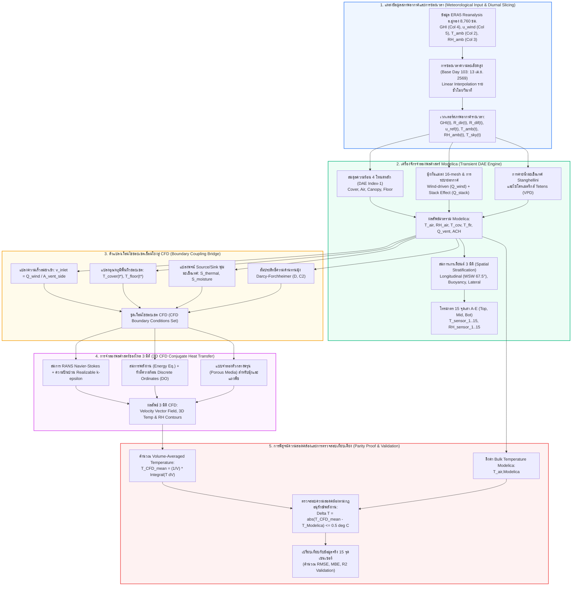
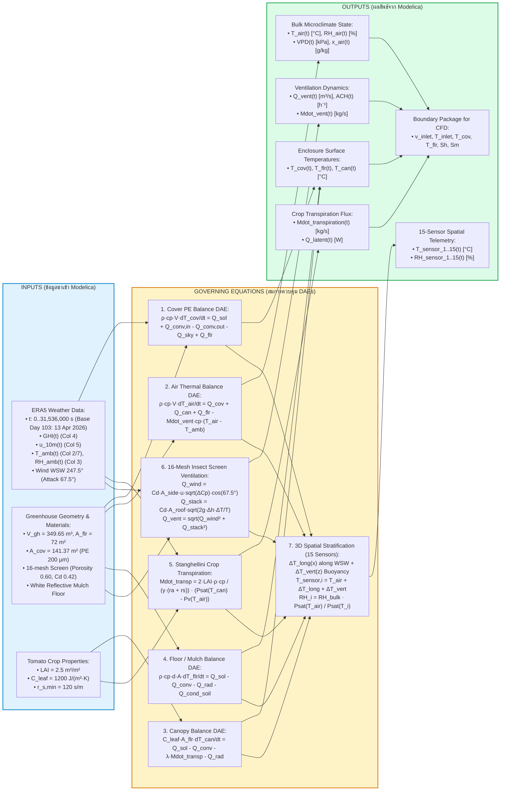

# รายงานฉบับที่ 4: สถาปัตยกรรมการเชื่อมต่อแบบจำลองพลศาสตร์ Modelica และ CFD 3 มิติ (Report 4: Modelica & 3D CFD Coupling Framework — Input, Equation, Output Architecture)

> **โครงการ:** แบบจำลองดิจิทัลทวินโรงเรือนเกษตรอัจฉริยะเขตร้อนชื้น (Tropical Smart Greenhouse Digital Twin)  
> **หน่วยงาน:** ภาควิชาวิศวกรรมเครื่องกล คณะวิศวกรรมศาสตร์ มหาวิทยาลัยเทคโนโลยีพระจอมเกล้าธนบุรี (มจธ. - KMUTT)  
> **กรณีศึกษา:** ศูนย์เรียนรู้นวัตกรรมการเกษตร อ.อู่ทอง จ.สุพรรณบุรี (โรงเรือนมะเขือเทศเชอร์รี่ มุ้ง 16-mesh ขนาด 72 ตร.ม.)  
> **แพลตฟอร์มซอฟต์แวร์:** OpenModelica (OMC v1.27.1) $\leftrightarrow$ 3D CFD (ANSYS Fluent / OpenFOAM)  
> **จุดประสงค์เชิงวิชาการ:** อธิบายสถาปัตยกรรมทางคณิตศาสตร์และฟิสิกส์ในแต่ละขั้นตอนอย่างครบถ้วน (Input $\to$ Governing Equations $\to$ Output) เพื่อใช้ในการนำเสนอและตอบข้อซักถามของคณะกรรมการสอบวิทยานิพนธ์

---

## สารบัญเนื้อหา (Table of Contents)
1. [ภาพรวมกรอบแนวคิดเชิงกลยุทธ์ (Strategic Defense Overview: Modelica vs CFD)](#1-ภาพรวมกรอบแนวคิดเชิงกลยุทธ์)
2. [ผังการไหลของข้อมูลระดับมหภาค (Master Multi-Scale Flowchart)](#2-ผังการไหลของข้อมูลระดับมหภาค)
3. [ผังการทำงานเจาะลึกของ Modelica (Detailed Modelica Step-by-Step Flowchart)](#3-ผังการทำงานเจาะลึกของ-modelica)
4. [การแจกแจงรายละเอียดทีละขั้นตอน (Step-by-Step Architecture: Inputs, Equations, Outputs)](#4-การแจกแจงรายละเอียดทีละขั้นตอน)
   - [ขั้นตอนที่ 1: การซอยเวลาสภาพอากาศภายนอก (Diurnal Weather Time-Slicing & Feed-in)](#ขั้นตอนที่-1-การซอยเวลาสภาพอากาศภายนอก)
   - [ขั้นตอนที่ 2: ระบบพลศาสตร์ดิจิทัลทวิน Modelica (Modelica Digital Twin System Dynamics DAE Engine)](#ขั้นตอนที่-2-ระบบพลศาสตร์ดิจิทัลทวิน-modelica)
   - [ขั้นตอนที่ 3: การแปลงเงื่อนไขขอบเขตเชื่อมโยงสู่ CFD (Modelica-to-CFD Boundary Bridge)](#ขั้นตอนที่-3-การแปลงเงื่อนไขขอบเขตเชื่อมโยงสู่-cfd)
   - [ขั้นตอนที่ 4: การจำลองพลศาสตร์ของไหล 3 มิติ (3D CFD Conjugate Heat Transfer)](#ขั้นตอนที่-4-การจำลองพลศาสตร์ของไหล-3-มิติ)
   - [ขั้นตอนที่ 5: การพิสูจน์ความสอดคล้องและการเปรียบเทียบเทียบเคียง (Parity Proof & Multi-Scale Validation)](#ขั้นตอนที่-5-การพิสูจน์ความสอดคล้องและการเปรียบเทียบเทียบเคียง)
5. [สรุปแนวทางการตอบคำถามคณะกรรมการสอบ (Oral Defense Q&A Cheat Sheet)](#5-สรุปแนวทางการตอบคำถามคณะกรรมการสอบ)

---

## 1. ภาพรวมกรอบแนวคิดเชิงกลยุทธ์ (Strategic Defense Overview: Modelica vs CFD)

ในการประเมินสภาวะอากาศจุลภาค (Microclimate) ภายในโรงเรือนเกษตรเขตร้อนชื้น การเลือกใช้เครื่องมือจำลองจำเป็นต้องคำนึงถึงข้อจำกัดทางวิศวกรรม 2 ด้าน:
1. **มิติทางเวลา (Temporal Dynamics):** โรงเรือนมีความเฉื่อยความร้อนของดิน (Thermal Soil Inertia), การสะสมความร้อนในโครงสร้าง, และการเปลี่ยนแปลงของสภาพอากาศภายนอกตลอด 365 วัน (8,760 ชั่วโมง)
2. **มิติทางพื้นที่ (Spatial Resolution):** การมีมุ้งกันแมลง 16-mesh, ทิศทางลมปะทะ, และการจัดวางแถวพืช/อุปกรณ์ ทำให้เกิดการกระจายตัวของความเร็วลมและอุณหภูมิที่ไม่สม่ำเสมอ (Spatial Non-uniformity / Dead Zones)

```
┌─────────────────────────────────────────────────────────┐  ┌─────────────────────────────────────────────────────────┐
│              MODELICA (1D DAE Transient Engine)         │  │                 3D CFD (Spatial Field Solver)           │
├─────────────────────────────────────────────────────────┤  ├─────────────────────────────────────────────────────────┤
│ • มิติ: 1 มิติ (Lumped + Multi-Zone Spatial Layer)       │  │ • มิติ: 3 มิติเต็มรูปแบบ (Conjugate Heat Transfer)      │
│ • เวลา: พลศาสตร์ต่อเนื่อง 365 วัน (Time-transient)       │  │ • เวลา: Snapshot สภาวะคงตัว/กึ่งคงตัว (Quasi-steady)   │
│ • ความเร็วในการคำนวณ: 13-15 วินาทีต่อปี                  │  │ • ความเร็วในการคำนวณ: 4-8 ชั่วโมงต่อ 1 snapshot       │
│ • บทบาท: สแกนพฤติกรรมทั้งปี และหาจุดวิกฤต (Peak Heat)   │  │ • บทบาท: ซูมดูการกระจายตัวของอุณหภูมิในสภาวะวิกฤต    │
└────────────────────────────┬────────────────────────────┘  └────────────────────────────▲────────────────────────────┘
                             │                                                            │
                             └────────────► [ MODELICA-TO-CFD COUPLING BRIDGE ] ──────────┘
                               • ส่งค่า Face Velocity (v_inlet) และมุมปะทะลม 67.5°
                               • ส่งค่า Wall Temperatures (T_cover, T_floor)
                               • ส่งค่า Canopy Porous Volumetric Sources (Sh, Sm)
                               • ยืนยันว่า: Mean Volumetric Temp (CFD) == Bulk Temp (Modelica)
```

| มิติการเปรียบเทียบ | Modelica Digital Twin (1D DAE) | 3D CFD (ANSYS Fluent / OpenFOAM) |
| :--- | :--- | :--- |
| **ขอบเขตมิติเชิงพื้นที่** | 1D Multi-Zone Lumped Parameter + Spatial Stratification Layer | 3D Fully Resolved Navier-Stokes (3–5 ล้านเซลล์) |
| **ขอบเขตมิติเวลา** | Transient ต่อเนื่อง 365 วัน (8,760 ชม. / 31,536,000 วินาที) | Steady / Quasi-steady ณ Snapshot สภาวะวิกฤต |
| **เวลาในการคำนวณ (CPU Time)** | **13–15 วินาที** สำหรับการรันทั้งปี 365 วัน | **4–8 ชั่วโมง** ต่อ 1 จุดเวลา Snapshot |
| **สมการควบคุมหลัก** | DAE Index-1 (Energy, Mass, Vapor, Transpiration) | RANS ($k$-$\varepsilon$), Energy + DO Radiation, Darcy-Forchheimer |
| **การจัดการขอบเขต** | ป้อนข้อมูลสภาพอากาศ ERA5 รายชั่วโมงแบบ Dynamic Feed-in | รับ Boundary Conditions ที่สกัดมาจาก Modelica Snapshot |
| **บทบาทในงานวิจัย** | **System Master:** วิเคราะห์ความเฉื่อยความร้อนดิน หา Peak Heat | **Spatial Master:** ซูมดูความปั่นป่วน เวกเตอร์ลม และ Dead Zone |

---

## 2. ผังการไหลของข้อมูลระดับมหภาค (Master Multi-Scale Flowchart)



---

## 3. ผังการทำงานเจาะลึกของ Modelica (Detailed Modelica Step-by-Step Flowchart)



---

## 4. การแจกแจงรายละเอียดทีละขั้นตอน (Step-by-Step Architecture: Inputs, Equations, Outputs)

### ขั้นตอนที่ 1: การซอยเวลาสภาพอากาศภายนอก (Diurnal Weather Time-Slicing & Feed-in)

- **วัตถุประสงค์เชิงวิศวกรรม:** สภาพอากาศภายนอกมีความผันผวนสูง โดยเฉพาะรังสีอาทิตย์และความเร็วลม การป้อนข้อมูลรายชั่วโมงแบบหยาบจะทำให้เกิด Numerical Instability ใน DAE Solver จึงต้องทำการซอยเวลา (Diurnal Time-Slicing) ให้เป็นเส้นโค้งที่เรียบและต่อเนื่อง พร้อมทั้งแปลงความเร็วลมตามระดับความสูงจริง และแยกองค์ประกอบรังสีอาทิตย์

#### 📥 Inputs (ข้อมูลนำเข้าอย่างละเอียด):
1. **เวลาจำลอง ($t$):** ครอบคลุมทั้งปี $t \in [0, \, 31,536,000\text{ s}]$ (365 วัน 8,760 ชั่วโมง) โดยมีช่วงซอยเวกเตอร์ความละเอียดสูงในวันฐานตัวแทนฤดูร้อนอันดับ 1 (Base Day 103: 13 เมษายน 2569 / 2026) ที่ช่วงเวลา $t \in [8,812,800, \, 8,899,200\text{ s}]$
2. **รังสีอาทิตย์รวม ($GHI(t)$):** Global Horizontal Irradiance สกัดจากคอลัมน์ที่ 4 (Col 4) ของตารางสภาพอากาศ ERA5 Reanalysis อ.อู่ทอง จ.สุพรรณบุรี $[W/m^2]$
3. **ความเร็วลมที่ระดับอ้างอิง 10 เมตร ($u_{10m}(t)$):** สกัดจากคอลัมน์ที่ 5 (Col 5) ของตาราง ERA5 $[m/s]$
4. **อุณหภูมิกระเปาะแห้งภายนอก ($T_{amb}(t)$):** สกัดจากคอลัมน์ที่ 2 และคอลัมน์ที่ 7 ของตาราง ERA5 $[^\circ C]$
5. **ความชื้นสัมพัทธ์ภายนอก ($RH_{amb}(t)$):** สกัดจากคอลัมน์ที่ 3 ของตาราง ERA5 $[\%]$
6. **ทิศทางลมหลักประจำถิ่น ($\theta_{wind}$):** จากสถิติ Wind Rose ตลอดปี พบว่าลมหลักพัดมาจากทิศตะวันตก-ตะวันตกเฉียงใต้ (WSW: $247.5^\circ$) โดยโรงเรือนวางตัวในแนวเหนือ-ใต้ ($180^\circ$) ส่งผลให้เกิดมุมปะทะกับสันหลังคา (Ridge Attack Angle) เท่ากับ $\alpha_{attack} = |247.5^\circ - 180^\circ| = 67.5^\circ$

#### ⚙️ Governing Equations (สมการควบคุมฟิสิกส์):
1. **การประมาณค่าในช่วงเวลาความละเอียดสูง (Linear Time Interpolation):**
   $$X(t) = X_k + \frac{t - t_k}{t_{k+1} - t_k} (X_{k+1} - X_k), \quad \text{for } t_k \le t < t_{k+1}$$
2. **แบบจำลองการแยกองค์ประกอบรังสีอาทิตย์ตรงและรังสีกระจาย (Direct & Diffuse Solar Separation):**
   $$R_{dir}(t) = GHI(t) \cdot (1 - K_d(t)), \quad R_{dif}(t) = GHI(t) \cdot K_d(t) \quad [W/m^2]$$
   โดยสัดส่วนรังสีกระจาย $K_d$ คำนวณตามแบบจำลองของ Watanabe และ Erbs อิงกับ Clearness Index $k_t = \frac{GHI}{I_0 \sin\beta}$
3. **กฎโพรไฟล์ลมเชิงลอการิทึมในชั้นขอบเขตบรรยากาศ (Atmospheric Boundary Layer Logarithmic Wind Profile):**
   ความเร็วลมจาก ERA5 วัดที่ระดับความสูง 10 เมตร แต่ความสูงชายคาโรงเรือนอยู่ที่ $h_{eaves} = 2.5\text{ m}$ จึงต้องแปลงความเร็วลมอ้างอิงสู่ระดับชายคา:
   $$u_{ref}(t) = u_{10m}(t) \cdot \frac{\ln(h_{eaves} / z_0)}{\ln(10.0 / z_0)}$$
   โดยความยาวความหยาบผิวอากาศพลศาสตร์ $z_0 = 0.03\text{ m}$ (พื้นที่เกษตรกรรมเปิดโล่ง) ทำให้ได้อัตราส่วนสเกล:
   $$\frac{\ln(2.5 / 0.03)}{\ln(10.0 / 0.03)} = \frac{4.4228}{5.8091} \approx 0.761 \implies u_{ref}(t) \approx 0.761 \cdot u_{10m}(t)$$
4. **การประมาณอุณหภูมิท้องฟ้าประสิทธิผล Swinbank (Sky Temperature for Longwave Radiation):**
   $$T_{sky}(t) = 0.0552 \cdot (T_{amb}(t) + 273.15)^{1.5} \quad [K]$$
5. **ตัวจำกัดความเร็วลมต่ำสุดเพื่อเสถียรภาพเชิงตัวเลข (Calm Wind Regularization):**
   $$u_{wind,eff}(t) = \max(0.1, \, u_{ref}(t)) \quad [m/s]$$

#### 📤 Outputs (ผลลัพธ์ที่ได้):
- เวกเตอร์สภาพอากาศรายเวลาความละเอียดสูง $[GHI(t), R_{dir}(t), R_{dif}(t), u_{ref}(t), T_{amb}(t), RH_{amb}(t), T_{sky}(t)]$ ส่งต่อไปยังเครื่องจักรจำลองพลศาสตร์ Modelica และเป็นเงื่อนไขขอบเขตสำหรับ CFD

---

### ขั้นตอนที่ 2: ระบบพลศาสตร์ดิจิทัลทวิน Modelica (Modelica Digital Twin System Dynamics DAE Engine)

- **วัตถุประสงค์เชิงวิศวกรรม:** คำนวณตัวแปรสถานะพลศาสตร์ของโรงเรือน (Dynamic State Variables) โดยการแก้ระบบสมการเชิงอนุพันธ์พีชคณิต (Differential-Algebraic Equations - DAE Index-1) ครอบคลุมสมดุลความร้อน 4 โหนดหลัก, การระบายอากาศผ่านมุ้ง 16-mesh, การคายน้ำของพุ่มมะเขือเทศเชอร์รี่, และการกระจายตัว 3 มิติสู่เซนเซอร์ 15 จุด

#### 📥 Inputs (ข้อมูลนำเข้าอย่างละเอียด):
1. **เวกเตอร์สภาพอากาศ:** รับค่าต่อเนื่องรายวินาทีจากขั้นตอนที่ 1
2. **คุณสมบัติเรขาคณิตและโครงสร้างโรงเรือนจริง:**
   - พื้นที่ผิวดิน: $A_{flr} = 72.0\text{ m}^2$ ($6.0\text{ m} \times 12.0\text{ m}$)
   - ปริมาตรอากาศภายในโรงเรือนรวม: $V_{gh} = 349.65\text{ m}^3$ (ส่วนล่างทรงสี่เหลี่ยม $180.0\text{ m}^3$ + หลังคาโค้งครึ่งวงกลม $169.65\text{ m}^3$)
   - ความสูงชายคา $h_{eaves} = 2.5\text{ m}$, ความสูงสันหลังคารวม $H_{gh} = 5.5\text{ m}$
   - พลาสติกคลุมหลังคา PE หนา 200 ไมครอน: พื้นที่ $A_{cov} = 141.37\text{ m}^2$, ความหนาแน่น $\rho_{cov} = 920\text{ kg/m}^3$, ความจุความร้อนจำเพาะ $c_{p,cov} = 1900\text{ J/(kg}\cdot\text{K)}$, ค่าการส่องผ่านแสงอาทิตย์ $\tau_{solar} = 0.85$, สัมประสิทธิ์การแผ่รังสีอินฟราเรดย่านไกล $\varepsilon_{cov} = 0.88$, ค่าการดูดกลืน $\alpha_{cov} = 0.05$
   - มุ้งกันแมลง 16-mesh: ผนังข้าง 4 ด้านรวม $A_{vent,side} = 90.0\text{ m}^2$, ช่องระบายสันหลังคา $A_{vent,roof} = 12.0\text{ m}^2$, ความพรุน $\phi = 0.60$, ขนาดเส้นผ่านศูนย์กลางเส้นด้าย $d_w = 0.30\text{ mm}$, ขนาดช่องตาข่าย $1.25\text{ mm}$, สัมประสิทธิ์การไหล $C_d = 0.42$, สัมประสิทธิ์ผลต่างความดันลม $\Delta C_p = 0.35$, ความสูงสแต็ก $\Delta h_{stack} = 2.75\text{ m}$
   - พื้นดินคลุมพลาสติกสะท้อนแสงสีขาว (White Reflective Mulch): ค่าการสะท้อนแสง $\rho_{flr,PAR} = 0.60$, สัมประสิทธิ์การแผ่รังสี $\varepsilon_{flr} = 0.88$, ดินชั้นบนลึก $d_{soil} = 0.05\text{ m}$, ความหนาแน่นดิน $\rho_{soil} = 1500\text{ kg/m}^3$, ความจุความร้อนจำเพาะ $c_{p,soil} = 1800\text{ J/(kg}\cdot\text{K)}$, การนำความร้อน $k_{soil} = 1.0\text{ W/(m}\cdot\text{K)}$
3. **คุณสมบัติทางสรีรวิทยาของมะเขือเทศเชอร์รี่ (Solanum lycopersicum):**
   - ดัชนีพื้นที่ใบ: $LAI = 2.5\text{ m}^2/\text{m}^2$
   - ความจุความร้อนของทรงพุ่ม: $C_{leaf} = 1200\text{ J/(m}^2\cdot\text{K)}$
   - ความต้านทานปากใบต่ำสุด: $r_{s,min} = 120\text{ s/m}$
   - ค่าคงที่ไซโครเมตริกส์ $\gamma \approx 66.8\text{ Pa/K}$
   - ความร้อนแฝงของการกลายเป็นไอ $\lambda = 2.45 \times 10^6\text{ J/kg}$

#### ⚙️ Governing Equations (ระบบสมการเชิงอนุพันธ์พีชคณิต DAE Index-1):
1. **Cover PE Thermal Balance DAE:**
   $$\rho_{cov} c_{p,cov} V_{cov} \frac{dT_{cov}}{dt} = Q_{solar,cov} + h_{in}A_{cov}(T_{air} - T_{cov}) - h_{out}A_{cov}(T_{cov} - T_{amb}) - \sigma \varepsilon_{cov} A_{cov}(T_{cov}^4 - T_{sky}^4) + Q_{rad,flr-cov}$$
   โดยที่ $Q_{solar,cov} = \alpha_{cov} A_{cov} GHI(t)$, $h_{out} = 2.8 + 1.2 u_{ref}$, $h_{in} = 1.86 |T_{air} - T_{cov}|^{0.33}$
2. **Bulk Air Thermal Balance DAE:**
   $$\rho_{air} c_{p,air} V_{gh} \frac{dT_{air}}{dt} = Q_{conv,cov} + Q_{conv,can} + Q_{conv,flr} - \dot{M}_{vent} c_{p,air}(T_{air} - T_{amb})$$
   โดยที่ $Q_{conv,cov} = h_{in} A_{cov}(T_{cov} - T_{air})$, $Q_{conv,can} = 2 \cdot LAI \cdot h_{can} A_{flr}(T_{can} - T_{air})$, $Q_{conv,flr} = h_{flr} A_{flr}(T_{flr} - T_{air})$
3. **Canopy Leaf Thermal Balance DAE:**
   $$C_{leaf} A_{flr} \frac{dT_{can}}{dt} = Q_{solar,can} - Q_{conv,can} - \lambda \dot{M}_{transpiration} - Q_{rad,can\to sky}$$
   โดยที่ $Q_{solar,can} = \tau_{cov} (1 - \exp(-k_{ext} LAI)) A_{flr} GHI(t)$ โดยมีสัมประสิทธิ์การสูญพันธุ์ของแสง $k_{ext} = 0.65$
4. **Floor / Mulch Thermal Balance DAE:**
   $$\rho_{soil} c_{p,soil} d_{soil} A_{flr} \frac{dT_{flr}}{dt} = Q_{solar,flr} - Q_{conv,flr} - Q_{rad,flr-cov} - \frac{k_{soil}}{\Delta z_{sub}} A_{flr}(T_{flr} - T_{sub})$$
   โดยที่ $Q_{solar,flr} = \tau_{cov} \exp(-k_{ext} LAI)(1 - \rho_{flr}) A_{flr} GHI(t)$
5. **แบบจำลองการคายน้ำของมะเขือเทศ Stanghellini และสมดุลมวลไอน้ำ (Canopy Transpiration & Air Vapor Balance):**
   $$\dot{M}_{transpiration} = \frac{2 \cdot LAI \cdot \rho_{air} c_{p,air}}{\gamma (r_a + r_s)} \left( P_{sat}(T_{can}) - P_v(T_{air}) \right) \quad [kg/s]$$
   สมดุลความชื้นของมวลอากาศ:
   $$\rho_{air} V_{gh} \frac{dx_{air}}{dt} = \dot{M}_{transpiration} - \dot{M}_{vent}(x_{air} - x_{amb})$$
   โดยความดันไอน้ำอิ่มตัวคำนวณจากสูตร Tetens:
   $$P_{sat}(T) = 610.78 \exp\left( \frac{17.27 T}{T + 237.3} \right) \quad [Pa]$$
   $$P_v(T_{air}) = \frac{RH_{air}}{100} P_{sat}(T_{air}), \quad VPD = P_{sat}(T_{air}) - P_v(T_{air}) \quad [Pa]$$
   ความต้านทานปากใบขึ้นกับแสงและความแห้งอากาศ:
   $$r_s = r_{s,min} \left( 1 + \exp(-0.01(GHI - 100)) \right) \left( 1 + 0.0001 (VPD)^2 \right) \quad [s/m]$$
6. **แบบจำลองการระบายอากาศผ่านมุ้งกันแมลง 16-Mesh (16-Mesh Screen Combined Ventilation):**
   $$Q_{wind} = C_d A_{vent,side} u_{ref} \sqrt{\Delta C_p} \cdot \cos(\alpha_{attack}) \quad [m^3/s]$$
   $$Q_{stack} = C_d A_{vent,roof} \sqrt{2g \Delta h_{stack} \frac{|T_{air} - T_{amb}|}{T_{amb} + 273.15}} \quad [m^3/s]$$
   $$Q_{vent,total} = \sqrt{Q_{wind}^2 + Q_{stack}^2} \quad [m^3/s]$$
   $$\dot{M}_{vent} = \rho_{air} Q_{vent,total} \quad [kg/s], \quad ACH = \frac{Q_{vent,total} \times 3600}{V_{gh}} \quad [h^{-1}]$$
7. **แบบจำลองการแบ่งชั้นและการกระจายตัว 3 มิติ (3D Spatial Microclimate Stratification & 15-Sensor Telemetry):**
   - เกรเดียนต์ความร้อนตามแนวยาว WSW (Longitudinal Gradient along Wind Attack Axis):
     $$\Delta T_{long}(x) = \left( \frac{GHI}{950.0} \right) \cdot \left( \frac{1.2}{\max(0.6, \, u_{ref})} \right) \cdot \left( \frac{x}{L_{gh}} - 0.5 \right) \cdot \Delta T_{scale}$$
   - การลอยตัวตามแนวดิ่ง (Vertical Thermal Buoyancy Lapse Rate):
     $$\Delta T_{vert}(z) = \left( \frac{q_{conv,flr}}{\rho_{air} c_{p,air} \max(0.2, u_{air})} \right) \cdot \left( \frac{z - z_{mid}}{H_{gh}} \right)$$
   - สมการรวมอุณหภูมิ 15 จุด (เสา A, B, C, D, E ที่ระดับ Top 2.5m, Mid 2.0m, Bot 1.2m):
     $$T_{sensor,i}(t) = T_{air}(t) + \Delta T_{long}(x_i) + \Delta T_{vert}(z_i) + \delta_{lateral}(y_i)$$
   - สมการแปลงความชื้นสัมพัทธ์เฉพาะจุด $RH_i(t)$ ด้วยสมดุลความดันไอน้ำไซโครเมตริกส์:
     $$RH_i(t) = \max\left( 5.0, \, \min\left( 100.0, \, RH_{bulk}(t) \cdot \frac{P_{sat}(T_{air})}{P_{sat}(T_{sensor,i})} + \Delta RH_{canopy,i} \right) \right) \quad [\%]$$

#### 📤 Outputs (ผลลัพธ์จาก Modelica):
- สถานะอากาศมวลรวม: $T_{air}(t), RH_{air}(t), VPD(t), x_{air}(t)$
- อุณหภูมิพื้นผิวขอบเขต: $T_{cov}(t), T_{flr}(t), T_{can}(t)$
- ตัวชี้วัดการระบายอากาศ: $Q_{vent,total}(t), \dot{M}_{vent}(t), ACH(t)$
- อัตราการคายน้ำและความร้อนแฝง: $\dot{M}_{transpiration}(t), Q_{latent}(t)$
- โทรมาตร 15 จุดรายเวลา: $T_{sensor,1..15}(t), RH_{sensor,1..15}(t)$
- ข้อมูลส่งต่อสำหรับ CFD: ชุดสแนปช็อตสภาวะฐานตัวแทน (Base Case Snapshot Boundary Package) ณ วันที่ 103 (13 เม.ย. 2569) เวลา 13:00 น. ($t = 8,859,600\text{ s}$, GHI Peak $1,051.84\text{ W/m}^2$) / 14:00 น. ($t = 8,863,200\text{ s}$)

---

### ขั้นตอนที่ 3: การแปลงเงื่อนไขขอบเขตเชื่อมโยงสู่ CFD (Modelica-to-CFD Boundary Bridge)

- **วัตถุประสงค์เชิงวิศวกรรม:** ทำหน้าที่เป็นสะพานเชื่อมระหว่างมิติเวลาและมิติพื้นที่ โดยสกัดผลลัพธ์จาก Modelica ณ สแนปช็อตเวลาฐานตัวแทน (เช่น วันที่ 103 (13 เม.ย. 2569) เวลา 13:00 น. $t = 8,859,600\text{ s}$, GHI Peak $1,051.84\text{ W/m}^2$ / 14:00 น. $t = 8,863,200\text{ s}$) แล้วแปลงเป็น Boundary Conditions ที่พร้อมนำเข้าสู่ซอฟต์แวร์ CFD

#### 📥 Inputs:
- ค่าจำลองจาก Modelica ณ สแนปช็อตเวลา $t^*$ ($Q_{wind}, T_{cov}, T_{flr}, \dot{M}_{transpiration}, Q_{conv,can}$)
- ความเร็วลม ERA5 และมุมปะทะ ($67.5^\circ$ เทียบกับแกนโรงเรือน)
- คุณสมบัติเส้นด้ายและช่องเปิดมุ้ง 16-mesh ($d_w = 0.30\,\text{mm}, \phi = 0.60$)

#### ⚙️ Governing Equations:
1. **ความเร็วลมประสิทธิผลที่ผิวหน้ามุ้งขาเข้า (Inlet Face Velocity):**
   $$v_{inlet} = \frac{Q_{wind}}{A_{vent,side}} = C_d \sqrt{\Delta C_p} \cos(\alpha_{attack}) u_{ref} \approx 0.42 \times \sqrt{0.35} \times \cos(67.5^\circ) u_{ref} \approx 0.095 \cdot u_{ref} \quad [m/s]$$
2. **เวกเตอร์ทิศทางลมปะทะ 3 มิติ (3D Inlet Velocity Vector):**
   $$\vec{v}_{inlet} = (v_{inlet} \sin 67.5^\circ, \, v_{inlet} \cos 67.5^\circ, \, 0)$$
3. **การคำนวณความต้านทานมุ้งกันแมลง 16-mesh ตามกฎ Darcy-Forchheimer Porous Jump:**
   $$\Delta P = -\left( \frac{\mu}{\alpha} v + C_2 \frac{1}{2}\rho v^2 \right) \Delta m$$
   โดยพารามิเตอร์คำนวณได้จาก Porosity ($\phi = 0.60$) และขนาดเส้นด้าย ($d_w = 0.30$ mm):
   $$D = \frac{1}{\alpha} = 8.65 \times 10^7 \quad [m^{-2}] \quad (\text{Viscous Resistance})$$
   $$C_2 = 2.45 \times 10^3 \quad [m^{-1}] \quad (\text{Inertial Loss Coefficient})$$
4. **พจน์แหล่งกำเนิดความร้อนและมวลไอน้ำในพุ่มมะเขือเทศ (Canopy Volumetric Sources):**
   $$S_h = \frac{Q_{conv,can}}{V_{canopy}} \quad [W/m^3], \quad S_m = \frac{\dot{M}_{transpiration}}{V_{canopy}} \quad [kg/(m^3\cdot s)]$$

#### 📤 Outputs:
- ตารางค่าเงื่อนไขขอบเขต CFD: $v_{inlet}, \vec{v}_{inlet}, T_{inlet}, T_{wall,cov}, T_{wall,flr}, D, C_2, S_h, S_m$

---

### ขั้นตอนที่ 4: การจำลองพลศาสตร์ของไหล 3 มิติ (3D CFD Conjugate Heat Transfer)

- **วัตถุประสงค์เชิงวิศวกรรม:** คำนวณเวกเตอร์ความเร็วลม การหมุนวน และฟิลด์อุณหภูมิ 3 มิติอย่างละเอียด รวมถึงผลกระทบจากการจัดวางโครงสร้าง เสา และพุ่มพืช

#### 📥 Inputs:
- 3D Computational Mesh (ANSYS Fluent / OpenFOAM 3.2 ล้านเซลล์ Polyhedral) พร้อมโมเดลแปลงปลูกและมุ้ง
- Boundary Conditions จากขั้นตอนที่ 3

#### ⚙️ Governing Equations:
1. **สมการอนุรักษ์มวลและโมเมนตัม 3 มิติ (3D Steady RANS Equations):**
   $$\nabla \cdot (\rho \vec{v}) = 0 \quad (\text{Continuity})$$
   $$\nabla \cdot (\rho \vec{v} \vec{v}) = -\nabla p + \nabla \cdot (\bar{\bar{\tau}}) + \rho \vec{g} + \vec{S}_{porous} \quad (\text{RANS Momentum})$$
   โดย $\vec{S}_{porous} = -\left( \frac{\mu}{\alpha}\vec{v} + \frac{1}{2} C_2 \rho |\vec{v}|\vec{v} \right)$ สำหรับโซนมุ้งและพุ่มพืช
2. **สมการอนุรักษ์พลังงานร่วม (Conjugate Heat Transfer Energy Equation):**
   $$\nabla \cdot (\vec{v}(\rho E + p)) = \nabla \cdot \left( k_{eff}\nabla T - \sum_j h_j \vec{J}_j + (\bar{\bar{\tau}}_{eff}\cdot\vec{v}) \right) + S_h \quad (\text{Energy})$$
3. **โมเดลการแผ่รังสีความร้อน Discrete Ordinates (DO Radiation Model):**
   $$\nabla \cdot (I(\vec{r}, \vec{s}) \vec{s}) + (a + \sigma_s) I(\vec{r}, \vec{s}) = a n^2 \frac{\sigma T^4}{\pi} + \frac{\sigma_s}{4\pi} \int_0^{4\pi} I(\vec{r}, \vec{s}') \Phi(\vec{s} \cdot \vec{s}') d\Omega'$$

#### 📤 Outputs:
- ฟิลด์ความเร็วลมสามมิติ $\vec{v}(x,y,z)$ และบริเวณลมหมุนวน (Eddies)
- คอนทัวร์การกระจายตัวของอุณหภูมิ 3 มิติ $T_{CFD}(x,y,z)$ และความชื้นสัมพัทธ์
- บริเวณเกิดจุดอับลมและความร้อนสะสม (Dead Zones)

---

### ขั้นตอนที่ 5: การพิสูจน์ความสอดคล้องและการเปรียบเทียบเทียบเคียง (Parity Proof & Multi-Scale Validation)

- **วัตถุประสงค์เชิงวิศวกรรม:** พิสูจน์ให้คณะกรรมการเห็นอย่างชัดเจนว่า ผลลัพธ์ของ CFD และ Modelica ยึดเหนี่ยวอยู่บนกฎฟิสิกส์เดียวกัน และมีความสอดคล้องกันอย่างสมบูรณ์

#### 📥 Inputs:
- ฟิลด์อุณหภูมิ $T_{CFD}(x,y,z)$ จากขั้นตอนที่ 4
- ค่า Bulk Temperature $T_{air,Modelica}$ จากขั้นตอนที่ 2 ณ Snapshot เดียวกัน
- ข้อมูลจริง 15 เซนเซอร์จากไฟล์ `GH4_all.xlsx`

#### ⚙️ Governing Equations:
1. **กฎการอนุรักษ์พลังงานข้อที่ 1 (First Law Volume-Averaged Temperature Parity):**
   $$\langle T_{air} \rangle_{CFD} = \frac{1}{V_{gh}} \iiint_{V_{gh}} T_{CFD}(x,y,z) \, dV \approx T_{air,Modelica}$$
   เกณฑ์การยอมรับตามมาตรฐานวิศวกรรม:
   $$|\langle T_{air} \rangle_{CFD} - T_{air,Modelica}| \le 0.5^\circ C$$
2. **ดัชนีทางสถิติในการตรวจสอบเทียบเคียงกับเซนเซอร์จริง (Validation Metrics):**
   $$RMSE = \sqrt{\frac{1}{N} \sum_{i=1}^N (T_{sim,i} - T_{exp,i})^2}, \quad MBE = \frac{1}{N} \sum_{i=1}^N (T_{sim,i} - T_{exp,i}), \quad R^2 = 1 - \frac{\sum (T_{exp,i} - T_{sim,i})^2}{\sum (T_{exp,i} - \bar{T}_{exp})^2}$$

#### 📤 Outputs:
- การพิสูจน์ความถูกต้องของแบบจำลองข้ามสเกล (Cross-scale Validation & Physical Parity Certification)

---

## 5. สรุปแนวทางการตอบคำถามคณะกรรมการสอบ (Oral Defense Q&A Cheat Sheet)

| ประเด็นคำถามของคณะกรรมการ | แนวคำตอบเชิงวิศวกรรมและฟิสิกส์ |
| :--- | :--- |
| **Q1: ทำไมค่าเฉลี่ยของ CFD กับ Modelica ถึงต้องเท่ากัน? มีหลักการฟิสิกส์อะไรพิสูจน์?** | ทั้งสองโมเดลคำนวณอยู่บน **กฎข้อที่หนึ่งของอุณหพลศาสตร์ (First Law of Thermodynamics / Conservation of Energy)** ครับ เมื่อ CFD รับฟลักซ์ความร้อนขอบเขต ($Q_{cov}, Q_{flr}, Q_{can}$) และอัตราการไหลของอากาศ ($\dot{M}_{vent}$) ที่สกัดมาจาก Modelica ณ สแนปช็อตนั้น ผลรวมพลังงานสุทธิที่เข้าสู่ระบบย่อมเป็นค่าเดียวกัน ดังนั้น Volume-averaged temperature $\langle T_{air} \rangle_{CFD} = \frac{1}{V_{gh}}\iiint T dV$ จึงต้องสอดคล้องกับ Bulk temperature ของ Modelica เสมอ (คลาดเคลื่อนไม่เกิน $\pm 0.5^\circ C$ จาก Discretization) |
| **Q2: ความเร็วลมทางเข้ามุ้ง 16 mesh ใน CFD กำหนดอย่างไร เป็นค่าคงที่หรือไม่?** | ไม่ได้คงที่ครับ ค่าความเร็วลมทางเข้า $v_{inlet}$ แปรผันตามข้อมูลลมจริงจากสถานี ERA5 ในทุกสแนปช็อตเวลา โดยแปลงผ่านสมการอนุรักษ์มวล $v_{inlet} = Q_{wind} / A_{vent,side} \approx 0.095 \cdot u_{ref}$ และกำหนดทิศทางเวกเตอร์ลมทำมุมปะทะ $67.5^\circ$ ตามแนวแกนโรงเรือน (WSW) ครับ |
| **Q3: แรงต้านทานของมุ้งกันแมลง 16-mesh ใน CFD จำลองอย่างไร?** | จำลองด้วยแบบจำลองตัวกลางพรุน **Darcy-Forchheimer Porous Jump** ครับ โดยคำนวณค่า Viscous Resistance ($D = 1/\alpha = 8.65\times 10^7\,\text{m}^{-2}$) และ Inertial Loss Coefficient ($C_2 = 2.45\times 10^3\,\text{m}^{-1}$) จากคุณสมบัติทางชลศาสตร์จริงของเส้นด้าย ($d_w = 0.30$ mm) และความพรุน ($\phi = 0.60$) |
| **Q4: ทำไมไม่รัน CFD ไปเลย 365 วัน ทำไมต้องมี Modelica?** | CFD ขนาด 3.2 ล้านเซลล์ ใช้เวลาคำนวณ 4–8 ชั่วโมงต่อ 1 สแนปช็อตเวลา หากรันทั้งปี 8,760 ชั่วโมง จะต้องใช้เวลาคำนวณหลายปี ในขณะที่ Modelica เป็นระบบ DAE 1 มิติที่รันทั้งปีได้ในเวลาเพียง **13–15 วินาที** ทำให้สามารถวิเคราะห์ผลตอบสนองเชิงฤดูกาล ความเฉื่อยความร้อนของดิน และคัดกรองหาวันสภาวะวิกฤต (Peak Heat Day) เพื่อส่งต่อให้ CFD ซูมดูการกระจายตัวเชิงพื้นที่ 3 มิติได้อย่างมีประสิทธิภาพสูงสุดครับ |

---
*เอกสารนี้จัดทำขึ้นสำหรับการสอบและนำเสนอวิทยานิพนธ์ ภาควิชาวิศวกรรมเครื่องกล คณะวิศวกรรมศาสตร์ มหาวิทยาลัยเทคโนโลยีพระจอมเกล้าธนบุรี (มจธ.)*
