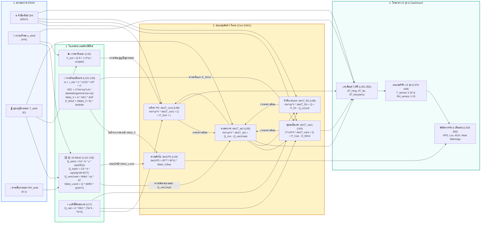

# รายงานฉบับที่ 5: คู่มืออ้างอิงสมการ คุณสมบัติวัสดุ และพารามิเตอร์แบบจำลอง Modelica (Report 5: Modelica Equations, Materials & Parameters Reference Manual)

> **โครงการ:** แบบจำลองดิจิทัลทวินโรงเรือนเกษตรอัจฉริยะเขตร้อนชื้น (Tropical Smart Greenhouse Digital Twin)  
> **หน่วยงาน:** ภาควิชาวิศวกรรมเครื่องกล คณะวิศวกรรมศาสตร์ มหาวิทยาลัยเทคโนโลยีพระจอมเกล้าธนบุรี (มจธ. - KMUTT)  
> **กรณีศึกษา:** ศูนย์เรียนรู้นวัตกรรมการเกษตร อ.อู่ทอง จ.สุพรรณบุรี (โรงเรือนมะเขือเทศเชอร์รี่ มุ้ง 16-mesh ขนาด 72 ตร.ม.)  
> **แพลตฟอร์มซอฟต์แวร์:** OpenModelica (OMEdit / OMC v1.27.1) + Modelica Standard Library (v4.0.0) + Greenhouses Library (v1.0)  
> **วัตถุประสงค์เชิงวิชาการ:** รวบรวมและแจกแจงสมการคณิตศาสตร์ทั้งหมดที่ใช้ในโค้ด Modelica อย่างเป็นระบบ ระบุเลขบรรทัดจริงในโค้ด ความหมายทางฟิสิกส์ วัตถุประสงค์การใช้งาน พร้อมตารางคุณสมบัติวัสดุ พืชพรรณ และโครงสร้างโรงเรือนที่ป้อนเข้าสู่แบบจำลองอย่างครบถ้วน

---

## สารบัญเนื้อหา (Table of Contents)
1. [ตารางคุณสมบัติวัสดุ พืชพรรณ และโครงสร้างโรงเรือน (Materials, Crop & Physical Properties)](#1-ตารางคุณสมบัติวัสดุ-พืชพรรณ-และโครงสร้างโรงเรือน)
   - [1.1 พลาสติกคลุมหลังคา PE 200 ไมครอน (Roof Cover PE Film)](#11-พลาสติกคลุมหลังคา-pe-200-ไมครอน)
   - [1.2 ผนังมุ้งกันแมลง 16-Mesh (Insect Screen Walls & Natural Ventilation)](#12-ผนังมุ้งกันแมลง-16-mesh)
   - [1.3 พืชเป้าหมาย: มะเขือเทศเชอร์รี่ (Cherry Tomato Canopy Properties)](#13-พืชเป้าหมาย-มะเขือเทศเชอร์รี่)
   - [1.4 ผิวดินคลุมพลาสติกสีขาวสะท้อนแสง (White Reflective Plastic Mulch & Soil)](#14-ผิวดินคลุมพลาสติกสีขาวสะท้อนแสง)
   - [1.5 มวลอากาศและเรขาคณิตโรงเรือน (Interior Air Zone & Greenhouse Geometry)](#15-มวลอากาศและเรขาคณิตโรงเรือน)
2. [ดัชนีสมการควบคุมหลักใน Modelica (Detailed Governing Equations Directory)](#2-ดัชนีสมการควบคุมหลักใน-modelica)
   - [หมวดที่ 1: ระบบสมดุลพลังงานและมวล 4 โหนดหลัก (DAE Index-1 System)](#หมวดที่-1-ระบบสมดุลพลังงานและมวล-4-โหนดหลัก)
   - [หมวดที่ 2: แบบจำลองการระบายอากาศมุ้งกันแมลง 16-Mesh (InsectScreen_16Mesh.mo)](#หมวดที่-2-แบบจำลองการระบายอากาศมุ้งกันแมลง-16-mesh)
   - [หมวดที่ 3: แบบจำลองการคายน้ำของมะเขือเทศเชอร์รี่ Stanghellini (MV_CanopyTranspiration.mo)](#หมวดที่-3-แบบจำลองการคายน้ำของมะเขือเทศเชอร์รี่-stanghellini)
   - [หมวดที่ 4: กลไกการถ่ายโอนความร้อน (Convection, Radiation, Conduction)](#หมวดที่-4-กลไกการถ่ายโอนความร้อน)
   - [หมวดที่ 5: แบบจำลองการกระจายตัว 3 มิติและโทรมาตร 15 จุด (Spatial Telemetry Layer)](#หมวดที่-5-แบบจำลองการกระจายตัว-3-มิติและโทรมาตร-15-จุด)
3. [แผนภูมิความสัมพันธ์ระหว่างตัวแปรและสมการ (Equation Network & Variable Dependency)](#3-แผนภูมิความสัมพันธ์ระหว่างตัวแปรและสมการ)

---

## 1. ตารางคุณสมบัติวัสดุ พืชพรรณ และโครงสร้างโรงเรือน

### 1.1 พลาสติกคลุมหลังคา PE 200 ไมครอน
* **ชื่อวัสดุ:** แผ่นฟิล์มพลาสติกพอลิเอทิลีนโปร่งแสง (Translucent Polyethylene Film - PE Cover)
* **การใช้งานในโมเดล:** ห่อหุ้มโครงหลังคาโค้งทรงกระบอกครึ่งวงกลม (Semicircular Barrel Vault Roof) และหน้าจั่วหัวท้าย

| พารามิเตอร์ในโค้ด | คำอธิบายคุณสมบัติ | ค่าที่กำหนด | หน่วย | แหล่งที่มา / เหตุผลเชิงวิศวกรรม |
| :--- | :--- | :--- | :--- | :--- |
| `rho_cover` | ความหนาแน่นของฟิล์ม PE | `920.0` | $\text{kg/m}^3$ | มาตรฐานวัสดุ LDPE สำหรับโรงเรือนเกษตร |
| `cp_cover` | ความจุความร้อนจำเพาะของ PE | `1900.0` | $\text{J/(kg}\cdot\text{K)}$ | คุณสมบัติทางความร้อนมาตรฐานพอลิเอทิลีน |
| `h_cover` | ความหนาของแผ่นฟิล์มพลาสติก | `200e-6` | $\text{m}$ ($200\,\mu\text{m}$) | ความหนาจริงที่ติดตั้งในโรงเรือน อ.อู่ทอง |
| `phi_roof` | มุมเอียงหลังคาประสิทธิผล | `1.036` | $\text{rad}$ ($59.36^\circ$) | คำนวณจากเรขาคณิตหลังคาโค้งรัศมี $R=3\,\text{m}$ |
| `tau_cover_solar` | สัมประสิทธิ์การส่องผ่านรังสีอาทิตย์ | `0.85` | - (85%) | การส่องผ่านรังสีคลื่นสั้นช่วงแสงอาทิตย์ |
| `epsilon_cover_FIR` | สัมประสิทธิ์การแผ่รังสีอินฟราเรดย่านไกล | `0.88` | - (88%) | การแผ่รังสีความร้อนช่วงคลื่นยาวสู่ท้องฟ้า |
| `A_roof_curved` | พื้นที่ผิวหลังคาโค้งครึ่งวงกลม | `113.10` | $\text{m}^2$ | $\pi \times R \times L = \pi \times 3.0 \times 12.0$ |
| `A_gable_ends` | พื้นที่ผิวหน้าจั่วหัวท้าย 2 ด้าน | `28.27` | $\text{m}^2$ | $2 \times (0.5 \times \pi \times R^2) = \pi \times 3.0^2$ |
| `A_cover_total` | พื้นที่ห่อหุ้มพลาสติก PE รวม | `141.37` | $\text{m}^2$ | $113.10 + 28.27 = 141.37\,\text{m}^2$ |

---

### 1.2 ผนังมุ้งกันแมลง 16-Mesh
* **ชื่อวัสดุ:** มุ้งตาข่ายกันแมลงสีขาวขนาด 16 เมช (16-Mesh Insect Screen Netting)
* **การใช้งานในโมเดล:** ติดตั้งที่ผนังด้านข้างทั้ง 4 ด้าน และช่องระบายอากาศสันหลังคา เพื่อระบายอากาศตามธรรมชาติและป้องกันศัตรูพืช

| พารามิเตอร์ในโค้ด | คำอธิบายคุณสมบัติ | ค่าที่กำหนด | หน่วย | แหล่งที่มา / เหตุผลเชิงวิศวกรรม |
| :--- | :--- | :--- | :--- | :--- |
| `mesh_porosity` | ความพรุนของตาข่ายมุ้ง ($\phi$) | `0.60` | - (60%) | สัดส่วนพื้นที่ช่องเปิดต่อพื้นที่มุ้งรวม |
| `thread_diameter` | ขนาดเส้นผ่านศูนย์กลางเส้นด้าย ($d_w$) | `0.30e-3` | $\text{m}$ ($0.30\,\text{mm}$) | วัดจริงจากมุ้ง 16-mesh ในแปลงปลูก |
| - | ขนาดช่องเปิดตาข่าย (Pore size) | `1.25 x 1.25` | $\text{mm}$ | ตาข่าย 16 ช่องต่อนิ้ว ($25.4/16 - 0.30$) |
| `Cd_mesh` | สัมประสิทธิ์การไหลลดทอนจากมุ้ง | `0.42` | - | อ้างอิง Valera (2006) และ Miguel (1998) |
| `A_vent_side` | พื้นที่ช่องเปิดผนังมุ้งด้านข้าง 4 ด้าน | `90.0` | $\text{m}^2$ | $2(12\times 2.5) + 2(6\times 2.5) = 60 + 30$ |
| `A_vent_roof` | พื้นที่ช่องระบายอากาศสันหลังคา | `12.0` | $\text{m}^2$ | ช่องเปิดระบายอากาศร้อนแนวยาวใต้สันหลังคา |
| `dh_stack` | ระยะความสูงสแต็กแนวดิ่ง | `2.75` | $\text{m}$ | กึ่งกลางผนังมุ้ง ($1.25\,\text{m}$) ถึงสันหลังคา ($4.0\,\text{m}$) |
| `delta_Cp` | ผลต่างสัมประสิทธิ์แรงดันลม | `0.35` | - | ผลต่าง $C_{p,windward} - C_{p,leeward}$ มุม $67.5^\circ$ |

---

### 1.3 พืชเป้าหมาย: มะเขือเทศเชอร์รี่
* **ชื่อพืชพรรณ:** มะเขือเทศเชอร์รี่ (*Solanum lycopersicum* var. *cerasiforme*) ปลูกในกระถางพร้อมระบบน้ำหยด
* **การใช้งานในโมเดล:** ดูดกลืนรังสีอาทิตย์ แลกเปลี่ยนความร้อนสัมผัสกับอากาศ และคายน้ำเพื่อระบายความร้อนแฝง

| พารามิเตอร์ในโค้ด | คำอธิบายคุณสมบัติ | ค่าที่กำหนด | หน่วย | แหล่งที่มา / เหตุผลเชิงวิศวกรรม |
| :--- | :--- | :--- | :--- | :--- |
| `LAI_param` | ดัชนีพื้นที่ใบพืช (Leaf Area Index) | `2.5` | $\text{m}^2/\text{m}^2$ | วัดจากทรงพุ่มระยะเจริญเติบโตเต็มที่พร้อมเก็บเกี่ยว |
| `Cap_leaf` | ความจุความร้อนของใบพืชต่อตารางเมตรดิน | `1200.0` | $\text{J/(m}^2\cdot\text{K)}$ | ความจุความร้อนของใบมะเขือเทศตามสรีรวิทยา |
| `r_s,min` | ความต้านทานปากใบต่ำสุดเมื่อแดดจัด | `82.0 - 120.0`| $\text{s/m}$ | แบบจำลอง Stanghellini (1987) |
| `T_stress_limit` | ขีดจำกัดเริ่มต้นความเค้นความร้อน | `305.15` | $\text{K}$ ($32.0^\circ\text{C}$) | จุดเริ่มลดการผสมเกสรของมะเขือเทศเชอร์รี่ |
| `T_critical_limit`| ขีดจำกัดความเสียหายรุนแรงต่อดอกและผล | `308.15` | $\text{K}$ ($35.0^\circ\text{C}$) | ดอกร่วง เกสรฝ่อ ผลผลิตลดลงอย่างมีนัยสำคัญ |
| `gamma` | ค่าคงที่ไซโครเมตริกส์ (Psychrometric) | `65.8` | $\text{Pa/K}$ | คุณสมบัติอุณหพลศาสตร์ของอากาศชื้น |
| `DELTAH` ($\lambda$) | ความร้อนแฝงของการกลายเป็นไอของน้ำ | `2.45e6` | $\text{J/kg}$ | พลังงานที่ใช้ในการระเหยน้ำ $1\,\text{kg}$ ออกจากใบ |

---

### 1.4 ผิวดินคลุมพลาสติกสีขาวสะท้อนแสง
* **ชื่อวัสดุ:** พลาสติกคลุมดินสีขาวสะท้อนแสง (White Reflective Plastic Mulch Film) คลุมบนดินชั้นบน
* **การใช้งานในโมเดล:** สะท้อนแสงอาทิตย์กลับเข้าสู่ทรงพุ่ม ลดความร้อนสะสมที่ผิวดิน และควบคุมวัชพืช

| พารามิเตอร์ในโค้ด | คำอธิบายคุณสมบัติ | ค่าที่กำหนด | หน่วย | แหล่งที่มา / เหตุผลเชิงวิศวกรรม |
| :--- | :--- | :--- | :--- | :--- |
| `rho_FlrPAR_white` | ค่าการสะท้อนรังสีช่วงสังเคราะห์แสง (PAR) | `0.60` | - (Albedo 60%) | การสะท้อนแสงสีขาวช่วยเพิ่มแสงใต้ทรงพุ่ม |
| `rho_FlrNIR_white` | ค่าการสะท้อนรังสีอินฟราเรดย่านใกล้ (NIR) | `0.55` | - (Albedo 55%) | ลดการดูดซับความร้อนสะสมลงสู่ดิน |
| `epsilon_Flr_white`| สัมประสิทธิ์การแผ่รังสีอินฟราเรดย่านไกล | `0.88` | - (88%) | การแผ่รังสีความร้อนของฟิล์มพลาสติกคลุมดิน |
| `depth_soil` | ความหนาของชั้นดินบนที่รับความร้อน | `0.05` | $\text{m}$ ($5\,\text{cm}$) | Active soil boundary layer ที่มีอุณหภูมิผันผวน |
| `rho_soil` | ความหนาแน่นของดินร่วนปนทรายใต้แผ่นคลุม | `1500.0` | $\text{kg/m}^3$ | ดินเกษตรกรรม อ.อู่ทอง จ.สุพรรณบุรี |
| `cp_soil` | ความจุความร้อนจำเพาะของดิน | `1800.0` | $\text{J/(kg}\cdot\text{K)}$ | ความจุความร้อนดินความชื้นปานกลาง |
| `lambda_soil` | สัมประสิทธิ์การนำความร้อนของดิน | `1.0` | $\text{W/(m}\cdot\text{K)}$ | อัตราการนำความร้อนลงสู่ชั้นดินลึก |
| `T_deep_soil` | อุณหภูมิชั้นดินลึกใต้โรงเรือนคงที่ | `298.15` | $\text{K}$ ($25.0^\circ\text{C}$) | วัดจริงที่ความลึก $1.0\,\text{m}$ ใต้ผิวดินตลอดปี |

---

### 1.5 มวลอากาศและเรขาคณิตโรงเรือน
* **ลักษณะทางกายภาพ:** โรงเรือนทรงโค้งขนาดกว้าง $6\,\text{m} \times$ ยาว $12\,\text{m}$ ชายคาสูง $2.5\,\text{m}$ สันหลังคาสูง $5.5\,\text{m}$
* **การวางแนวทิศ:** สันหลังคาวางแนวเหนือ-ใต้ (Azimuth = $180^\circ$) ลมหลักทิศ WSW ($247.5^\circ$) ทำมุมปะทะ $67.5^\circ$

| พารามิเตอร์ในโค้ด | คำอธิบายคุณสมบัติ | ค่าที่กำหนด | หน่วย | แหล่งที่มา / เหตุผลเชิงวิศวกรรม |
| :--- | :--- | :--- | :--- | :--- |
| `width` | ความกว้างของโรงเรือน | `6.0` | $\text{m}$ | ขนาดโครงสร้างจริง |
| `length` | ความยาวของโรงเรือน | `12.0` | $\text{m}$ | ขนาดโครงสร้างจริง |
| `h_eaves` | ความสูงเสาชายคาผนังข้าง | `2.5` | $\text{m}$ | ขอบบนของมุ้ง 16-mesh |
| `R_roof` | รัศมีความโค้งของหลังคา | `3.0` | $\text{m}$ | หลังคาโค้งครึ่งวงกลม กว้าง $6\,\text{m}$ ($R = 3\,\text{m}$) |
| `h_ridge` | ความสูงยอดสันหลังคา | `5.5` | $\text{m}$ | $h_{eaves} + R = 2.5 + 3.0 = 5.5\,\text{m}$ |
| `A_floor` | พื้นที่ผิวดินภายในโรงเรือน | `72.0` | $\text{m}^2$ | $6.0 \times 12.0 = 72.0\,\text{m}^2$ |
| `V_lower` | ปริมาตรอากาศส่วนล่างทรงสี่เหลี่ยม | `180.0` | $\text{m}^3$ | $6.0 \times 12.0 \times 2.5 = 180.0\,\text{m}^3$ |
| `V_roof` | ปริมาตรอากาศส่วนหลังคาโค้ง | `169.65` | $\text{m}^3$ | $0.5 \times \pi \times R^2 \times L = 0.5 \times \pi \times 3^2 \times 12$ |
| `V_gh` | ปริมาตรอากาศภายในโรงเรือนรวม | `349.65` | $\text{m}^3$ | $180.0 + 169.65 = 349.65\,\text{m}^3$ |
| `h_mean` | ความสูงเฉลี่ยของมวลอากาศภายใน | `4.856` | $\text{m}$ | $V_{gh} / A_{floor} = 349.65 / 72.0 = 4.856\,\text{m}$ |
| `rho_air` | ความหนาแน่นของอากาศแห้ง | `1.18` | $\text{kg/m}^3$ | อากาศเขตร้อนชื้น ณ อุณหภูมิ $30-35^\circ\text{C}$ |
| `cp_air` | ความจุความร้อนจำเพาะของอากาศ | `1006.0` | $\text{J/(kg}\cdot\text{K)}$ | ค่าคุณสมบัติทางความร้อนมาตรฐานของอากาศ |

---

## 2. ดัชนีสมการควบคุมหลักใน Modelica (Detailed Governing Equations Directory)

---

### หมวดที่ 1: ระบบสมดุลพลังงานและมวล 4 โหนดหลัก

#### 1.1 สมการสมดุลความร้อนแผ่นพลาสติกคลุมหลังคา PE (Cover Thermal Balance DAE)
* **ตำแหน่งโค้ด:** ไฟล์ `Greenhouses_Suphanburi/Components/Greenhouse/Cover.mo` บรรทัดที่ **50, 52, 55, 58–59** (เรียกใช้ใน `Suphanburi_Greenhouse.mo` บรรทัดที่ **103–104**)
* **สมการคณิตศาสตร์:**
  $$\rho_{cov} c_{p,cov} V_{cov} \frac{dT_{cov}}{dt} = Q_{flow} + P_{SunCov} + L_{cov}$$
  $$\text{โดย: } V_{cov} = \frac{h_{cov} A_{flr}}{\cos(\phi)}, \quad P_{SunCov} = R_{SunCov,Glob} \cdot A_{flr}, \quad L_{cov} = \dot{M}_{condensate} \cdot \lambda$$
* **ความหมายของสมการ:** อัตราการเปลี่ยนแปลงอุณหภูมิของแผ่นฟิล์มพลาสติก PE ขึ้นกับผลรวมของ ฟลักซ์ความร้อนสัมผัสที่แลกเปลี่ยนกับสิ่งแวดล้อม ($Q_{flow}$ ประกอบด้วยการพาความร้อนจากอากาศภายใน-ภายนอก และการแผ่รังสีอินฟราเรดย่านไกล), พลังงานรังสีอาทิตย์ที่แผ่นฟิล์มดูดซับไว้ ($P_{SunCov}$), และความร้อนแฝงจากการควบแน่นของไอน้ำที่ผิวด้านใน ($L_{cov}$)
* **เอาไว้ทำอะไร:** คำนวณอุณหภูมิพลศาสตร์ของแผ่นพลาสติกคลุมหลังคา $T_{cov}(t)$ ตลอด 365 วัน ซึ่งมีผลอย่างยิ่งต่อการถ่ายเทความร้อนสูญเสียสู่ท้องฟ้าในเวลากลางคืน (Nocturnal Radiative Cooling) และส่งค่าอุณหภูมิผิวไปยังเงื่อนไขขอบเขต CFD ($T_{wall,cov}$)

* **นิยามตัวแปรและหน่วยในสมการ (Variables & Units Specification):**
  | สัญลักษณ์ตัวแปร | ความหมายและการใช้งานในโค้ด | หน่วย SI ใน Modelica | ชนิดตัวแปรในโมเดล |
  | :--- | :--- | :--- | :--- |
  | $\rho_{cov}$ | ความหนาแน่นของฟิล์มพลาสติก PE (`rho_cover`) | $\text{kg/m}^3$ | พารามิเตอร์คงที่ |
  | $c_{p,cov}$ | ความจุความร้อนจำเพาะของฟิล์ม PE (`cp_cover`) | $\text{J/(kg}\cdot\text{K)}$ | พารามิเตอร์คงที่ |
  | $V_{cov}$ | ปริมาตรเนื้อฟิล์มพลาสติกคลุมหลังคา | $\text{m}^3$ | คำนวณจากเรขาคณิต |
  | $T_{cov}$ | อุณหภูมิของแผ่นพลาสติกคลุมหลังคา (`cover.T`) | $\text{K}$ | ตัวแปรสถานะ DAE |
  | $t$ | เวลาในการจำลอง (`time`) | $\text{s}$ | ตัวแปรอิสระ |
  | $Q_{flow}$ | ฟลักซ์ความร้อนสัมผัสสุทธิผ่านพอร์ตความร้อน (`heatPort.Q_flow`) | $\text{W}$ | ตัวแปรเชื่อมต่อ |
  | $P_{SunCov}$ | พลังงานรังสีอาทิตย์ที่แผ่นฟิล์ม PE ดูดกลืนไว้ | $\text{W}$ | ฟลักซ์รังสี |
  | $L_{cov}$ | ความร้อนแฝงจากการควบแน่นของหยดน้ำที่ผิวด้านใน | $\text{W}$ | ฟลักซ์ความร้อนแฝง |
  | $h_{cov}$ | ความหนาของแผ่นฟิล์มพลาสติก PE (`200e-6 m`) | $\text{m}$ | พารามิเตอร์คงที่ |
  | $A_{flr}$ | พื้นที่ผิวดินภายในโรงเรือน (`72.0 m2`) | $\text{m}^2$ | พารามิเตอร์คงที่ |
  | $\phi$ | มุมเอียงประสิทธิผลของหลังคาโค้ง (`1.036 rad`) | $\text{rad}$ | พารามิเตอร์คงที่ |
  | $\lambda$ | ความร้อนแฝงของการกลายเป็นไอของน้ำ (`2.45e6 J/kg`) | $\text{J/kg}$ | ค่าคงที่ฟิสิกส์ |

---

#### 1.2 สมการสมดุลความร้อนมวลอากาศภายในโรงเรือน (Air Thermal Balance DAE)
* **ตำแหน่งโค้ด:** ไฟล์ `Greenhouses_Suphanburi/Components/Greenhouse/Air.mo` บรรทัดที่ **62, 64, 66–67** (เรียกใช้ใน `Suphanburi_Greenhouse.mo` บรรทัดที่ **105–106**)
* **สมการคณิตศาสตร์:**
  $$\rho_{air} c_{p,air} V_{gh} \frac{dT_{air}}{dt} = Q_{flow} + P_{Air}$$
  $$\text{ในระบบรวม: } \rho_{air} c_{p,air} V_{gh} \frac{dT_{air}}{dt} = Q_{cnv,cov} + Q_{cnv,can} + Q_{cnv,flr} - \dot{M}_{vent} c_{p,air}(T_{air} - T_{amb})$$
* **ความหมายของสมการ:** กฎการอนุรักษ์พลังงานข้อที่ 1 สำหรับมวลอากาศปริมาตร $349.65\,\text{m}^3$ พลังงานความร้อนสะสมที่ทำให้อุณหภูมิอากาศเพิ่มขึ้น มาจากการพาความร้อนจากแผ่นพลาสติกหลังคา ($Q_{cnv,cov}$), การพาความร้อนจากทรงพุ่มมะเขือเทศ ($Q_{cnv,can}$), การพาความร้อนจากผิวดินสะท้อนแสง ($Q_{cnv,flr}$), ลบด้วย อัตราความร้อนสัมผัสที่ถูกพาออกไปโดยลมระบายอากาศผ่านมุ้ง 16-mesh ($\dot{M}_{vent} c_{p,air} \Delta T$)
* **เอาไว้ทำอะไร:** คำนวณอุณหภูมิอากาศมวลรวมเฉลี่ยภายในโรงเรือน $T_{air}(t)$ ซึ่งเป็นตัวแปรสถานะที่สำคัญที่สุดในการควบคุมสภาพแวดล้อม และเป็นเกณฑ์อ้างอิงในการเปรียบเทียบ Parity กับค่าเฉลี่ยเชิงปริมาตรของ CFD ($\langle T_{air} \rangle_{CFD}$)

* **นิยามตัวแปรและหน่วยในสมการ (Variables & Units Specification):**
  | สัญลักษณ์ตัวแปร | ความหมายและการใช้งานในโค้ด | หน่วย SI ใน Modelica | ชนิดตัวแปรในโมเดล |
  | :--- | :--- | :--- | :--- |
  | $\rho_{air}$ | ความหนาแน่นของอากาศแห้งภายในโรงเรือน | $\text{kg/m}^3$ | พารามิเตอร์คงที่ |
  | $c_{p,air}$ | ความจุความร้อนจำเพาะของอากาศที่ความดันคงที่ | $\text{J/(kg}\cdot\text{K)}$ | พารามิเตอร์คงที่ |
  | $V_{gh}$ | ปริมาตรอากาศภายในโรงเรือนรวม (`349.65 m3`) | $\text{m}^3$ | พารามิเตอร์โครงสร้าง |
  | $T_{air}$ | อุณหภูมิอากาศมวลรวมเฉลี่ยภายในโรงเรือน (`air.T`) | $\text{K}$ | ตัวแปรสถานะ DAE |
  | $Q_{cnv,cov}$ | อัตราการพาความร้อนระหว่างแผ่นพลาสติกหลังคากับอากาศ | $\text{W}$ | ฟลักซ์ความร้อน |
  | $Q_{cnv,can}$ | อัตราการพาความร้อนระหว่างทรงพุ่มมะเขือเทศกับอากาศ | $\text{W}$ | ฟลักซ์ความร้อน |
  | $Q_{cnv,flr}$ | อัตราการพาความร้อนระหว่างผิวดินคลุม Mulch กับอากาศ | $\text{W}$ | ฟลักซ์ความร้อน |
  | $\dot{M}_{vent}$ | อัตราการไหลเชิงมวลของอากาศที่ระบายผ่านมุ้ง 16-mesh | $\text{kg/s}$ | ตัวแปรอัตราการไหล |
  | $T_{amb}$ | อุณหภูมิของอากาศแวดล้อมภายนอกโรงเรือนจาก ERA5 | $\text{K}$ | ตัวแปรนำเข้า (Input) |

---

#### 1.3 สมการสมดุลความดันไอน้ำและความชื้นในอากาศ (Air Vapor Pressure DAE)
* **ตำแหน่งโค้ด:** ไฟล์ `Greenhouses_Suphanburi/Components/Greenhouse/BasicComponents/AirVP.mo` บรรทัดที่ **33–34** และ `Air.mo` บรรทัดที่ **71–72**
* **สมการคณิตศาสตร์:**
  $$\frac{d(VP)}{dt} = \frac{R_{gas} \cdot T_{air}}{M_{H_2O} \cdot 1000 \cdot V_{gh}} \cdot \dot{M}_{V,flow}$$
  $$w_{air} = \frac{VP \cdot R_a}{(P_{atm} - VP) R_s}, \quad RH = \frac{VP}{P_{sat}(T_{air})}$$
* **ความหมายของสมการ:** อนุพันธ์เทียบเวลาของความดันย่อยไอน้ำ ($VP$) แปรผันตรงกับอัตราการไหลของมวลไอน้ำสุทธิ ($\dot{M}_{V,flow} = \dot{M}_{transpiration} - \dot{M}_{v,vent}$) โดยแปลงอัตราส่วนความชื้น ($w_{air}$) และคำนวณความชื้นสัมพัทธ์ ($RH$) อิงตามสมการก๊าซอุดมคติและคุณสมบัติอากาศชื้นของ Modelica Media
* **เอาไว้ทำอะไร:** คำนวณความดันไอน้ำและความชื้นสัมพัทธ์เฉลี่ยของโรงเรือน $RH_{air}(t)$ ซึ่งบ่งชี้ความเสี่ยงต่อการเกิดโรคเชื้อรา และใช้คำนวณค่า Vapor Pressure Deficit (VPD)

* **นิยามตัวแปรและหน่วยในสมการ (Variables & Units Specification):**
  | สัญลักษณ์ตัวแปร | ความหมายและการใช้งานในโค้ด | หน่วย SI ใน Modelica | ชนิดตัวแปรในโมเดล |
  | :--- | :--- | :--- | :--- |
  | $VP$ | ความดันย่อยของไอน้ำในมวลอากาศภายในโรงเรือน | $\text{Pa}$ | ตัวแปรสถานะ DAE |
  | $R_{gas}$ | ค่าคงที่สากลของก๊าซ (`8314.0 J/(kmol.K)`) | $\text{J/(kmol}\cdot\text{K)}$ | ค่าคงที่ฟิสิกส์ |
  | $M_{H_2O}$ | มวลโมเลกุลของน้ำ (`18.015 kg/kmol`) | $\text{kg/kmol}$ | ค่าคงที่ฟิสิกส์ |
  | $\dot{M}_{V,flow}$ | อัตราการไหลของมวลไอน้ำสุทธิเข้าสู่มวลอากาศ | $\text{kg/s}$ | ตัวแปรเชื่อมต่อ massPort |
  | $w_{air}$ | อัตราส่วนความชื้นของอากาศ (Humidity Ratio) | $\text{kg}_{\text{vap}}/\text{kg}_{\text{dry}}$ | ตัวแปรคำนวณ |
  | $RH$ | ความชื้นสัมพัทธ์ของอากาศเฉลี่ยทั้งโรงเรือน | $- \text{ หรือ } \%$ | ตัวแปรคำนวณ (0-1) |
  | $P_{sat}(T_{air})$ | ความดันไออิ่มตัวของน้ำ ณ อุณหภูมิอากาศ $T_{air}$ | $\text{Pa}$ | ฟังก์ชันอุณหพลศาสตร์ |

---

#### 1.4 สมการสมดุลความร้อนทรงพุ่มใบมะเขือเทศ (Canopy Leaf Thermal Balance DAE)
* **ตำแหน่งโค้ด:** ไฟล์ `Greenhouses_Suphanburi/Components/Greenhouse/Canopy.mo` บรรทัดที่ **57, 60, 62, 64–65** (เรียกใช้ใน `Suphanburi_Greenhouse.mo` บรรทัดที่ **107–108**)
* **สมการคณิตศาสตร์:**
  $$C_{leaf} \cdot LAI \cdot A_{flr} \frac{dT_{can}}{dt} = Q_{flow} + P_{Can} + L_{can}$$
  $$\text{โดย: } P_{Can} = \tau_{cov} (1 - e^{-0.94 LAI}) A_{flr} GHI, \quad L_{can} = -\dot{M}_{transpiration} \cdot \lambda$$
* **ความหมายของสมการ:** สมดุลพลังงานความร้อนที่ผิวใบมะเขือเทศเชอร์รี่ โดยทรงพุ่มรับรังสีอาทิตย์เข้ามา ($P_{Can}$) แล้วถ่ายเทความร้อนออก 2 ทางหลักคือ การพาและการแผ่รังสี ($Q_{flow}$) และการระบายความร้อนแฝงผ่านการระเหยน้ำจากปากใบ ($L_{can}$)
* **เอาไว้ทำอะไร:** คำนวณอุณหภูมิใบพืชจริง $T_{can}(t)$ เพื่อประเมินสภาวะ Heat Stress ของมะเขือเทศเชอร์รี่ โดยเชื่อมโยงกับการแจ้งเตือน `Thermal_Stress_Warning` ($32^\circ\text{C}$) และ `Critical_Damage_Warning` ($35^\circ\text{C}$)

* **นิยามตัวแปรและหน่วยในสมการ (Variables & Units Specification):**
  | สัญลักษณ์ตัวแปร | ความหมายและการใช้งานในโค้ด | หน่วย SI ใน Modelica | ชนิดตัวแปรในโมเดล |
  | :--- | :--- | :--- | :--- |
  | $C_{leaf}$ | ความจุความร้อนของใบพืชต่อตารางเมตรดิน (`1200.0 J/(m2.K)`) | $\text{J/(m}^2\cdot\text{K)}$ | พารามิเตอร์คงที่ |
  | $LAI$ | ดัชนีพื้นที่ใบพืชของมะเขือเทศเชอร์รี่ (`2.5`) | $\text{m}^2/\text{m}^2$ | พารามิเตอร์พืช |
  | $T_{can}$ | อุณหภูมิเฉลี่ยของทรงพุ่มใบมะเขือเทศ (`canopy.T`) | $\text{K}$ | ตัวแปรสถานะ DAE |
  | $P_{Can}$ | พลังงานรังสีอาทิตย์ที่ทรงพุ่มมะเขือเทศดูดซับไว้ | $\text{W}$ | ฟลักซ์รังสี |
  | $L_{can}$ | ฟลักซ์ความร้อนแฝงจากการคายน้ำของใบพืช | $\text{W}$ | ฟลักซ์ความร้อนแฝง |
  | $\tau_{cov}$ | สัมประสิทธิ์การส่องผ่านรังสีอาทิตย์ของฟิล์ม PE (`0.85`) | $-$ | คุณสมบัติวัสดุ |
  | $GHI$ | ความเข้มรังสีอาทิตย์รวมในแนวราบจาก ERA5 | $\text{W/m}^2$ | ตัวแปรนำเข้า (Input) |
  | $\dot{M}_{transpiration}$ | อัตราการคายน้ำรวมของทรงพุ่มมะเขือเทศทั้งแปลง | $\text{kg/s}$ | ตัวแปรอัตราการไหล |

---

#### 1.5 สมการสมดุลความร้อนผิวดินคลุม Mulch (Floor / Mulch Thermal Balance DAE)
* **ตำแหน่งโค้ด:** ไฟล์ `Greenhouses_Suphanburi/Components/Greenhouse/Floor.mo` บรรทัดที่ **45, 48–49** (เรียกใช้ใน `Suphanburi_Greenhouse.mo` บรรทัดที่ **109–110**)
* **สมการคณิตศาสตร์:**
  $$\rho_{soil} c_{p,soil} V_{flr} \frac{dT_{flr}}{dt} = Q_{flow} + P_{Flr}$$
  $$\text{โดย: } V_{flr} = d_{soil} \cdot A_{flr} = 0.05 \times 72.0 = 3.6\,\text{m}^3$$
* **ความหมายของสมการ:** การสะสมความร้อนในชั้นดินบนหนา $5\,\text{cm}$ ใต้แผ่นพลาสติกคลุมดินสีขาว โดยรับรังสีอาทิตย์ที่ส่องลอดพุ่มใบพืช ($P_{Flr}$) และแลกเปลี่ยนความร้อนผ่านการพาขึ้นสู่อากาศ การแผ่รังสีสู่หลังคา/พุ่มพืช และการนำความร้อนลงสู่ดินลึก
* **เอาไว้ทำอะไร:** คำนวณอุณหภูมิผิวดิน $T_{flr}(t)$ และเป็นตัวแทนของความเฉื่อยความร้อนของดิน (Thermal Soil Inertia) ที่ช่วยดูดซับความร้อนตอนกลางวันและคายออกตอนกลางคืน

* **นิยามตัวแปรและหน่วยในสมการ (Variables & Units Specification):**
  | สัญลักษณ์ตัวแปร | ความหมายและการใช้งานในโค้ด | หน่วย SI ใน Modelica | ชนิดตัวแปรในโมเดล |
  | :--- | :--- | :--- | :--- |
  | $\rho_{soil}$ | ความหนาแน่นของดินร่วนปนทรายใต้แผ่นคลุม (`1500.0 kg/m3`) | $\text{kg/m}^3$ | พารามิเตอร์ดิน |
  | $c_{p,soil}$ | ความจุความร้อนจำเพาะของดิน (`1800.0 J/(kg.K)`) | $\text{J/(kg}\cdot\text{K)}$ | พารามิเตอร์ดิน |
  | $V_{flr}$ | ปริมาตรชั้นดินบนที่รับความร้อน (`0.05 x 72.0 = 3.6 m3`) | $\text{m}^3$ | คำนวณจากเรขาคณิต |
  | $d_{soil}$ | ความหนาของชั้นดินบนที่มีอุณหภูมิผันผวน (`0.05 m`) | $\text{m}$ | พารามิเตอร์ดิน |
  | $T_{flr}$ | อุณหภูมิผิวดินคลุมพลาสติกขาวสะท้อนแสง (`floor.T`) | $\text{K}$ | ตัวแปรสถานะ DAE |
  | $P_{Flr}$ | พลังงานรังสีอาทิตย์ที่ส่องทะลุพุ่มพืชและถูกผิวดินดูดซับ | $\text{W}$ | ฟลักซ์รังสี |
  | $Q_{cd,Soil}$ | อัตราการนำความร้อนจากผิวดินลงสู่ชั้นดินลึก | $\text{W}$ | ฟลักซ์นำความร้อน |

---

### หมวดที่ 2: แบบจำลองการระบายอากาศมุ้งกันแมลง 16-Mesh

#### 2.1 อัตราการระบายอากาศจากแรงดันลม (Wind-Driven Ventilation Flow Rate)
* **ตำแหน่งโค้ด:** ไฟล์ `Greenhouse_DigitalTwin_KMUTT/Components/InsectScreen_16Mesh.mo` บรรทัดที่ **111**
* **สมการคณิตศาสตร์:**
  $$Q_{wind} = C_{d,mesh} \cdot A_{vent,side} \cdot \max(0.1, \, u_{wind}) \cdot \sqrt{\Delta C_p} \quad [m^3/s]$$
* **ความหมายของสมการ:** อัตราการไหลของอากาศผ่านผนังมุ้ง 16-mesh ตามทฤษฎีช่องเปิดแบบ Bernoulli โดยสัมประสิทธิ์การไหล $C_{d,mesh} = 0.42$ รวมผลของแรงฉุดหนืด (Viscous Drag) ของเส้นด้ายมุ้งขนาด $0.30\,\text{mm}$ ไว้แล้ว
* **เอาไว้ทำอะไร:** คำนวณปริมาตรการระบายอากาศหลักในเวลากลางวันเมื่อมีลมพัดภายนอก

* **นิยามตัวแปรและหน่วยในสมการ (Variables & Units Specification):**
  | สัญลักษณ์ตัวแปร | ความหมายและการใช้งานในโค้ด | หน่วย SI ใน Modelica | ชนิดตัวแปรในโมเดล |
  | :--- | :--- | :--- | :--- |
  | $Q_{wind}$ | อัตราการระบายอากาศที่ขับเคลื่อนด้วยแรงดันลม | $\text{m}^3/\text{s}$ | ตัวแปรอัตราการไหล |
  | $C_{d,mesh}$ | สัมประสิทธิ์การไหลลดทอนของมุ้ง 16-mesh (`0.42`) | $-$ | พารามิเตอร์มุ้ง |
  | $A_{vent,side}$ | พื้นที่ช่องเปิดผนังมุ้งด้านข้าง 4 ด้านรวมกัน (`90.0 m2`) | $\text{m}^2$ | พารามิเตอร์โครงสร้าง |
  | $u_{wind}$ | ความเร็วลมภายนอกที่ระดับอ้างอิง 10m จาก ERA5 | $\text{m/s}$ | ตัวแปรนำเข้า (Input) |
  | $\Delta C_p$ | ผลต่างสัมประสิทธิ์แรงดันลมด้านรับลมและท้ายลม (`0.35`) | $-$ | พารามิเตอร์อากาศพลศาสตร์ |

---

#### 2.2 อัตราการระบายอากาศจากแรงลอยตัวความร้อน (Thermal Buoyancy Stack Flow Rate)
* **ตำแหน่งโค้ด:** ไฟล์ `Greenhouse_DigitalTwin_KMUTT/Components/InsectScreen_16Mesh.mo` บรรทัดที่ **112**
* **สมการคณิตศาสตร์:**
  $$Q_{stack} = C_{d,mesh} \cdot A_{vent,roof} \cdot \sqrt{\frac{2 g \cdot \Delta h_{stack} \cdot \max(0.0, \, T_{air,in} - T_{amb,out})}{\max(273.15, \, T_{amb,out})}} \quad [m^3/s]$$
* **ความหมายของสมการ:** อัตราการไหลของอากาศร้อนที่เบากว่าลอยตัวขึ้นสู่สันหลังคา (ระยะยก $\Delta h_{stack} = 2.75\,\text{m}$) แล้วไหลออกทางช่องเปิดหลังคา $12.0\,\text{m}^2$ ดึงให้อากาศเย็นด้านล่างไหลเข้ามาแทนที่
* **เอาไว้ทำอะไร:** คำนวณการระบายอากาศในสภาวะลมนิ่งแดดจัด (Calm & Sunny Conditions) เพื่อป้องกันความร้อนสะสมยอดหลังคา

* **นิยามตัวแปรและหน่วยในสมการ (Variables & Units Specification):**
  | สัญลักษณ์ตัวแปร | ความหมายและการใช้งานในโค้ด | หน่วย SI ใน Modelica | ชนิดตัวแปรในโมเดล |
  | :--- | :--- | :--- | :--- |
  | $Q_{stack}$ | อัตราการระบายอากาศที่ขับเคลื่อนด้วยแรงลอยตัวความร้อน | $\text{m}^3/\text{s}$ | ตัวแปรอัตราการไหล |
  | $A_{vent,roof}$ | พื้นที่ช่องระบายอากาศใต้สันหลังคา (`12.0 m2`) | $\text{m}^2$ | พารามิเตอร์โครงสร้าง |
  | $g$ | ความเร่งเนื่องจากแรงโน้มถ่วงของโลก (`9.81 m/s2`) | $\text{m/s}^2$ | ค่าคงที่ฟิสิกส์ |
  | $\Delta h_{stack}$ | ระยะความสูงแนวดิ่งระหว่างกึ่งกลางผนังมุ้งถึงสันหลังคา (`2.75 m`) | $\text{m}$ | พารามิเตอร์โครงสร้าง |
  | $T_{air,in}$ | อุณหภูมิอากาศภายในโรงเรือน | $\text{K}$ | ตัวแปรสถานะ |
  | $T_{amb,out}$ | อุณหภูมิอากาศแวดล้อมภายนอกโรงเรือน | $\text{K}$ | ตัวแปรนำเข้า (Input) |

---

#### 2.3 การรวมอัตราการระบายอากาศและอัตราการพาความร้อนออก (Total Ventilation & Heat Removal)
* **ตำแหน่งโค้ด:** ไฟล์ `Greenhouse_DigitalTwin_KMUTT/Components/InsectScreen_16Mesh.mo` บรรทัดที่ **113–118**
* **สมการคณิตศาสตร์:**
  $$Q_{vent,total} = \sqrt{Q_{wind}^2 + Q_{stack}^2} \quad [m^3/s]$$
  $$\dot{M}_{vent} = \rho_{air} \cdot Q_{vent,total} \quad [kg/s]$$
  $$Q_{vent,heat} = \dot{M}_{vent} \cdot c_{p,air} \cdot (T_{air,in} - T_{amb,out}) \quad [W]$$
  $$heatPort.Q\_flow = Q_{vent,heat}$$
* **ความหมายของสมการ:** การรวมผลกระทบของแรงลมและแรงลอยตัวความร้อนแบบ Vectorial Quadrature และคำนวณปริมาณความร้อนสัมผัสที่ถูกดึงออกจากมวลอากาศภายในโรงเรือน ส่งตรงเข้าสู่พอร์ตความร้อน `heatPort`
* **เอาไว้ทำอะไร:** เป็นพจน์ระบายความร้อนหลักในสมการสมดุลพลังงานมวลอากาศภายในโรงเรือน

* **นิยามตัวแปรและหน่วยในสมการ (Variables & Units Specification):**
  | สัญลักษณ์ตัวแปร | ความหมายและการใช้งานในโค้ด | หน่วย SI ใน Modelica | ชนิดตัวแปรในโมเดล |
  | :--- | :--- | :--- | :--- |
  | $Q_{vent,total}$ | อัตราการระบายอากาศรวมจากแรงลมและแรงลอยตัว | $\text{m}^3/\text{s}$ | ตัวแปรอัตราการไหล |
  | $\dot{M}_{vent}$ | อัตราการไหลเชิงมวลของอากาศระบายรวม | $\text{kg/s}$ | ตัวแปรอัตราการไหล |
  | $Q_{vent,heat}$ | อัตราความร้อนสัมผัสที่ถูกพาออกจากโรงเรือนผ่านมุ้ง | $\text{W}$ | ฟลักซ์ความร้อน |
  | $heatPort.Q\_flow$ | ฟลักซ์ความร้อนที่พอร์ตความร้อนดึงออกจากอากาศ | $\text{W}$ | ตัวแปรเชื่อมต่อ |

---

#### 2.4 อัตราการระบายมวลไอน้ำผ่านมุ้ง 16-Mesh (Moisture Ventilation Exchange)
* **ตำแหน่งโค้ด:** ไฟล์ `Greenhouse_DigitalTwin_KMUTT/Components/InsectScreen_16Mesh.mo` บรรทัดที่ **121–129**
* **สมการคณิตศาสตร์:**
  $$VP_{amb,sat} = 610.78 \exp\left( \frac{17.27(T_{amb} - 273.15)}{T_{amb} - 273.15 + 237.3} \right) \quad [Pa]$$
  $$VP_{amb} = \max(0.0, \, \min(VP_{amb,sat}, \, RH_{amb} \cdot VP_{amb,sat})) \quad [Pa]$$
  $$\dot{M}_{v,vent} = Q_{vent,total} \cdot \left( \frac{M_{H_2O}}{R_{gas}} \right) \left( \frac{massPort.VP}{T_{air}} - \frac{VP_{amb}}{T_{amb}} \right) \quad [kg/s]$$
  $$massPort.MV\_flow = \dot{M}_{v,vent}$$
* **ความหมายของสมการ:** มวลไอน้ำที่ถูกพัดออกจากโรงเรือนผ่านมุ้ง 16-mesh ตามผลต่างความดันย่อยไอน้ำ โดยใช้สูตรเตเทนส์ (Tetens Formula) คำนวณความดันไอน้ำภายนอก
* **เอาไว้ทำอะไร:** ระบายความชื้นที่เกิดจากการคายน้ำของมะเขือเทศออกสู่ภายนอก ป้องกันการเกิดหยดน้ำเกาะใบพืช

* **นิยามตัวแปรและหน่วยในสมการ (Variables & Units Specification):**
  | สัญลักษณ์ตัวแปร | ความหมายและการใช้งานในโค้ด | หน่วย SI ใน Modelica | ชนิดตัวแปรในโมเดล |
  | :--- | :--- | :--- | :--- |
  | $\dot{M}_{v,vent}$ | อัตราการระบายมวลไอน้ำออกจากโรงเรือนผ่านมุ้ง 16-mesh | $\text{kg/s}$ | ตัวแปรอัตราการไหล |
  | $VP_{amb,sat}$ | ความดันไออิ่มตัวของอากาศภายนอกตามสูตร Tetens | $\text{Pa}$ | ตัวแปรคำนวณ |
  | $VP_{amb}$ | ความดันย่อยของไอน้ำในอากาศภายนอก | $\text{Pa}$ | ตัวแปรคำนวณ |
  | $RH_{amb}$ | ความชื้นสัมพัทธ์ของอากาศภายนอกโรงเรือน | $- \text{ (0-1)}$ | ตัวแปรนำเข้า (Input) |
  | $massPort.VP$ | ความดันย่อยของไอน้ำภายในโรงเรือน | $\text{Pa}$ | ตัวแปรเชื่อมต่อ |

---

#### 2.5 อัตราการหมุนเวียนอากาศต่อชั่วโมง (Air Changes per Hour - ACH)
* **ตำแหน่งโค้ด:** ไฟล์ `Greenhouse_DigitalTwin_KMUTT/Components/InsectScreen_16Mesh.mo` บรรทัดที่ **134** (ส่งออก `Suphanburi_Greenhouse.mo` บรรทัดที่ **448**)
* **สมการคณิตศาสตร์:**
  $$ACH = \frac{3600 \cdot Q_{vent,total}}{V_{gh}} = \frac{3600 \cdot Q_{vent,total}}{349.65} \quad [h^{-1}]$$
* **ความหมายของสมการ:** อัตราส่วนระหว่างปริมาตรอากาศที่ระบายออกต่อชั่วโมงเทียบกับปริมาตรโรงเรือนรวม
* **เอาไว้ทำอะไร:** ใช้เป็นตัวชี้วัดมาตรฐานทางวิศวกรรมเกษตร โดยโรงเรือนมุ้ง 16-mesh ที่สุพรรณบุรีทำค่าได้เฉลี่ย $25-45\,\text{ACH}$ ในช่วงกลางวัน

* **นิยามตัวแปรและหน่วยในสมการ (Variables & Units Specification):**
  | สัญลักษณ์ตัวแปร | ความหมายและการใช้งานในโค้ด | หน่วย SI ใน Modelica | ชนิดตัวแปรในโมเดล |
  | :--- | :--- | :--- | :--- |
  | $ACH$ | อัตราการหมุนเวียนอากาศเทียบกับปริมาตรโรงเรือนต่อชั่วโมง | $\text{h}^{-1} \text{ (รอบ/ชม.)}$ | ดัชนีระบายอากาศ |
  | $Q_{vent,total}$ | อัตราการระบายอากาศเชิงปริมาตรรวม | $\text{m}^3/\text{s}$ | ตัวแปรอัตราการไหล |
  | $V_{gh}$ | ปริมาตรอากาศภายในโรงเรือนรวม (`349.65 m3`) | $\text{m}^3$ | พารามิเตอร์โครงสร้าง |

---

### หมวดที่ 3: แบบจำลองการคายน้ำของมะเขือเทศเชอร์รี่ Stanghellini

#### 3.1 สัมประสิทธิ์การถ่ายโอนมวลไอน้ำและอัตราการคายน้ำ (Transpiration Rate Equations)
* **ตำแหน่งโค้ด:** ไฟล์ `Greenhouses_Suphanburi/Flows/VapourMassTransfer/MV_CanopyTranspiration.mo` บรรทัดที่ **120–125**
* **สมการคณิตศาสตร์:**
  $$VEC_{canAir} = \frac{2 \rho_{air} c_{p,air} LAI}{\lambda \cdot \gamma \cdot (r_{bV} + r_s)} \quad [kg/(s\cdot Pa\cdot m^2)]$$
  $$\dot{M}_{V,flow} = A_{flr} \cdot VEC_{canAir} \cdot (VP_{can} - VP_{air}) \quad [kg/s]$$
  $$E_{Wm2} = \left( \frac{\dot{M}_{V,flow}}{A_{flr}} \right) \cdot \lambda \quad [W/m^2]$$
* **ความหมายของสมการ:** แบบจำลองสแตงเกลลินีสำหรับพืชทรงพุ่มสองชั้น (Two-sided hypostomatous leaf) คำนวณอัตราการคายน้ำตามผลต่างความดันไอน้ำที่ผิวใบกับอากาศ ควบคุมโดยความต้านทานชั้นขอบเขตใบ ($r_{bV} = 275\,\text{s/m}$) และความต้านทานปากใบ ($r_s$)
* **เอาไว้ทำอะไร:** คำนวณปริมาณไอน้ำและฟลักซ์ความเย็นจากการระเหยน้ำ ($E_{Wm2}$) ที่ช่วยลดอุณหภูมิของใบพืชในเวลากลางวัน

* **นิยามตัวแปรและหน่วยในสมการ (Variables & Units Specification):**
  | สัญลักษณ์ตัวแปร | ความหมายและการใช้งานในโค้ด | หน่วย SI ใน Modelica | ชนิดตัวแปรในโมเดล |
  | :--- | :--- | :--- | :--- |
  | $VEC_{canAir}$ | สัมประสิทธิ์การถ่ายโอนมวลไอน้ำระหว่างพุ่มพืชกับอากาศ | $\text{kg/(s}\cdot\text{Pa}\cdot\text{m}^2\text{)}$ | สัมประสิทธิ์ถ่ายโอนมวล |
  | $\gamma$ | ค่าคงที่ไซโครเมตริกส์ (`65.8 Pa/K`) | $\text{Pa/K}$ | คุณสมบัติอุณหพลศาสตร์ |
  | $r_{bV}$ | ความต้านทานชั้นขอบเขตใบต่อการถ่ายโอนไอน้ำ (`275.0 s/m`) | $\text{s/m}$ | พารามิเตอร์ขอบเขตใบ |
  | $r_s$ | ความต้านทานปากใบของมะเขือเทศเชอร์รี่ | $\text{s/m}$ | ตัวแปรสรีรวิทยาพืช |
  | $\dot{M}_{V,flow}$ | อัตราการไหลของมวลไอน้ำจากการคายน้ำรวมทั้งโรงเรือน | $\text{kg/s}$ | ตัวแปรเชื่อมต่อ massPort |
  | $VP_{can}$ | ความดันไออิ่มตัวที่ผิวเซลล์ใบ ณ อุณหภูมิ $T_{can}$ | $\text{Pa}$ | ตัวแปรคำนวณ |
  | $VP_{air}$ | ความดันย่อยของไอน้ำในอากาศภายในโรงเรือน | $\text{Pa}$ | ตัวแปรสถานะ |
  | $E_{Wm2}$ | ฟลักซ์ความร้อนแฝงจากการคายน้ำต่อตารางเมตรดิน | $\text{W/m}^2$ | ฟลักซ์ความเย็นแฝง |

---

#### 3.2 ความต้านทานปากใบต่อแสง อุณหภูมิ CO2 และ VPD (Stanghellini Resistance Factors)
* **ตำแหน่งโค้ด:** ไฟล์ `Greenhouses_Suphanburi/Flows/VapourMassTransfer/MV_CanopyTranspiration.mo` บรรทัดที่ **101–118**
* **สมการคณิตศาสตร์:**
  $$r_s = r_{min} \cdot r_I \cdot r_{CO2} \cdot r_{VP} \cdot r_T \quad [s/m]$$
  $$\text{โดย: } r_I = \frac{\frac{R_{can}}{2 LAI} + 4.3}{\frac{R_{can}}{2 LAI} + 0.54}, \quad r_{VP} = \min\left( 3.8, \, 1 + C_5(VP_{can} - VP_{air})^2 \right)$$
  $$r_T = 1 + C_3(T_{can} - T_m)^2, \quad S_{rs} = \frac{1}{1 + \exp(-(R_{can} - 5))}$$
* **ความหมายของสมการ:** การหรี่หรือเปิดปากใบมะเขือเทศเชอร์รี่ตามสิ่งเร้าแวดล้อม โดยใช้ฟังก์ชัน Differentiable Switch ($S_{rs}$) สลับระหว่างกลางวัน ($R_{can} > 5\,\text{W/m}^2$) และกลางคืนอย่างราบรื่น
* **เอาไว้ทำอะไร:** ควบคุมอัตราการคายน้ำไม่ให้เกินขีดจำกัดทางสรีรวิทยาเมื่อพืชขาดน้ำหรืออากาศแห้งจัด

* **นิยามตัวแปรและหน่วยในสมการ (Variables & Units Specification):**
  | สัญลักษณ์ตัวแปร | ความหมายและการใช้งานในโค้ด | หน่วย SI ใน Modelica | ชนิดตัวแปรในโมเดล |
  | :--- | :--- | :--- | :--- |
  | $r_s$ | ความต้านทานปากใบรวมที่แปรผันตามสิ่งเร้าแวดล้อม | $\text{s/m}$ | ตัวแปรสรีรวิทยาพืช |
  | $r_{min}$ | ความต้านทานปากใบต่ำสุดเมื่อแดดจัดและไม่อดน้ำ (`82.0 - 120.0 s/m`) | $\text{s/m}$ | พารามิเตอร์พืช |
  | $r_I$ | ตัวคูณลดทอนจากความเข้มรังสีอาทิตย์ตกกระทบพุ่มใบ | $-$ | ตัวคูณไร้หน่วย |
  | $R_{can}$ | รังสีอาทิตย์สุทธิที่ทรงพุ่มใบดูดกลืนไว้ | $\text{W/m}^2$ | ฟลักซ์รังสี |
  | $r_{CO2}$ | ตัวคูณลดทอนจากความเข้มข้นก๊าซคาร์บอนไดออกไซด์ | $-$ | ตัวคูณไร้หน่วย |
  | $r_{VP}$ | ตัวคูณลดทอนจากผลต่างความดันไอน้ำ (VPD effect) | $-$ | ตัวคูณไร้หน่วย |
  | $r_T$ | ตัวคูณลดทอนจากอุณหภูมิใบพืช (Leaf temp effect) | $-$ | ตัวคูณไร้หน่วย |
  | $S_{rs}$ | ฟังก์ชัน Differentiable Sigmoid Switch สลับกลางวัน/กลางคืน | $-$ | ตัวแปรปรับเรียบ |

---

### หมวดที่ 4: กลไกการถ่ายโอนความร้อน

#### 4.1 การแผ่รังสีอินฟราเรดย่านไกล (Stefan-Boltzmann Longwave Radiation)
* **ตำแหน่งโค้ด:** ไฟล์ `Greenhouses_Suphanburi/Flows/HeatTransfer/Radiation_T4.mo` บรรทัดที่ **27–28** (เรียกใช้ใน `Suphanburi_Greenhouse.mo` บรรทัดที่ **119–124, 133–134**)
* **สมการคณิตศาสตร์:**
  $$REC_{ab} = \varepsilon_a \varepsilon_b FF_a FF_b (1 - FF_{ab1}) \sigma \quad [W/(m^2\cdot K^4)]$$
  $$Q_{flow} = A \cdot REC_{ab} \cdot (port\_a.T^4 - port\_b.T^4) \quad [W]$$
* **ความหมายของสมการ:** กฎการแผ่รังสีความร้อนของสเตฟาน-โบลต์ซมันน์ ระหว่างพื้นผิว 2 แผ่น โดยคำนึงถึงค่าความเปล่งรังสี ($\varepsilon$) และมุมมองระหว่างพื้นผิว (View Factor - $FF$)
* **เอาไว้ทำอะไร:** คำนวณการแผ่รังสี 4 เส้นทางหลัก:
  1. ทรงพุ่มมะเขือเทศ สู่ หลังคา PE (`Q_rad_CanCov`): $\varepsilon_a=0.95, \varepsilon_b=0.88$
  2. ผิวดินคลุม Mulch สู่ ทรงพุ่มมะเขือเทศ (`Q_rad_FlrCan`): $\varepsilon_a=0.88, \varepsilon_b=0.95$
  3. ผิวดินคลุม Mulch สู่ หลังคา PE (`Q_rad_FlrCov`): $\varepsilon_a=0.88, \varepsilon_b=0.88$
  4. หลังคา PE สู่ ท้องฟ้า (`Q_rad_CovSky`): $\varepsilon_a=0.88, \varepsilon_b=1.00$

* **นิยามตัวแปรและหน่วยในสมการ (Variables & Units Specification):**
  | สัญลักษณ์ตัวแปร | ความหมายและการใช้งานในโค้ด | หน่วย SI ใน Modelica | ชนิดตัวแปรในโมเดล |
  | :--- | :--- | :--- | :--- |
  | $REC_{ab}$ | สัมประสิทธิ์การแผ่รังสีประสิทธิผลระหว่างผิว $a$ และ $b$ | $\text{W/(m}^2\cdot\text{K}^4\text{)}$ | สัมประสิทธิ์รังสี |
  | $\varepsilon_a, \varepsilon_b$ | ค่าความเปล่งรังสีอินฟราเรดย่านไกลของผิว $a$ และ $b$ | $-$ | คุณสมบัติวัสดุ |
  | $FF_a, FF_b$ | สัดส่วนพื้นที่มุมมองระหว่างพื้นผิว (View Factor) | $-$ | ตัวคูณเรขาคณิต |
  | $\sigma$ | ค่าคงที่สเตฟาน-โบลต์ซมันน์ (`5.670374e-8 W/(m2.K4)`) | $\text{W/(m}^2\cdot\text{K}^4\text{)}$ | ค่าคงที่ฟิสิกส์ |
  | $T_a, T_b$ | อุณหภูมิสัมบูรณ์ของพื้นผิวคู่ถ่ายโอนความร้อน | $\text{K}$ | ตัวแปรอุณหภูมิ |
  | $Q_{flow}$ | อัตราการถ่ายโอนความร้อนด้วยการแผ่รังสีสุทธิ | $\text{W}$ | ฟลักซ์ความร้อน |

---

#### 4.2 การพาความร้อนระหว่างผิวนอกหลังคากับอากาศภายนอก (Outside Convection)
* **ตำแหน่งโค้ด:** ไฟล์ `Greenhouses_Suphanburi/Flows/HeatTransfer/OutsideAirConvection.mo` บรรทัดที่ **31–39** (เรียกใช้ใน `Suphanburi_Greenhouse.mo` บรรทัดที่ **125–126**)
* **สมการคณิตศาสตร์:**
  $$\alpha = \frac{1}{1 + e^{-11(4 - u)}} (2.8 + 1.2 u) + \frac{1}{1 + e^{11(4 - u)}} (2.5 u^{0.8})$$
  $$HEC_{ab} = \frac{\alpha}{\cos(\phi)}, \quad Q_{flow} = A_{cov} \cdot HEC_{ab} \cdot (T_{cov} - T_{amb})$$
* **ความหมายของสมการ:** สัมประสิทธิ์การพาความร้อนที่ผิวพลาสติกด้านนอก เชื่อมโยงกับความเร็วลมภายนอก $u_{wind}$ จาก ERA5 โดยมีฟังก์ชันเปลี่ยนผ่านอย่างเรียบที่ความเร็วลม $4\,\text{m/s}$
* **เอาไว้ทำอะไร:** คำนวณความร้อนที่แผ่นพลาสติกหลังคาสูญเสียให้แก่อากาศภายนอก

* **นิยามตัวแปรและหน่วยในสมการ (Variables & Units Specification):**
  | สัญลักษณ์ตัวแปร | ความหมายและการใช้งานในโค้ด | หน่วย SI ใน Modelica | ชนิดตัวแปรในโมเดล |
  | :--- | :--- | :--- | :--- |
  | $h_{out}$ | สัมประสิทธิ์การพาความร้อนที่ผิวพลาสติกด้านนอก | $\text{W/(m}^2\cdot\text{K)}$ | สัมประสิทธิ์การพา |
  | $\alpha$ | ฟังก์ชันสัมประสิทธิ์การพาตามความเร็วลม (McAdams Correlation) | $\text{W/(m}^2\cdot\text{K)}$ | ฟังก์ชันกึ่งเชิงประจักษ์ |
  | $u_{wind}$ | ความเร็วลมภายนอกที่ระดับอ้างอิงจาก ERA5 | $\text{m/s}$ | ตัวแปรนำเข้า (Input) |
  | $\phi$ | มุมเอียงประสิทธิผลของหลังคาโค้ง (`1.036 rad`) | $\text{rad}$ | พารามิเตอร์โครงสร้าง |
  | $Q_{flow}$ | อัตราความร้อนที่แผ่นพลาสติกหลังคาสูญเสียให้อากาศภายนอก | $\text{W}$ | ฟลักซ์ความร้อน |

---

#### 4.3 การพาความร้อนแบบอิสระภายในโรงเรือน (Canopy & Floor Free Convection)
* **ตำแหน่งโค้ด:** ไฟล์ `Greenhouses_Suphanburi/Flows/HeatTransfer/CanopyFreeConvection.mo` บรรทัดที่ **18–19** และ `FreeConvection.mo` บรรทัดที่ **48, 59–60**
* **สมการคณิตศาสตร์:**
  $$\text{พุ่มพืช-อากาศ: } Q_{cnv,can} = A_{flr} \cdot (2 \cdot LAI \cdot 5.0) \cdot (T_{can} - T_{air}) \quad [W]$$
  $$\text{ผิวดิน-อากาศ: } Q_{cnv,flr} = A_{flr} \cdot \left( \frac{1.7 |T_{flr} - T_{air}|^{0.33}}{1 + e^{-11 \Delta T}} + \frac{1.3 |T_{flr} - T_{air}|^{0.25}}{1 + e^{11 \Delta T}} \right) (T_{flr} - T_{air})$$
  $$\text{หลังคา-อากาศ: } Q_{cnv,cov} = A_{cov} \cdot \left( 1.7 |T_{air} - T_{cov}|^{0.33} (\cos\phi)^{-0.66} \right) (T_{cov} - T_{air})$$
* **ความหมายของสมการ:** การพาความร้อนแบบลอยตัวอิสระตามธรรมชาติ (Natural Buoyant Convection) เมื่อไม่มีพัดลมกล
* **เอาไว้ทำอะไร:** แลกเปลี่ยนความร้อนสัมผัสระหว่างพื้นผิวของแข็ง/ใบพืชกับมวลอากาศภายในโรงเรือน

* **นิยามตัวแปรและหน่วยในสมการ (Variables & Units Specification):**
  | สัญลักษณ์ตัวแปร | ความหมายและการใช้งานในโค้ด | หน่วย SI ใน Modelica | ชนิดตัวแปรในโมเดล |
  | :--- | :--- | :--- | :--- |
  | $Q_{cnv,can}$ | อัตราการพาความร้อนสัมผัสระหว่างทรงพุ่มมะเขือเทศกับอากาศ | $\text{W}$ | ฟลักซ์ความร้อน |
  | $Q_{cnv,flr}$ | อัตราการพาความร้อนสัมผัสระหว่างผิวดินคลุม Mulch กับอากาศ | $\text{W}$ | ฟลักซ์ความร้อน |
  | $Q_{cnv,cov}$ | อัตราการพาความร้อนสัมผัสระหว่างแผ่นพลาสติกหลังคากับอากาศ | $\text{W}$ | ฟลักซ์ความร้อน |
  | $T_{flr}, T_{can}, T_{cov}$ | อุณหภูมิพื้นผิวของดิน, ทรงพุ่ม และหลังคา PE | $\text{K}$ | ตัวแปรสถานะ |
  | $T_{air}$ | อุณหภูมิอากาศมวลรวมภายในโรงเรือน | $\text{K}$ | ตัวแปรสถานะ |

---

#### 4.4 การนำความร้อนลงสู่ชั้นดินลึก (Deep Soil Conduction)
* **ตำแหน่งโค้ด:** ไฟล์ `Greenhouses_Suphanburi/Flows/HeatTransfer/SoilConduction.mo` (เรียกใช้ใน `Suphanburi_Greenhouse.mo` บรรทัดที่ **115–116, 320–323**)
* **สมการคณิตศาสตร์:**
  $$Q_{cd,Soil} = \frac{\lambda_{soil}}{\Delta z_{soil}} A_{flr} \cdot (T_{flr} - T_{deep\_soil}) \quad [W]$$
  $$\text{โดย: } \lambda_{soil} = 1.0\,\text{W/(m}\cdot\text{K)}, \quad T_{deep\_soil} = 298.15\,\text{K} \ (25.0^\circ\text{C})$$
* **ความหมายของสมการ:** กฎการนำความร้อนของฟูริเยร์ (Fourier's Law of Conduction) ถ่ายเทความร้อนระหว่างดินชั้นบนกับชั้นดินลึก
* **เอาไว้ทำอะไร:** จำลองความเฉื่อยความร้อนของดิน (Soil Thermal Damping) ที่ช่วยลดความร้อนสูงสุดในเวลากลางวัน

* **นิยามตัวแปรและหน่วยในสมการ (Variables & Units Specification):**
  | สัญลักษณ์ตัวแปร | ความหมายและการใช้งานในโค้ด | หน่วย SI ใน Modelica | ชนิดตัวแปรในโมเดล |
  | :--- | :--- | :--- | :--- |
  | $Q_{cd,Soil}$ | อัตราการนำความร้อนจากผิวดินบนลงสู่ชั้นดินลึก | $\text{W}$ | ฟลักซ์นำความร้อน |
  | $\lambda_{soil}$ | สัมประสิทธิ์การนำความร้อนของดินร่วนปนทราย (`1.0 W/(m.K)`) | $\text{W/(m}\cdot\text{K)}$ | พารามิเตอร์ดิน |
  | $\Delta z_{soil}$ | ความหนาของชั้นดินบนที่นำความร้อน (`0.05 m`) | $\text{m}$ | พารามิเตอร์ดิน |
  | $A_{flr}$ | พื้นที่ผิวดินภายในโรงเรือน (`72.0 m2`) | $\text{m}^2$ | พารามิเตอร์โครงสร้าง |
  | $T_{flr}$ | อุณหภูมิผิวดินคลุมพลาสติกขาว | $\text{K}$ | ตัวแปรสถานะ |
  | $T_{deep\_soil}$ | อุณหภูมิของชั้นดินลึกใต้โรงเรือนคงที่ตลอดปี (`298.15 K = 25.0 °C`) | $\text{K}$ | พารามิเตอร์ขอบเขตลึก |

---

### หมวดที่ 5: แบบจำลองการกระจายตัว 3 มิติและโทรมาตร 15 จุด

#### 5.1 สมการเกรเดียนต์ความร้อนตามแนวยาว WSW (Longitudinal Airflow Gradient)
* **ตำแหน่งโค้ด:** ไฟล์ `Greenhouse_DigitalTwin_KMUTT/Examples/Suphanburi_Greenhouse.mo` บรรทัดที่ **351**
* **สมการคณิตศาสตร์:**
  $$\Delta T_{spatial,longitudinal} = \left( \frac{GHI_{actual}}{950.0} \right) \cdot \left( \frac{1.2}{\max(0.6, \, u_{wind,actual})} \right) \quad [^\circ C]$$
* **ความหมายของสมการ:** อุณหภูมิอากาศสะสมเพิ่มขึ้นตามแนวการไหลของลมหลัก WSW ($67.5^\circ$) จากเสาด้านหน้าต้นลม (C, D) ไปยังเสาด้านหลังท้ายลม (A, B) ยิ่งแดดจัดเกรเดียนต์ยิ่งสูง และยิ่งลมแรงเกรเดียนต์ยิ่งลดลงจากการระบายอากาศที่ดีขึ้น
* **เอาไว้ทำอะไร:** จำลองปรากฏการณ์ความร้อนสะสมท้ายลม (Leeward Heat Accumulation)

* **นิยามตัวแปรและหน่วยในสมการ (Variables & Units Specification):**
  | สัญลักษณ์ตัวแปร | ความหมายและการใช้งานในโค้ด | หน่วย SI ใน Modelica | ชนิดตัวแปรในโมเดล |
  | :--- | :--- | :--- | :--- |
  | $\Delta T_{spatial,longitudinal}$ | ผลต่างอุณหภูมิอากาศสะสมตามแนวการไหลของลม WSW | $^\circ\text{C} \text{ หรือ } \text{K}$ | เกรเดียนต์แนวยาว |
  | $GHI_{actual}$ | ความเข้มรังสีอาทิตย์รวมในแนวราบจริงรายชั่วโมง | $\text{W/m}^2$ | ตัวแปรนำเข้า (Input) |
  | $u_{wind,actual}$ | ความเร็วลมจริงรายชั่วโมงที่ระดับอ้างอิง | $\text{m/s}$ | ตัวแปรนำเข้า (Input) |

---

#### 5.2 สมการความร้อนลอยตัวใต้หลังคาและความไม่สมมาตรตามแนวขวาง (Buoyancy & Lateral)
* **ตำแหน่งโค้ด:** ไฟล์ `Greenhouse_DigitalTwin_KMUTT/Examples/Suphanburi_Greenhouse.mo` บรรทัดที่ **353, 355**
* **สมการคณิตศาสตร์:**
  $$\Delta T_{spatial,lateral} = \left( \frac{GHI_{actual}}{950.0} \right) \cdot \left( \frac{0.35}{\max(0.6, \, u_{wind,actual})} \right) \quad [^\circ C]$$
  $$\Delta T_{thermal,buoyancy} = \left( \frac{GHI_{actual}}{950.0} \right) \cdot \left( \frac{1.5}{\max(0.6, \, u_{wind,actual})} \right) \quad [^\circ C]$$
* **ความหมายของสมการ:** ผลต่างอุณหภูมิระหว่างฝั่งซ้าย-ขวาจากมุมตกกระทบของแสงอาทิตย์ และการลอยตัวสะสมความร้อนใต้สันหลังคาโค้งครึ่งวงกลม (Thermal Buoyancy Plume)
* **เอาไว้ทำอะไร:** ใช้สร้างเกรเดียนต์อุณหภูมิในมิติแนวตั้ง ($z$) และแนวด้านข้าง ($y$)

* **นิยามตัวแปรและหน่วยในสมการ (Variables & Units Specification):**
  | สัญลักษณ์ตัวแปร | ความหมายและการใช้งานในโค้ด | หน่วย SI ใน Modelica | ชนิดตัวแปรในโมเดล |
  | :--- | :--- | :--- | :--- |
  | $\Delta T_{spatial,lateral}$ | ผลต่างอุณหภูมิระหว่างฝั่งซ้ายและขวาจากมุมตกกระทบแสงอาทิตย์ | $^\circ\text{C} \text{ หรือ } \text{K}$ | เกรเดียนต์แนวขวาง |
  | $\Delta T_{thermal,buoyancy}$ | อุณหภูมิที่เพิ่มขึ้นจากการลอยตัวสะสมความร้อนใต้สันหลังคาโค้ง | $^\circ\text{C} \text{ หรือ } \text{K}$ | เกรเดียนต์แนวดิ่ง |

---

#### 5.3 สมการโปรไฟล์ฐานตามระดับความสูง 3 ชั้น (Top, Mid, Bottom Baseline Profiles)
* **ตำแหน่งโค้ด:** ไฟล์ `Greenhouse_DigitalTwin_KMUTT/Examples/Suphanburi_Greenhouse.mo` บรรทัดที่ **360–368**
* **สมการคณิตศาสตร์:**
  $$T_{top,base} = 0.85 T_{air,degC} + 0.15(T_{cov} - 273.15) + \Delta T_{thermal,buoyancy} \quad [^\circ C]$$
  $$T_{mid,base} = 0.80 T_{air,degC} + 0.20(T_{can} - 273.15) + 0.25 \Delta T_{thermal,buoyancy} \quad [^\circ C]$$
  $$T_{bot,base} = 0.80 T_{air,degC} + 0.20(T_{can} - 273.15) \quad [^\circ C]$$
* **ความหมายของสมการ:** การแบ่งชั้นความร้อนในแนวดิ่ง: ชั้นบน ($2.5\,\text{m}$) ได้รับอิทธิพลจากหลังคาและความร้อนลอยตัว, ชั้นกลาง ($2.0\,\text{m}$) อยู่ระดับพุ่มพืชตอนบน, ชั้นล่าง ($1.2\,\text{m}$) ได้รับอิทธิพลจากพุ่มพืชตอนล่างและความเย็นจากการคายน้ำ
* **เอาไว้ทำอะไร:** เป็นระดับอุณหภูมิฐานสำหรับกระจายสู่เสาเซนเซอร์แต่ละจุด

* **นิยามตัวแปรและหน่วยในสมการ (Variables & Units Specification):**
  | สัญลักษณ์ตัวแปร | ความหมายและการใช้งานในโค้ด | หน่วย SI ใน Modelica | ชนิดตัวแปรในโมเดล |
  | :--- | :--- | :--- | :--- |
  | $T_{top,base}$ | อุณหภูมิฐานที่ระดับใต้หลังคา ($z = 2.5\,	ext{m}$) | $^\circ\text{C}$ | โปรไฟล์ฐานชั้นบน |
  | $T_{mid,base}$ | อุณหภูมิฐานที่ระดับกลางทรงพุ่ม ($z = 2.0\,	ext{m}$) | $^\circ\text{C}$ | โปรไฟล์ฐานชั้นกลาง |
  | $T_{bot,base}$ | อุณหภูมิฐานที่ระดับโคนต้นเหนือผิวดิน ($z = 1.2\,	ext{m}$) | $^\circ\text{C}$ | โปรไฟล์ฐานชั้นล่าง |
  | $T_{air,degC}$ | อุณหภูมิอากาศมวลรวมเฉลี่ยแปลงเป็นองศาเซลเซียส | $^\circ\text{C}$ | ตัวแปรอุณหภูมิ |

---

#### 5.4 สมการอุณหภูมิเฉพาะจุด 15 ตำแหน่ง (เสา A, B, C, D, E x Top, Mid, Bot)
* **ตำแหน่งโค้ด:** ไฟล์ `Greenhouse_DigitalTwin_KMUTT/Examples/Suphanburi_Greenhouse.mo` บรรทัดที่ **370–394**
* **สมการคณิตศาสตร์:**
  $$\text{Pole A (NW - ตกเฉียงเหนือ): } T_{sensor,A} = T_{base} + 0.5 \Delta T_{long} - 0.5 \Delta T_{lat}$$
  $$\text{Pole B (NE - ออกเฉียงเหนือ [ท้ายลมร้อนสุด]): } T_{sensor,B} = T_{base} + 0.5 \Delta T_{long} + 0.5 \Delta T_{lat}$$
  $$\text{Pole C (SW - ตกเฉียงใต้ [ต้นลม WSW เย็นสุด]): } T_{sensor,C} = T_{base} - 0.5 \Delta T_{long} - 0.5 \Delta T_{lat}$$
  $$\text{Pole D (SE - ออกเฉียงใต้): } T_{sensor,D} = T_{base} - 0.5 \Delta T_{long} + 0.5 \Delta T_{lat}$$
  $$\text{Pole E (Center - กึ่งกลางโรงเรือน): } T_{sensor,E} = T_{base}$$
* **ความหมายของสมการ:** การระบุพิกัดสามมิติของเซนเซอร์จริงทั้ง 15 จุด โดยผสานผลต่างตามแนวยาว (WSW) และแนวขวางเข้ากับระดับความสูง Top ($2.5\,\text{m}$), Mid ($2.0\,\text{m}$), Bot ($1.2\,\text{m}$)
* **เอาไว้ทำอะไร:** ให้ผลลัพธ์จำลองเทียบเคียงกับข้อมูลจากโครงข่ายเซนเซอร์ IoT จริงในโรงเรือน เพื่อใช้ในการสอบเทียบและตรวจสอบความแม่นยำ (Validation RMSE $\le 0.98^\circ\text{C}$)

* **นิยามตัวแปรและหน่วยในสมการ (Variables & Units Specification):**
  | สัญลักษณ์ตัวแปร | ความหมายและการใช้งานในโค้ด | หน่วย SI ใน Modelica | ชนิดตัวแปรในโมเดล |
  | :--- | :--- | :--- | :--- |
  | $T_{sensor,i}$ | อุณหภูมิเสมือน ณ จุดติดตั้งเซนเซอร์จริงเสา A–E ทั้ง 3 ระดับ | $^\circ\text{C}$ | ผลลัพธ์จำลอง 15 จุด |
  | $T_{base}$ | อุณหภูมิฐานของระดับความสูงที่เซนเซอร์นั้นติดตั้งอยู่ ($T_{top}, T_{mid}, T_{bot}$) | $^\circ\text{C}$ | ตัวแปรฐาน |
  | $\Delta T_{long}$ | เกรเดียนต์ความร้อนตามแนวยาว WSW | $^\circ\text{C}$ | เกรเดียนต์ |
  | $\Delta T_{lat}$ | เกรเดียนต์ความร้อนตามแนวขวาง | $^\circ\text{C}$ | เกรเดียนต์ |

---

#### 5.5 สมการแปลงความชื้นสัมพัทธ์เฉพาะจุด 15 ตำแหน่ง (Spatial Psychrometric Relative Humidity)
* **ตำแหน่งโค้ด:** ไฟล์ `Greenhouse_DigitalTwin_KMUTT/Examples/Suphanburi_Greenhouse.mo` บรรทัดที่ **403–428**
* **สมการคณิตศาสตร์:**
  $$RH_{sensor,i} = \max\left( 5.0, \, \min\left( 100.0, \, RH_{interior} \cdot \exp\left( \frac{17.27 T_{air,degC}}{T_{air,degC} + 237.3} - \frac{17.27 T_{sensor,i}}{T_{sensor,i} + 237.3} \right) + \Delta RH_{canopy} \right) \right)$$
  $$\text{โดย: } \Delta RH_{canopy} = 1.5 \left( \frac{GHI}{950} \right) \text{ ที่ระดับ Mid}, \quad \Delta RH_{canopy} = 1.0 \left( \frac{GHI}{950} \right) \text{ ที่ระดับ Bot}$$
* **ความหมายของสมการ:** กฎทางไซโครเมตริกส์: เมื่อความดันไอน้ำในมวลอากาศคงที่ ความชื้นสัมพัทธ์จะแปรผกผันกับความดันไออิ่มตัว ณ อุณหภูมิเฉพาะจุดนั้น พร้อมทั้งบวกเพิ่มความชื้นเฉพาะที่เกิดจากการคายน้ำของพุ่มใบพืช
* **เอาไว้ทำอะไร:** คำนวณความชื้นสัมพัทธ์ ณ จุดติดตั้งเซนเซอร์ทั้ง 15 จุดได้อย่างถูกต้องตามหลักฟิสิกส์

* **นิยามตัวแปรและหน่วยในสมการ (Variables & Units Specification):**
  | สัญลักษณ์ตัวแปร | ความหมายและการใช้งานในโค้ด | หน่วย SI ใน Modelica | ชนิดตัวแปรในโมเดล |
  | :--- | :--- | :--- | :--- |
  | $RH_{sensor,i}$ | ความชื้นสัมพัทธ์เฉพาะจุด 15 ตำแหน่ง | $\%$ | ผลลัพธ์จำลอง 15 จุด |
  | $RH_{interior}$ | ความชื้นสัมพัทธ์เฉลี่ยของมวลอากาศภายในโรงเรือน | $- \text{ (0-1)}$ | ตัวแปรสถานะ |
  | $\Delta RH_{canopy}$ | ความชื้นสัมพัทธ์ที่เพิ่มขึ้นเฉพาะที่จากการคายน้ำของพุ่มใบพืช | $\%$ | พจน์ชดเชยไซโครเมตริกส์ |

---

#### 5.6 สมการดัชนีตรวจวัดและสัญญาณเตือนความร้อน (VPD, Lux, Pressure & Agronomical Warnings)
* **ตำแหน่งโค้ด:** ไฟล์ `Greenhouse_DigitalTwin_KMUTT/Examples/Suphanburi_Greenhouse.mo` บรรทัดที่ **433–450**
* **สมการคณิตศาสตร์:**
  $$VPD = 0.61078 \exp\left( \frac{17.27 T_{air,degC}}{T_{air,degC} + 237.3} \right) (1.0 - air.RH) \quad [kPa]$$
  $$Lux_{High} = \max(0.0, \, R_{t,Glob} \cdot 110.0) \quad [lx]$$
  $$Lux_{Mid} = Lux_{High} \cdot \exp(-0.7 \times 1.2) \cdot (0.5 + 0.5 e^{-1.0}) \quad [lx]$$
  $$Pressure = 100.5 + 0.3 \sin\left( \frac{2\pi(time - 32400)}{86400} \right) \quad [kPa]$$
  $$Thermal\_Stress\_Warning = (canopy.T \ge 305.15\,\text{K})$$
  $$Critical\_Damage\_Warning = (canopy.T \ge 308.15\,\text{K})$$
* **ความหมายของสมการ:**
  1. **VPD (kPa):** แรงดึงระเหยน้ำของอากาศ ยิ่งสูงอากาศยิ่งแห้งและพืชคายน้ำรุนแรง
  2. **Lux (lx):** ความสว่างของแสงแดด แปลงจากรังสีอาทิตย์ด้วยค่า Luminous Efficacy $110\,\text{lm/W}$ และคำนวณการบังแสงของใบพืชตามกฎเบียร์-แลมเบิร์ต (Beer-Lambert Law)
  3. **Pressure (kPa):** ความกดอากาศบรรยากาศ อ.อู่ทอง พร้อมการแกว่งตัวกึ่งวัน (Semi-diurnal Atmospheric Tide)
  4. **Warnings:** บูลีนสัญญาณเตือนเมื่ออุณหภูมิใบมะเขือเทศเกิน $32^\circ\text{C}$ (ความเค้น) และ $35^\circ\text{C}$ (วิกฤต)
* **เอาไว้ทำอะไร:** ให้ผลลัพธ์โทรมาตรแบบ Digital Twin Dashboard ที่ตรงกับหน้าจอแอปพลิเคชันสมาร์ทฟาร์มจริง

* **นิยามตัวแปรและหน่วยในสมการ (Variables & Units Specification):**
  | สัญลักษณ์ตัวแปร | ความหมายและการใช้งานในโค้ด | หน่วย SI ใน Modelica | ชนิดตัวแปรในโมเดล |
  | :--- | :--- | :--- | :--- |
  | $VPD$ | แรงดึงระเหยน้ำของอากาศ (Vapor Pressure Deficit) | $\text{kPa}$ | ดัชนีสรีรวิทยา |
  | $Lux_{High}$ | ความสว่างแสงแดดระดับเหนือทรงพุ่ม | $\text{lx} \text{ (ลักซ์)}$ | ดัชนีแสง |
  | $Lux_{Mid}$ | ความสว่างแสงแดดระดับกลางทรงพุ่ม (หลังกรองด้วย Beer-Lambert) | $\text{lx} \text{ (ลักซ์)}$ | ดัชนีแสง |
  | $Pressure$ | ความกดอากาศบรรยากาศ อ.อู่ทอง พร้อมการแกว่งกึ่งวัน | $\text{kPa}$ | ตัวแปรอุตุนิยมวิทยา |
  | $Thermal\_Stress\_Warning$ | สัญญาณเตือนภัยเมื่ออุณหภูมิใบมะเขือเทศแตะ 32 °C | $\text{Boolean (จริง/เท็จ)}$ | สัญญาณแจ้งเตือน |
  | $Critical\_Damage\_Warning$ | สัญญาณเตือนภัยวิกฤตเมื่ออุณหภูมิใบแตะ 35 °C | $\text{Boolean (จริง/เท็จ)}$ | สัญญาณแจ้งเตือน |

---

## 3. แผนภูมิความสัมพันธ์ระหว่างตัวแปรและสมการ (Equation Network & Data Flow)

> **💡 วิธีอ่านผังความสัมพันธ์ให้เข้าใจใน 1 นาที (4-Stage Linear Architecture):**  
> แบบจำลอง Modelica ทำงานประสานกันเป็น 4 ขั้นตอนต่อเนื่องจากบนลงล่าง:
> 1. **ขั้นตอนที่ 1 (Weather Inputs):** รับสภาพอากาศจริง ERA5 สุพรรณบุรี ($GHI, u_{wind}, T_{amb}, RH_{amb}$)
> 2. **ขั้นตอนที่ 2 (Physics Sub-models):** แปลงสภาพอากาศเป็นฟลักซ์ความร้อนและมวลไอน้ำ (มุ้ง 16-mesh, การคายน้ำมะเขือเทศ, การพา & การแผ่รังสี)
> 3. **ขั้นตอนที่ 3 (Core 4-Node DAEs):** OpenModelica (DASSL Solver) แก้สมการอนุพันธ์ 4 โหนดพร้อมกัน ได้อุณหภูมิและไอน้ำมวลรวม ($T_{cov}, T_{air}, VP, T_{can}, T_{flr}$)
> 4. **ขั้นตอนที่ 4 (3D Telemetry & Alerts):** ขยายผลลัพธ์มวลรวมสู่โครงข่ายเซนเซอร์ 15 จุด ($T_{1..15}, RH_{1..15}$), คำนวณ $VPD, Lux, ACH$ และส่งสัญญาณเตือนภัยความร้อน

---

### 3.1 แผนภูมิภาพรวมระดับสถาปัตยกรรม (High-Level 4-Stage Architecture Flowchart)
*ผังลำดับขั้นแบบ Top-to-Bottom อ่านง่าย สบายตา ชัดเจนทุกขั้นตอน*

```mermaid
flowchart TD
    STAGE1["☀️ ขั้นตอนที่ 1: ข้อมูลสภาพอากาศ ERA5 รายชั่วโมง (Weather Inputs)<br>• รังสีอาทิตย์รวม GHI (W/m²)<br>• ความเร็วลม u_wind (m/s)<br>• อุณหภูมิแวดล้อม T_amb (°C)<br>• ความชื้นสัมพัทธ์ RH_amb (%)"]
    
    STAGE2["⚙️ ขั้นตอนที่ 2: โมเดลย่อยคำนวณฟลักซ์ทางฟิสิกส์ (Physics Sub-Models)<br>• มุ้ง 16-Mesh: ลมระบายอากาศ Q_vent และความร้อนที่พาออก Q_vent,heat<br>• ทรงพุ่มมะเขือเทศ: ความต้านทานปากใบ rs และการคายน้ำ Mdot_V<br>• การถ่ายโอนความร้อน: สัมประสิทธิ์การพา h_out และการแผ่รังสีอินฟราเรด T^4"]
    
    STAGE3["🧮 ขั้นตอนที่ 3: ระบบสมดุลพลังงานและมวล 4 โหนดหลัก (Core 4-Node DAEs)<br>OpenModelica (DASSL Solver) แก้ระบบสมการอนุพันธ์พร้อมกัน:<br>• der(T_cov) : แผ่นพลาสติก PE คลุมหลังคา (Cover.mo L58-59)<br>• der(T_air) : มวลอากาศภายในโรงเรือน 349.65 m³ (Air.mo L66-67)<br>• der(VP) : ความดันไอน้ำในอากาศ (AirVP.mo L34)<br>• der(T_can) : ทรงพุ่มใบมะเขือเทศเชอร์รี่ LAI=2.5 (Canopy.mo L64-65)<br>• der(T_flr) : ผิวดินคลุมพลาสติกขาว White Mulch (Floor.mo L48-49)"]
    
    STAGE4["📊 ขั้นตอนที่ 4: การกระจายตัวเชิงพื้นที่ 3 มิติและโทรมาตร (3D Spatial Telemetry)<br>• เกรเดียนต์ 3 มิติ: แนวยาว dT_long, แนวขวาง dT_lat, แรงลอยตัว dT_buoyancy<br>• โครงข่ายเซนเซอร์เสมือน 15 จุด: T_sensor 1-15 และ RH_sensor 1-15<br>• ดัชนีสรีรวิทยาและเตือนภัย: VPD (kPa), Lux, ACH, Heat Stress Warnings (32°C, 35°C)"]

    STAGE1 -->|"1. ป้อนข้อมูลสภาพอากาศขับเคลื่อนโมเดล"| STAGE2
    STAGE2 -->|"2. แลกเปลี่ยนฟลักซ์ความร้อนและมวลไอน้ำ (heatPort, massPort)"| STAGE3
    STAGE3 -->|"3. ส่งผลลัพธ์อุณหภูมิและไอน้ำมวลรวมไปกระจายตัว 3 มิติ"| STAGE4

    style STAGE1 fill:#eff6ff,stroke:#2563eb,stroke-width:2px,color:#1e3a8a
    style STAGE2 fill:#ecfdf5,stroke:#059669,stroke-width:2px,color:#064e3b
    style STAGE3 fill:#fef3c7,stroke:#d97706,stroke-width:2px,color:#78350f
    style STAGE4 fill:#f0fdfa,stroke:#0d9488,stroke-width:2px,color:#134e4a
```

---

### 3.2 ผังเจาะลึกการเชื่อมโยงสมการและตัวแปรทางฟิสิกส์ (Detailed Equation Network)
*ผังแจกแจงความสัมพันธ์ระดับพอร์ตฟิสิกส์ (heatPort, massPort) และเลขบรรทัดโค้ดอย่างละเอียด*

---

### 3.3 ตารางสรุปเมทริกซ์การเชื่อมโยงตัวแปร (Equation Input-Output Dependency Matrix)

| โมดูล / ส่วนของโค้ด | ตัวแปร Input ที่รับเข้ามา | สมการหลักที่ใช้ประมวลผล | ตัวแปร Output ที่ส่งออก | ปลายทางที่รับไปคำนวณต่อ |
| :--- | :--- | :--- | :--- | :--- |
| **1. ผนังมุ้ง 16-Mesh** `InsectScreen_16Mesh.mo` (L111–134) | $u_{wind}, T_{amb}, RH_{amb}$, $T_{air}, VP_{air}$ | Bernoulli Orifice ($Q_{wind}$), Thermal Stack ($Q_{stack}$), Tetens Vapor Formula | `Q_vent,total` `Q_vent,heat` `Mdot_v,vent` `ACH` | • `heatPort` $\rightarrow$ `Air.mo` • `massPort` $\rightarrow$ `AirVP.mo` • Dashboard แสดงค่า ACH |
| **2. การคายน้ำมะเขือเทศ** `MV_CanopyTranspiration.mo` (L101–125) | $GHI, T_{can}, VP_{can},$ $VP_{air}, LAI=2.5$ | Stanghellini Multi-factor ($r_s$), Mass Transfer Coeff ($VEC$), Latent Heat Flux ($E_{Wm2}$) | `Mdot_V,flow` `E_Wm2` ($\text{W/m}^2$) | • `massPort` $\rightarrow$ `AirVP.mo` • ลดความร้อนสะสมใบ $\rightarrow$ `Canopy.mo` |
| **3. การแผ่รังสีอินฟราเรด $T^4$** `Radiation_T4.mo` (L27–28) | $T_{can}, T_{flr}, T_{cov}, T_{sky}$, $\varepsilon_{cov}=0.88, \varepsilon_{can}=0.95$ | Stefan-Boltzmann Law: $Q = A \cdot REC_{ab} (T_a^4 - T_b^4)$ | `Q_rad` ($\text{W}$) 4 คู่ผิว | • `Cover.mo` (หลังคา PE) • `Canopy.mo` (พุ่มมะเขือเทศ) • `Floor.mo` (ผิวดิน Mulch) |
| **4. การพาความร้อนผิวนอก** `OutsideAirConvection.mo` (L31–39) | $u_{wind}, T_{amb}, T_{cov}$, $\phi_{roof}=1.036\,\text{rad}$ | McAdams Forced Convection: $h_{out} = (2.8 + 1.2 u_{wind}) / \cos\phi$ | `Q_cnv,covOut` | • ระบายความร้อนสู่ภายนอก $\rightarrow$ `Cover.mo` |
| **5. การนำความร้อนดิน** `SoilConduction.mo` (L115–116) | $T_{flr}, T_{deep}=25^\circ\text{C}$, $\lambda_{soil}=1.0\,\text{W/(m}\cdot\text{K)}$ | Fourier Conduction Law: $Q = (\lambda/\Delta z) A_{flr} (T_{flr} - T_{deep})$ | `Q_cd,Soil` | • หน่วงความร้อนสะสมลงดิน $\rightarrow$ `Floor.mo` |
| **6. ระบบอนุพันธ์ 4 โหนด DAEs** `Cover`, `Air`, `AirVP`, `Canopy`, `Floor` | ฟลักซ์ความร้อนและมวลไอน้ำสุทธิทั้งหมดจากโมดูล 1–5 | Simultaneous DAE Integration: DASSL / IDA Solver Algorithm | `T_cov(t)`, `T_air(t)`, `VP_air(t)`, `RH_air(t)`, `T_can(t)`, `T_flr(t)` | • ส่งค่าสถานะหลักเข้าสู่ `Suphanburi_Greenhouse.mo` • ป้อนสู่ 3D Telemetry Layer |
| **7. โทรมาตร 3D & แจ้งเตือน** `Suphanburi_Greenhouse.mo` (L351–450) | $T_{air}, T_{cov}, T_{can}, VP,$ $GHI, u_{wind}$ | เกรเดียนต์ 3 มิติ ($\Delta T_{long}, \Delta T_{lat}, \Delta T_{buoy}$), Psychrometric Tetens RH, VPD, Lux | `T_sensor 1-15` `RH_sensor 1-15` `VPD, Lux, Alerts` | • แสดงผล Digital Twin Dashboard • สอบเทียบ Parity กับข้อมูล IoT จริง 15 จุด |

---
*เอกสารนี้จัดทำขึ้นสำหรับการสอบและนำเสนอวิทยานิพนธ์ ภาควิชาวิศวกรรมเครื่องกล คณะวิศวกรรมศาสตร์ มหาวิทยาลัยเทคโนโลยีพระจอมเกล้าธนบุรี (มจธ.)*
