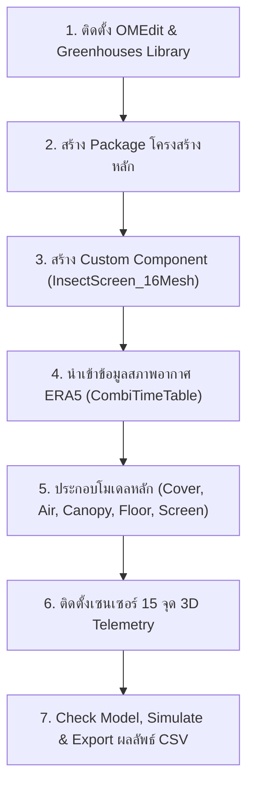

# รายงานฉบับที่ 6: คู่มือการสร้างแบบจำลองโรงเรือนสุพรรณบุรีทีละขั้นตอน (ฉบับ GUI Drag-and-Drop & Modelica Code)
## (Report 6: Step-by-Step Implementation Guide for Suphanburi Greenhouse Digital Twin)

> **โครงการ:** แบบจำลองดิจิทัลทวินโรงเรือนเกษตรอัจฉริยะเขตร้อนชื้น (Tropical Smart Greenhouse Digital Twin)  
> **หน่วยงาน:** ภาควิชาวิศวกรรมเครื่องกล คณะวิศวกรรมศาสตร์ มหาวิทยาลัยเทคโนโลยีพระจอมเกล้าธนบุรี (มจธ. - KMUTT)  
> **สถานที่ติดตั้งจริง:** ศูนย์เรียนรู้นวัตกรรมการเกษตร อ.อู่ทอง จ.สุพรรณบุรี  
> **ซอฟต์แวร์:** OpenModelica Connection Editor (OMEdit) v1.20 - v1.27 / OMC  
> **ไลบรารีอ้างอิง:** Modelica Standard Library (MSL) v4.0.0 & Greenhouses Library v1.0  
> **โมเดลเป้าหมาย:** `Greenhouse_DigitalTwin_KMUTT.Examples.Suphanburi_Greenhouse`  

---

## สารบัญเนื้อหา (Table of Contents)
1. [บทนำและแผนที่การพัฒนาแบบจำลอง (Project Overview & Roadmap)](#1-บทนำและแผนที่การพัฒนาแบบจำลอง)
2. [ขั้นตอนที่ 1: การเตรียมสภาพแวดล้อมและ Library (Environment Setup)](#2-ขั้นตอนที่-1-การเตรียมสภาพแวดล้อมและ-library)
3. [ขั้นตอนที่ 2: การสร้างโครงสร้าง Package (KMUTT Package Architecture)](#3-ขั้นตอนที่-2-การสร้างโครงสร้าง-package)
4. [ขั้นตอนที่ 3: การสร้างบล็อกมุ้งกันแมลง 16-Mesh (InsectScreen_16Mesh Component)](#4-ขั้นตอนที่-3-การสร้างบล็อกมุ้งกันแมลง-16-mesh)
5. [ขั้นตอนที่ 4: การนำเข้าและผูกข้อมูลอากาศ ERA5 อู่ทอง สุพรรณบุรี (ERA5 Weather Coupling)](#5-ขั้นตอนที่-4-การนำเข้าและผูกข้อมูลอากาศ-era5-อู่ทอง-สุพรรณบุรี)
6. [ขั้นตอนที่ 5: ผังบล็อกไดอะแกรมและการประกอบโมเดลหลัก (Full Assembly & Diagram Wiring)](#6-ขั้นตอนที่-5-ผังบล็อกไดอะแกรมและการประกอบโมเดลหลัก)
7. [ขั้นตอนที่ 6: การติดตั้งและโมเดลเซนเซอร์ 15 จุด 3 มิติ (Spatial Sensor Telemetry)](#7-ขั้นตอนที่-6-การติดตั้งและโมเดลเซนเซอร์-15-จุด-3-มิติ)
8. [ขั้นตอนที่ 7: การคอมไพล์ จำลองผล และ Export ข้อมูล CSV (Simulation & Export)](#8-ขั้นตอนที่-7-การคอมไพล์-จำลองผล-และ-export-ข้อมูล-csv)
9. [การแก้ไขปัญหาและข้อควรระวัง (Troubleshooting & Best Practices)](#9-การแก้ไขปัญหาและข้อควรระวัง)
10. [Source Code ฉบับสมบูรณ์พร้อมรัน (Complete Code & MOS Script)](#10-source-code-ฉบับสมบูรณ์พร้อมรัน)

---

## 1. บทนำและแผนที่การพัฒนาแบบจำลอง

คู่มือฉบับนี้จัดทำขึ้นเพื่อสอนการสร้างแบบจำลองโรงเรือนสุพรรณบุรี (Suphan Buri Greenhouse Digital Twin) ตั้งแต่ก้าวแรกจนได้แบบจำลองที่ทำงานได้จริง (Working Simulation Model) โดยนำเสนอควบคู่กัน 2 รูปแบบ (Dual-Track Approach):
1. **OMEdit GUI (Diagram & Icon View):** สอนวิธีการคลิกสร้างคลาส, วาดบล็อกสัญลักษณ์ (Icon Graphics), วางพอร์ตเชื่อมต่อ (Connectors), และลากเส้นสายสัญญาณ (Wiring Diagram)
2. **Modelica Text Code (Text View):** สอนไวยากรณ์โค้ดที่ระบบสร้างขึ้น, การประกาศตัวแปร, การกำหนดพารามิเตอร์, และการเขียนสมการทางฟิสิกส์ (Differential-Algebraic Equations: DAEs)



---

## 2. ขั้นตอนที่ 1: การเตรียมสภาพแวดล้อมและ Library

### 2.1 ซอฟต์แวร์ที่ต้องใช้
* **OpenModelica:** ติดตั้งรุ่น 1.20 หรือใหม่กว่า (แนะนำ v1.24+ หรือ v1.27)
* **Modelica Standard Library (MSL):** ติดตั้งมาพร้อมกับ OpenModelica (ใช้เวอร์ชัน 4.0.0)
* **Greenhouses Library:** ไลบรารีพลศาสตร์โรงเรือนเกษตร (อิงตาม Vanthoor et al., 2011)

### 2.2 การเปิดโหลด Greenhouses Library ใน OMEdit
1. เปิดโปรแกรม OMEdit
2. ไปที่เมนู **File** > **Open Model / Library File(s)**
3. เลือกไฟล์ `package.mo` ในโฟลเดอร์ของ `Greenhouses` library
4. เมื่อโหลดเสร็จ จะเห็นแถบไลบรารี `Greenhouses` ปรากฏขึ้นในหน้าต่าง Libraries Browser ทางซ้ายมือ

---

## 3. ขั้นตอนที่ 2: การสร้างโครงสร้าง Package

### 3.1 โครงสร้างโฟลเดอร์ในระบบไฟล์
```
Greenhouse_DigitalTwin_KMUTT/
├── package.mo
├── package.order
├── Components/
│   ├── package.mo
│   ├── package.order
│   └── InsectScreen_16Mesh.mo
├── Examples/
│   ├── package.mo
│   ├── package.order
│   └── Suphanburi_Greenhouse.mo
└── Resources/
    └── Data/
        ├── Suphanburi_ERA5_Jan_Dec.txt
        └── Suphanburi_ERA5_Weather.txt
```

### 3.2 วิธีการทำผ่าน OMEdit GUI
1. คลิกขวาที่พื้นที่ว่างใน Libraries Browser เลือก **New Modelica Class**
2. ตั้งค่าในไดอะล็อก:
   * **Name:** `Greenhouse_DigitalTwin_KMUTT`
   * **Specialization:** `Package`
   * ติ๊กถูก **Save contents of package in one directory with separate files for each class**
3. คลิกขวาที่แพ็กเกจ `Greenhouse_DigitalTwin_KMUTT` เลือก **New Modelica Class** เพื่อสร้างแพ็กเกจย่อย:
   * สร้าง `Components` (Package)
   * สร้าง `Examples` (Package)

---

## 4. ขั้นตอนที่ 3: การสร้างบล็อกมุ้งกันแมลง 16-Mesh (InsectScreen_16Mesh)

โรงเรือนที่ อ.อู่ทอง ติดตั้งมุ้งกันแมลงขนาด 16 เมช (16-Mesh Screen) รอบด้านข้างทั้ง 4 ทิศ เพื่อป้องกันแมลงศัตรูพืช มุ้งนี้ทำให้เกิดความต้านทานแรงเสียดทาน (Porous Drag Resistance) ซึ่งลดอัตราการระบายอากาศลงเมื่อเทียบกับช่องเปิดโล่ง

### 4.1 หลักการทางฟิสิกส์และสมการ
* อัตราการไหลจากแรงลม (Wind-driven Ventilation):
  $$Q_{\text{wind}} = C_d A_{\text{vent,side}} u_{\text{wind}} \sqrt{\Delta C_p}$$
* อัตราการไหลจากแรงลอยตัวอุณหภูมิ (Thermal Buoyancy Stack Effect):
  $$Q_{\text{stack}} = C_d A_{\text{vent,roof}} \sqrt{\frac{2 g \Delta h (T_{\text{in}} - T_{\text{out}})}{T_{\text{out}}}}$$
* อัตราการไหลรวม (Combined Flow Rate):
  $$Q_{\text{vent,total}} = \sqrt{Q_{\text{wind}}^2 + Q_{\text{stack}}^2}$$
* อัตราการระบายความร้อนสัมผัส (Sensible Heat Removal):
  $$Q_{\text{vent,heat}} = \rho_{\text{air}} Q_{\text{vent,total}} c_{p,\text{air}} (T_{\text{in}} - T_{\text{out}})$$

### 4.2 การวาดตัวบล็อกใน OMEdit (Icon & Diagram View)
1. ในโฟลเดอร์ `Components` คลิกขวาเลือก New Modelica Class -> Name: `InsectScreen_16Mesh`, Specialization: `Model`
2. ดับเบิ้ลคลิกเปิดโมเดล แล้วคลิกแท็บ **Icon View** ที่แถบมุมมองด้านบน
3. **วาดรูปสี่เหลี่ยมพื้นหลัง:** เลือกเครื่องมือ Rectangle วาดกรอบสี่เหลี่ยมขนาด `{{-90, 90}, {90, -90}}` ตั้งสีกรอบ `#008080` (Teal) และสีพื้นหลัง `#E6F8F8` (Light Cyan)
4. **วาดลายตารางมุ้งลวด:** ใช้ Line Tool ลากเส้นประแนวตั้งและแนวนอนตัดกัน 5x5 เส้น (Line Pattern: Dot)
5. **ใส่ข้อความ Label:** ใช้ Text Tool พิมพ์คำว่า `16-MESH INSECT SCREEN` และ `%mesh_porosity`
6. **วาง Connectors (พอร์ต):**
   * ลาก `Modelica.Blocks.Interfaces.RealInput` มาวางฝั่งซ้าย 4 ตัว: `T_air_in`, `T_amb_out`, `wind_speed`, `RH_amb_out`
   * ลาก `Modelica.Thermal.HeatTransfer.Interfaces.HeatPort_a` มาวางฝั่งขวา: `heatPort`
   * ลาก `Greenhouses.Interfaces.Vapour.WaterMassPort_a` มาวางฝั่งขวา: `massPort`
   * ลาก `Modelica.Blocks.Interfaces.RealOutput` มาวางฝั่งขวา: `ACH`, `Q_vent`, `MV_vent`

---

## 5. ขั้นตอนที่ 4: การนำเข้าและผูกข้อมูลอากาศ ERA5

### 5.1 การเตรียมไฟล์สภาพอากาศ
สร้างไฟล์ `Suphanburi_ERA5_Jan_Dec.txt` บรรจุข้อมูลรายชั่วโมง (8,760 บรรทัด) ในรูปแบบ Modelica Matrix Table

### 5.2 วิธีการใน OMEdit GUI
1. ในหน้าต่าง Libraries Browser เปิดดู `Modelica.Blocks.Sources`
2. ลากบล็อก **CombiTimeTable** มาวางในหน้าต่าง Diagram View ของโมเดลหลัก
3. ตั้งชื่ออินสแตนซ์ว่า `weather_ERA5`
4. ดับเบิ้ลคลิกเพื่อเปิด Parameters Dialog:
   * `tableOnFile = true`
   * `tableName = "tab_jan_dec"`
   * `columns = 2:10`
   * `fileName = Modelica.Utilities.Files.loadResource("modelica://Greenhouse_DigitalTwin_KMUTT/Resources/Data/Suphanburi_ERA5_Jan_Dec.txt")`

---

## 6. ขั้นตอนที่ 5: ผังบล็อกไดอะแกรมและการประกอบโมเดลหลัก

### 6.1 ตารางรายการคอมโพเนนต์หลักในโรงเรือน
| บล็อกใน Diagram View | คลาสต้นแบบ (Class Path) | หน้าที่ทางฟิสิกส์ในโรงเรือนสุพรรณบุรี |
| :--- | :--- | :--- |
| `cover` | `Greenhouses.Components.Greenhouse.Cover` | แผ่นพลาสติก PE 200 ไมครอน หุ้มหลังคาโค้งและหน้าบัน |
| `air` | `Greenhouses.Components.Greenhouse.Air` | มวลอากาศภายในโรงเรือน ปริมาตร $349.65\text{ m}^3$ |
| `canopy` | `Greenhouses.Components.Greenhouse.Canopy` | ทรงพุ่มมะเขือเทศเชอร์รี่ ($LAI=2.5$, พื้นที่ $72\text{ m}^2$) |
| `floor` | `Greenhouses.Components.Greenhouse.Floor` | พื้นผิวดินพร้อมพลาสติกขาวคลุมดิน (White Mulch) |
| `solar_model` | `Greenhouses.Components.Greenhouse.Solar_model` | แบบจำลองแบ่งสรรรังสีอาทิตย์ PAR / NIR |
| `insectScreen` | `Greenhouse_DigitalTwin_KMUTT.Components.InsectScreen_16Mesh` | มุ้งกันแมลง 16 เมช และการระบายอากาศธรรมชาติ |
| `MV_CanAir` | `Greenhouses.Flows.VapourMassTransfer.MV_CanopyTranspiration` | การคายน้ำของมะเขือเทศเพิ่มความชื้นและลดความร้อน |
| `Q_cd_Soil` | `Greenhouses.Flows.HeatTransfer.SoilConduction` | การนำความร้อนลงสู่ชั้นดินลึก (Deep Soil) |

---

## 7. ขั้นตอนที่ 6: การติดตั้งและโมเดลเซนเซอร์ 15 จุด 3 มิติ

### 7.1 ตำแหน่งเสาเซนเซอร์ (5 เสา x 3 ระดับ)
* **Pole A (NW):** ด้านหลัง-ทิศเหนือ ตะวันตก
* **Pole B (NE):** ด้านหลัง-ทิศเหนือ ตะวันออก (ท้ายลม WSW สะสมความร้อนสูงสุด)
* **Pole C (SW):** ด้านหน้า-ทิศใต้ ตะวันตก (ต้นลม WSW ปะทะลมภายนอก อุณหภูมิต่ำสุด)
* **Pole D (SE):** ด้านหน้า-ทิศใต้ ตะวันออก
* **Pole E (Center):** ใจกลางโรงเรือน (จุดอ้างอิงหลัก)
* **3 ระดับความสูง:** Top ($z=2.5\text{ m}$ ชายคา), Mid ($z=2.0\text{ m}$ ทรงพุ่มบน), Bot ($z=1.2\text{ m}$ โคนต้น)

---

## 8. ขั้นตอนที่ 7: การคอมไพล์ จำลองผล และ Export ข้อมูล CSV

### 8.1 การตรวจสอบโมเดล (Check Model)
กดปุ่ม **Check Model** (ไอคอนเครื่องหมายถูกสีเขียวบนแถบเครื่องมือ) ในหน้าต่าง OMEdit
ระบบต้องรายงานข้อความ:
`Check of Greenhouse_DigitalTwin_KMUTT.Examples.Suphanburi_Greenhouse completed successfully.`  
`Class Greenhouse_DigitalTwin_KMUTT.Examples.Suphanburi_Greenhouse has 152 equation(s) and 152 variable(s).`

### 8.2 การตั้งค่า Simulation Setup และ Export CSV
1. กดปุ่ม **Simulation Setup** (รูปเฟืองถัดจากปุ่ม Run)
2. ในแท็บ **General**:
   * **Start Time:** `0`
   * **Stop Time:** `31536000` (1 ปีเต็ม) หรือ `86400` (1 วัน)
   * **Number of Intervals:** `8760`
   * **Output Format:** เปลี่ยนจาก `mat` เป็น **`csv`**
3. กดปุ่ม **Simulate**
4. เมื่อจำลองผลเสร็จสิ้น ไฟล์ผลลัพธ์ `Greenhouse_DigitalTwin_KMUTT.Examples.Suphanburi_Greenhouse_res.csv` จะถูกบันทึกอยู่ใน Working Directory ของคุณทันที

---

## 9. การแก้ไขปัญหาและข้อควรระวัง (Troubleshooting)

1. **Error: Model is structurally singular (Number of equations != Number of variables)**
   * สาเหตุ: ลืมต่อพอร์ตใดพอร์ตหนึ่ง หรือลืมกำหนดค่าตัวแปรอิสระ
   * วิธีแก้: ตรวจสอบแถบ Messages Browser ดูว่าตัวแปรใดที่ยังไม่มีสมการผูก
2. **Error: Cannot find table file Suphanburi_ERA5_Jan_Dec.txt**
   * สาเหตุ: พาทไฟล์ผิด หรือไฟล์ไม่ได้อยู่ในโฟลเดอร์ `Resources/Data/`
   * วิธีแก้: ใช้ `Modelica.Utilities.Files.loadResource("modelica://Greenhouse_DigitalTwin_KMUTT/Resources/Data/Suphanburi_ERA5_Jan_Dec.txt")`
